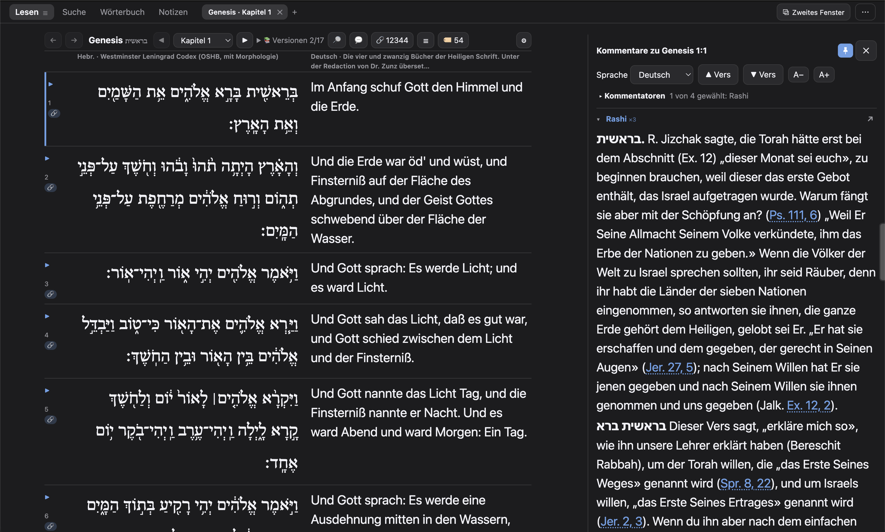
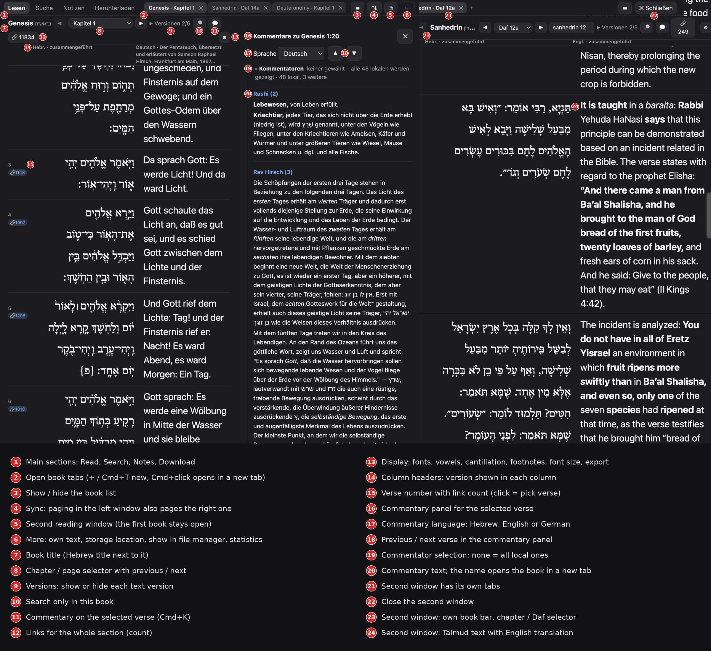
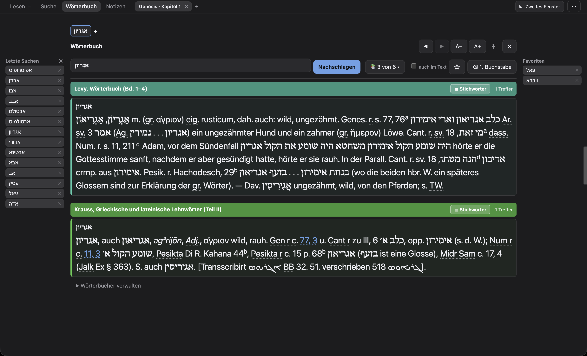
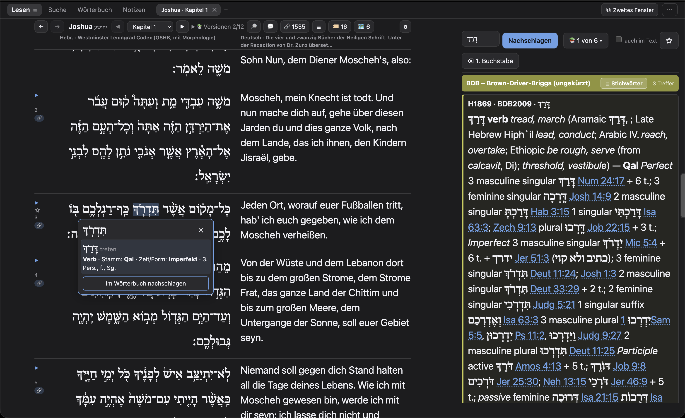
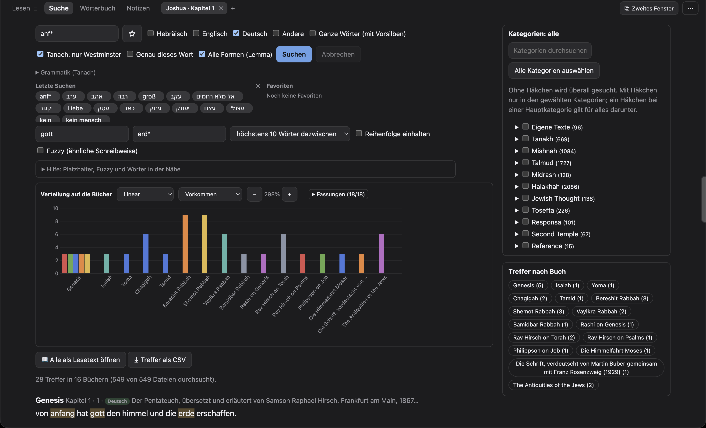

<h1 align="center">Safran סַפְרָן</h1>

<b>Deine jüdische Bibliothek, offline: Tanach, Talmud, Midrasch und Kommentare auf Hebräisch, Englisch und Deutsch, mit eingebautem Wörterbuchregal.</b>

  
  
  
  
  

  

<a href="README.md">English</a> &nbsp;·&nbsp; <b>Deutsch</b>

   
  Genesis 1: Hebräisch und Deutsch (Zunz) nebeneinander, rechts Raschi auf Deutsch im Kommentarfenster.

Safran ist eine kostenlose Desktop-App, die deine Texte auf dem eigenen Rechner hält. Du wählst einmal die Bücher und Sprachen aus der [Sefaria](https://www.sefaria.org)-Bibliothek und liest, durchsuchst und kommentierst sie danach ohne Internetverbindung. Dazu bringt Safran **238 deutsche Übersetzungen und Kommentare** mit, die es sonst kaum gibt, und **sechs Wörterbücher** mit über 85.000 Einträgen. Safran ist ein unabhängiges Projekt und nicht mit Sefaria verbunden.

## Warum Safran?

| | |
| --- | --- |
| 📴 **Funktioniert offline** | Texte, Verknüpfungen, Wörterbücher, Karten und Audio liegen auf deiner Festplatte. Nichts wird irgendwohin gesendet. |
| 🇩🇪 **Deutsche Texte, die es sonst nicht gibt** | Zunz, Philippson, Mendelssohns Biur, Herxheimer, Hertz, Hirsch, Raschi nach Bamberger, die Kautzsch-Apokryphen, Midrasch Rabba, More Nevuchim … sofort beim ersten Start da. |
| 📚 **Ein Wörterbuchregal, nicht nur ein Lexikon** | BDB, Gesenius, Jastrow, Levy und Krauss, durchsuchbar nach Stichwort *und* im Volltext, mit Abkürzungen beim Überfahren und Quellen, die sich im Lesefenster öffnen. |
| 🔬 **Gemacht zum Lernen** | Vers-für-Vers-Ausrichtung, Morphologie per Klick, zweites Lesefenster, Aleppo-Kodex, Qumran-Rollen, Septuaginta, Bibelkarte, Gliederungen und hebräische Lesung. |

## Schnellstart

1. **Herunterladen und öffnen:** das Installationsprogramm für dein System aus der [neuesten Version](https://github.com/mitkin89/Safran/releases/latest). Die App ist nicht mit einem kostenpflichtigen Zertifikat signiert, darum braucht der erste Start einen Klick mehr, siehe [Häufige Fragen](#häufige-fragen).
2. **Texte wählen:** *Herunterladen* im ⋯-Menü öffnen, den Katalog einmal laden (etwa 22 MB), Kategorien oder einzelne Bücher ankreuzen und die Sprachen wählen (Hebräisch, Englisch, Deutsch). Die mitgelieferten deutschen Texte und die Wörterbücher sind schon da, bevor du etwas herunterlädst.
3. **Lesen:** ein Buch wählen, eine Stelle ins Springen-Feld tippen (`2:5`, `Daf 3a`, `gen. 1:1`), Cmd+K für die Kommentare drücken und ein Wort doppelklicken, um es in den Wörterbüchern nachzuschlagen.

## Was Safran kann

<table>
<tr>
<td width="50%" valign="top"><b>📖 Drei Sprachen, Vers für Vers</b> Hebräisch, Englisch und Deutsch nebeneinander, Vers für Vers ausgerichtet. Fußnoten öffnen sich im Text. Kapitel und Talmudseiten per Pfeiltasten.</td>
<td width="50%" valign="top"><b>💬 Kommentarfenster (Cmd+K)</b> Raschi, Ibn Esra u. a. unter dem gewählten Vers, auf Hebräisch, Englisch oder Deutsch. Lässt sich neben dem Text anpinnen, zusammen mit dem Wörterbuch.</td>
</tr>
<tr>
<td valign="top"><b>🔎 Volltextsuche</b> In allem, was du geladen hast, auch in Fußnoten und eigenen Texten. Ignoriert Vokale und Kantillation. Wörter in der Nähe, Platzhalter, unscharfe Suche für Schreibvarianten.</td>
<td valign="top"><b>🔤 Morphologie per Klick</b> Der OSHB-Tanach trägt zu jedem Wort Lemma und Morphologie: ein Klick zeigt Stamm, Form, Person, Genus und Numerus, und das Lemma öffnet sich im Wörterbuch.</td>
</tr>
<tr>
<td valign="top"><b>⧉ Zweites Lesefenster</b> Zwei Bücher nebeneinander, jedes mit eigenen Tabs, eigenem Verlauf und Kommentarfenster. Beide Fenster blättern im Gleichlauf.</td>
<td valign="top"><b>📜 Handschriften und Fassungen</b> Aleppo-Kodex, Qumran-Rollen, Septuaginta mit hebräischem Gegenstück je Wortgruppe, Targum Pseudo-Jonathan und Neofiti mit Morphologie, Parallelstellen, Sefarias Verknüpfungen.</td>
</tr>
<tr>
<td valign="top"><b>🗺 Bibelkarte und Gliederungen</b> Die Orte jedes Kapitels auf einer Karte von Israel mit Entfernungen und Höhenprofil, eine detaillierte Jerusalem-Karte von 1865, Gliederungen für 39 Bücher mit Schalter 613 Mizwot, dazu Themen.</td>
<td valign="top"><b>🎧 Hebräische Lesung</b> Eine Lesung des ganzen Tanach, pro Buch herunterladbar. Der gelesene Vers wird markiert.</td>
</tr>
<tr>
<td valign="top"><b>✍️ Eigene Texte und Notizen</b> TXT, Word, CSV oder JSON als zusätzliche Spalte oder als Kommentar importieren. Lesezeichen und Notizen mit Export nach JSON, Markdown, Word oder PDF.</td>
<td valign="top"><b>🖥 Gemacht für langes Lesen</b> Helles, dunkles oder automatisches Thema, einstellbare Größe, Oberfläche auf Deutsch, Englisch und Hebräisch, Tabs und Sitzung werden beim nächsten Start wiederhergestellt.</td>
</tr>
</table>

<a href="docs/FEATURES.md">Alle Funktionen, Tastenkürzel und das Menü Werkzeuge (englisch) →</a>

## Wörterbücher

Den Reiter *Wörterbuch* öffnen, den Knopf 📖 neben dem Kommentarfenster drücken oder ein Wort in einem Text doppelklicken. Sechs Wörterbücher sind dabei:

| Wörterbuch | Einträge | Extras |
| --- | ---: | --- |
| **BDB**, Brown-Driver-Briggs (ungekürzt) | 10.022 | auch nach Strong- und BDB-Nummer; Bibelstellen verlinkt |
| **Gesenius**, Hebräisches Handwörterbuch (1915) | 10.118 | |
| **Jastrow**, Dictionary of the Targumim, Talmud and Midrash | 32.466 | |
| **Levy**, Wörterbuch über die Talmudim und Midraschim (Bd. 1–4) | 19.503 | Abkürzungen beim Überfahren, Quellen verlinkt |
| **Levy**, Chaldäisches Wörterbuch über die Targumim (Bd. 1–2) | 7.232 | Abkürzungen beim Überfahren, Quellen verlinkt |
| **Krauss**, Griechische und lateinische Lehnwörter (Teil II) | 6.329 | Abkürzungen beim Überfahren, Quellen verlinkt, Verweise *s. X* anklickbar |

- **Kluges Nachschlagen:** Vokalzeichen und Endbuchstaben werden ignoriert, die Präfixe ו ה ב כ ל מ ש abgelöst, und Einträge, die mit deinem Wort beginnen, erscheinen mit. Beim Tippen kommen Vorschläge.
- **Volltext:** mit dem Häkchen *auch im Text* wird im Artikeltext gesucht, nicht nur in den Stichwörtern. Treffer werden hervorgehoben.
- **Wörterbücher wählen:** der Knopf 📚 legt fest, welche Wörterbücher durchsucht werden. Die Auswahl wird gemerkt.
- **Stichwortliste:** *☰ Stichwörter* öffnet die vollständige, filterbare Stichwortliste eines Wörterbuchs.
- **Verlinkte Quellen:** eine Stellenangabe wie *Rosh Hashanah 18b* öffnet die Stelle im Lesefenster, sofern der Text in deiner Bibliothek ist.
- **Eigene mitbringen:** `.dsl`- / `.dsl.dz`-Wörterbücher (ABBYY-Lingvo-Format) unter *Wörterbücher verwalten* hinzufügen. Mit `{{ref:…}}` markierte Stellen werden in Safran anklickbar.

## Deutsche Texte, die es bei Sefaria nicht gibt

Safran liefert 238 deutsche Textdateien im Ordner `bundled/` mit. Sie werden beim ersten Start importiert und erscheinen unter *Eigene Texte* sowie als zusätzliche Versionen und Kommentatoren neben den Sefaria-Texten:

| Werk | Umfang |
| --- | --- |
| Zunz, *Die vier und zwanzig Bücher der Heiligen Schrift* (1838) | ganzer Tanach |
| Philippson, *Die Israelitische Bibel*, Übersetzung **und** Kommentar | ganzer Tanach |
| Herxheimer, *Die vier und zwanzig Bücher der Bibel* (1843), Übersetzung **und** Kommentar | ganzer Tanach |
| Kautzsch, *Die Apokryphen und Pseudepigraphen des Alten Testaments* (1900) | Ben Sira, Jubiläen, Henoch, Tobit, Judith, Makkabäer, Weisheit Salomos u. a. |
| Mendelssohn, *Netivot ha-Schalom* (Übersetzung, Taitsch und Biur) | Tora |
| Raschi nach Bamberger · Hertz, Pentateuch-Kommentar | Tora |
| Hirsch, Psalmen · Midrasch Bemidbar und Debarim Rabba (Wünsche) · *Führer der Unschlüssigen* (More Nevuchim) · *Kizzur Schulchan Aruch* (Bamberger) | |

Ebenfalls enthalten: der Westminster Leningrad Codex mit Morphologie (OSHB), der Aleppo-Kodex, die Qumran-Rollen, Targum Pseudo-Jonathan und Neofiti sowie die Septuaginta (CATSS). Quellen und Lizenzen: [SOURCES.de.md](SOURCES.de.md).

## Bildschirmfotos

   
  Zwei Lesefenster: links Genesis mit Hirschs Übersetzung und Raschi auf Deutsch, rechts Sanhedrin 12a mit englischer Übersetzung.

   
  Wörterbuch-Reiter: eine Suche in Levy und Krauss, links die letzten Suchen, rechts die Favoriten.

   
  Hebräisches Wort anklicken: die Grammatik auf einen Blick, daneben der BDB-Eintrag.

   
  Erweiterte Suche: Platzhalter und Wörter in der Nähe, Diagramm der Treffer je Buch und Kategorienfilter.

<!-- TODO Galerie: die folgenden Aufnahmen in screenshots/ ablegen und diesen Kommentar durch eine zweispaltige <table> mit Vorschaubildern ersetzen.
     Einstellungen für alle Aufnahmen: macOS, dunkles Thema, Fenster 1600×1000, Größe 100 %, SBL Hebrew installiert, ohne Beschriftungen, JPEG q80 oder optimiertes PNG, je ≤ 400 KB.
     1. dictionary-fulltext.jpg   – Reiter Wörterbuch, Suchwort „אפוטרופוס“, Häkchen „auch im Text“, 📚 zeigt „3 von 6“, Treffer in Levy, Jastrow und Krauss mit Hervorhebung, Letzte Suchen und Favoriten sichtbar.
     2. dictionary-headwords.jpg  – ein Krauss-Artikel mit geöffnetem Abkürzungs-Tooltip und aufgeklappter Stichwortliste ☰.
     3. morphology.jpg            – OSHB-Spalte, ein Wort angeklickt, Morphologie-Popup und BDB-Eintrag im Wörterbuchfenster.
     4. search-advanced.jpg       – Reiter Suche, „anf* · gott · erd*“ mit Abstand 10, Trefferchips je Buch.
     5. map-israel.jpg            – 🗺 Karte zu Josua 10 mit Routen und geöffnetem Höhenprofil.
     6. map-jerusalem.jpg         – 🏛 Jerusalem-Karte (Wilson 1865) stark gezoomt mit einer Ortsnotiz.
     7. safran-tour.gif           – 10–15 s, ≤ 3 MB: Genesis öffnen → Cmd+K → Doppelklick auf ein Wort → Wörterbuch → Fenster anpinnen.
-->

## Häufige Fragen

<b>Erster Start unter macOS und Windows: „beschädigt“, „Entwickler nicht verifiziert“, SmartScreen</b>

Die App hat kein kostenpflichtiges Entwicklerzertifikat (die Zertifikate von Apple und Microsoft kosten Geld), darum ist beim ersten Start ein Schritt mehr nötig. Die App ist nicht defekt. Unter macOS ist sie lokal (ad hoc) signiert.

**macOS** – bei *„Safran ist beschädigt und kann nicht geöffnet werden“* oder *„Entwickler kann nicht überprüft werden“*:

1. **Safran** in den Ordner **Programme** ziehen.
2. Am einfachsten: die `.dmg` erneut öffnen und mit Rechtsklick **Safran freischalten.command** → *Öffnen* → *Öffnen*. Oder im Terminal: `xattr -cr /Applications/Safran.app`
3. Bei *„Entwickler kann nicht überprüft werden“*: *Systemeinstellungen → Datenschutz & Sicherheit → Trotzdem öffnen* (nach unten scrollen) oder Rechtsklick auf die App → *Öffnen* → *Öffnen*.

**Windows** – SmartScreen zeigt evtl. *„Der Computer wurde durch Windows geschützt“*: **Weitere Informationen** → **Trotzdem ausführen**.

<b>Wie viel Speicherplatz brauche ich?</b>

Nur so viel, wie du auswählst. Grobe Werte: alle zusammengeführten hebräischen Texte ≈ 2,8 GB, Englisch ≈ 0,5 GB, deutsche Übersetzungen von Sefaria ≈ 0,13 GB. Alle JSON-Texte mit jeder Einzelversion ≈ 7 GB. Sefarias Verknüpfungsdaten ≈ 680 MB (optional). Hebräische Lesung insgesamt ≈ 3 GB, pro Buch herunterladbar (optional). Der Speicherort lässt sich verschieben, etwa auf eine externe Festplatte.

<b>Funktioniert es wirklich offline?</b>

Ja. Eine Verbindung brauchst du zum Herunterladen von Texten, Verknüpfungen und Audio und für die optionale Update-Prüfung. Alles andere, auch Suche, Wörterbücher, Karten und die mitgelieferten deutschen Texte, läuft ohne Internet.

<b>Wie steht es um den Datenschutz?</b>

Safran hat kein Konto, kein Tracking und keinen eigenen Server. Es lädt aus dem öffentlichen Sefaria-Export und von GitHub-Releases, nur was du anforderst. Deine Notizen, Lesezeichen, importierten Texte und Wörterbücher bleiben auf deinem Rechner. Safran lädt nie etwas zu Sefaria hoch.

<b>Wie verhält sich Safran zu Sefaria?</b>

Safran ist ein unabhängiges, quelloffenes Projekt und nicht mit Sefaria verbunden. Die Sefaria-Texte sind nicht Teil der App; sie werden aus dem öffentlichen [Sefaria-Export](https://github.com/Sefaria/Sefaria-Export) geladen und behalten ihre eigenen Lizenzen. Safran legt eigene deutsche Texte, Wörterbücher und Werkzeuge obendrauf. Das Menü Werkzeuge kann außerdem CSV-Dateien für einen Sefaria-Upload vorbereiten und prüfen.

<b>Welche macOS- und Windows-Versionen?</b>

Safran ist eine Electron-App; an jedem [Release](https://github.com/mitkin89/Safran/releases) hängen Installer für macOS (`.dmg`) und Windows (Installer und portable `.exe`). Für hebräischen Text lohnt sich die kostenlose Schrift **SBL Hebrew** der Society of Biblical Literature; Safran verwendet sie automatisch.

## Mitwirken

- **Fehler und Ideen:** ein [Issue](https://github.com/mitkin89/Safran/issues) anlegen. Bitte System, Safran-Version (⋯-Menü) und bei Textproblemen Buch und Stelle nennen.
- **Texte:** eigene Übersetzungen oder Kommentare mit ⋯ → *Eigene Texte für GitHub exportieren …* ausgeben und als Pull Request für `bundled/` anbieten. Bitte Quelle und Lizenz angeben.
- **Code:** [docs/DEVELOPMENT.md](docs/DEVELOPMENT.md) beschreibt Start aus dem Quelltext (`npm install`, `npm start`), Build und Tests. Die Oberflächentexte liegen in `i18n.js` (Englisch) und `i18n-he.js` (Hebräisch).

## Quellen und Lizenz

Der Quellcode steht unter der [MIT-Lizenz](LICENSE). Texte, Wörterbücher, Karten und Audio haben eigene Lizenzen: Sefaria-Export, OSHB, ETCBC (Aleppo-Kodex, Qumran-Rollen, Targumim, Parallelstellen), CATSS-Septuaginta ([LICENSE-CATSS.md](LICENSE-CATSS.md)), OpenBible.info, Copernicus DEM, Natural Earth, UBS Bible Routes, ToposText, OpenStreetMap und andere. Alles steht in [SOURCES.de.md](SOURCES.de.md). Die Änderungen stehen in [CHANGELOG.md](CHANGELOG.md) (englisch).

---

<b>סַפְרָן</b> <i>(safran)</i> ist hebräisch für Schreiber, im modernen Hebräisch Bibliothekar, von derselben Wurzel wie <i>sefer</i>, Buch. Safran entsteht bei <a href="https://talmud.de">talmud.de</a>.

