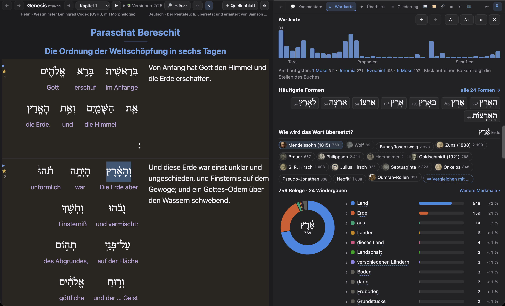
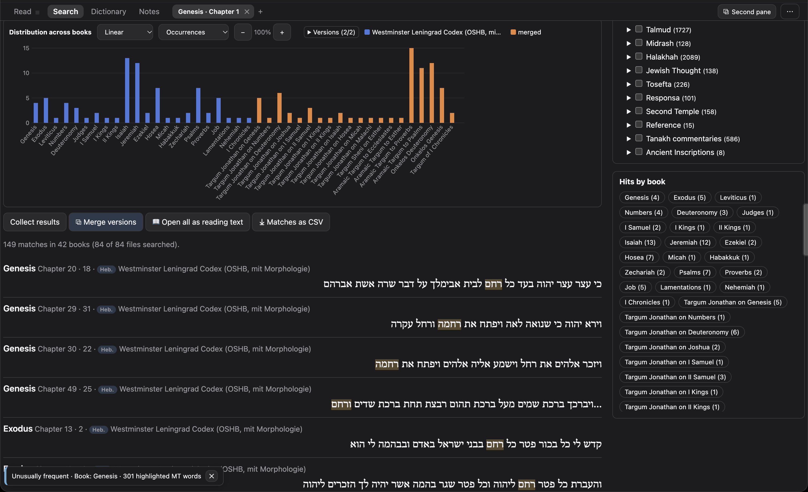
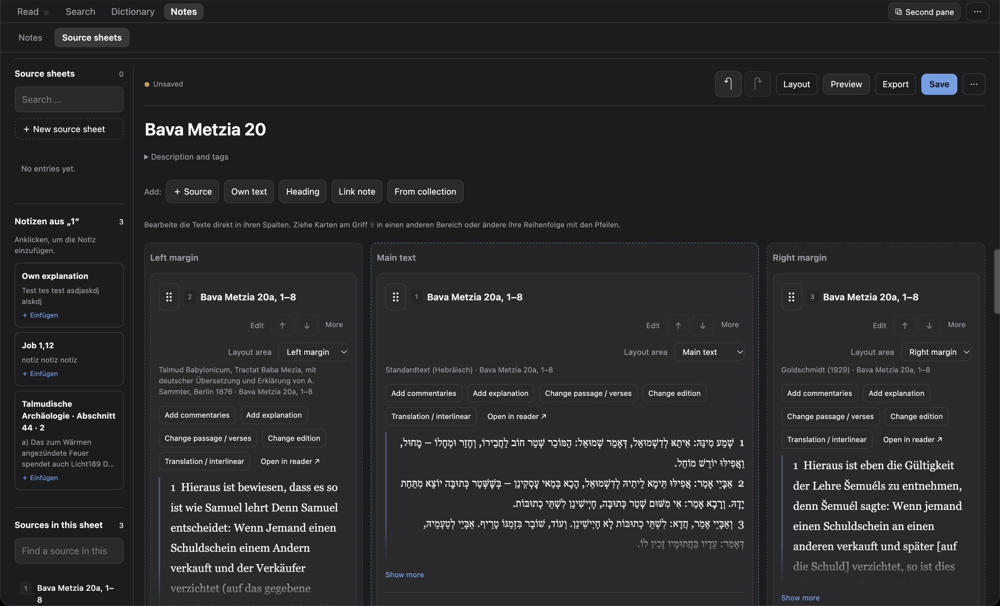
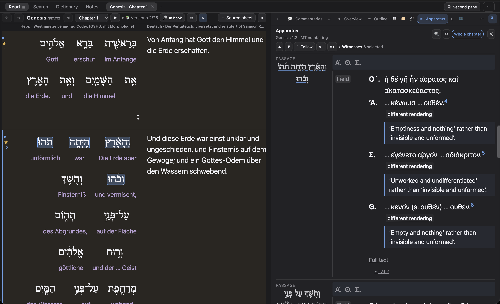
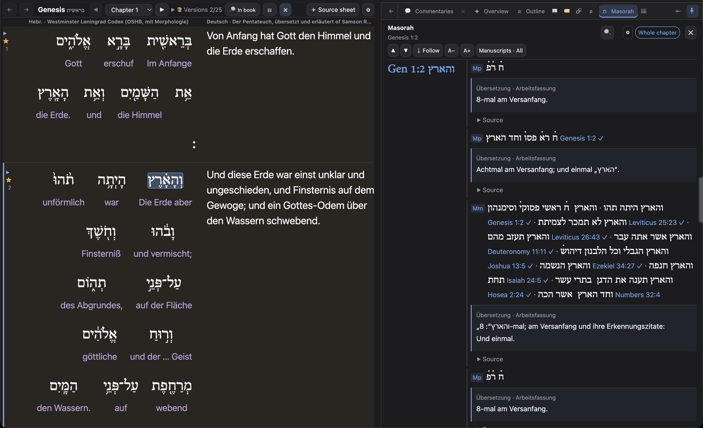

<p align="center"></p>

<h1 align="center">Safran <span dir="rtl">סַפְרָן</span></h1>

<p align="center"><b>Eine jüdische Bibliothek zum Lesen, Vergleichen und Notieren — offline.</b><br>Tanach, Talmud, Midrasch und Kommentare, mit deutschen Interlinearübersetzungen, Wörterbüchern und Quellenblättern.</p>

<p align="center">
  <a href="https://github.com/mitkin89/Safran/releases/latest"></a>
  <a href="LICENSE"></a>
  <a href="https://github.com/mitkin89/Safran/releases/latest"><b>Für macOS, Windows oder Linux herunterladen</b></a>
</p>

<p align="center"><a href="README.md">English</a> · <b>Deutsch</b> · <a href="#installation">Installation</a> · <a href="#notizbücher-und-quellenblätter">Notizbücher & Quellenblätter</a> · <a href="#masora">Masora</a> · <a href="#entwicklung">Entwicklung</a></p>


Safran ist eine kostenlose Desktop-App mit offenem Quellcode. Lies Texte nebeneinander, verfolge ein hebräisches Wort zu Grammatik und Übersetzungen und sammle deine Beobachtungen in Notizbüchern und Quellenblättern. Texte, Wörterbücher und deine Arbeit bleiben auf deinem Rechner. Safran ist ein unabhängiges Projekt und nicht mit Sefaria verbunden.

**Aktuelle Version: [2.8.5](https://github.com/mitkin89/Safran/releases/tag/2.8.5)** — Notizbücher, erweiterte Quellenblätter und Offline-Masora mit deutschen Arbeitsübersetzungen. [Versionshinweise](docs/releases/2.8.5.md).

**Seit 2.8.5 auf `main`:** Makkabäer I–IV erscheinen jeweils als ein Werk. Kahana, Kautzsch und Septuaginta stehen unter **Versionen** zur Auswahl. Diese Änderung ist noch nicht in den Installationsdateien von 2.8.5 enthalten.

## Installation

Wähle die passende Datei aus der [neuesten Version](https://github.com/mitkin89/Safran/releases/latest):

| System | Download | Start |
| --- | --- | --- |
| macOS, Apple Silicon | `.dmg` | Öffnen und Safran in den Ordner Programme ziehen. |
| Windows | Setup-`.exe` oder portable `.exe` | Installationsprogramm ausführen oder die portable App öffnen. |
| Linux | `.AppImage` oder `.deb` | AppImage ausführbar machen oder das Debian-Paket installieren. |

Safran hat kein kostenpflichtiges Entwicklerzertifikat. Blockiert Gatekeeper die App unter macOS, nutze **Systemeinstellungen → Datenschutz & Sicherheit → Trotzdem öffnen**. Die DMG enthält außerdem **Safran freischalten.command**; per Rechtsklick **Öffnen** wählen. Unter Windows bietet SmartScreen gegebenenfalls **Weitere Informationen → Trotzdem ausführen** an. Diese Schritte nur für einen vertrauenswürdigen Download aus diesem Repository verwenden.

### Erste Schritte

1. **Lesen:** Mitgelieferte Texte und Wörterbücher stehen beim ersten Start bereit. Buch und Kapitel wählen; unter **Versionen** die Ausgaben für die parallele Ansicht auswählen.
2. **Bibliothek erweitern:** Unter **⋯ → Herunterladen…** den Sefaria-Katalog laden und Bücher sowie Sprachen auswählen. Heruntergeladene Texte funktionieren offline.
3. **Wörter untersuchen:** **Interlinear** einschalten, ein hebräisches Wort für Grammatik und Wortkarte anklicken oder ein Wort per Doppelklick im Wörterbuch nachschlagen.
4. **Beobachtungen festhalten:** Unter **Notizen** ein Notizbuch anlegen oder mit **＋ Quellenblatt** im Lesefenster einen Auszug samt Edition übernehmen.

Die Oberfläche gibt es auf Deutsch, Englisch und Hebräisch; umstellen unter **⋯ → Sprache**. Die Bildschirmfotos zeigen die aktuelle Desktop-App mit hebräischen Quellen, deutschen Übersetzungen und ihren Lese- und Recherchewerkzeugen.

## Lesen und vergleichen

- **Parallele Ausgaben:** Hebräisch, Englisch, Deutsch und alte Übersetzungen in Spalten, mit Reitern, Stellennavigation und zweitem Lesefenster.
- **Deutsches Interlinear:** Zunz und Philippson decken alle 39 Bücher des Tanach ab. Weitere Übersetzungen erschließen einzelne Bücher oder Buchgruppen, darunter Mendelssohn, Goldschmidt, Hirsch und Breuer. Passende Zuordnungen alter Textzeugen lassen sich ergänzen.
- **Dem Text folgen:** Ein Wortklick markiert Gegenstücke, Fußnoten öffnen sich im Text und verknüpfte Stellen führen in andere Bücher.
- **Kommentare und Kontext:** Zu einem Vers oder Kapitel lassen sich Kommentare, Parallelstellen, Talmud- und Midraschbezüge, Halacha, Orte und Wörterbuchbelege zusammentragen.
- **Lesewerkzeuge:** Einstellbare Schriften, helle/dunkle Ansicht, Gliederungen, Bibelkarten, jüdischer Kalender und optionales hebräisches Audio.

Neue hebräische Bibelquellen verwenden **Westminster (OSHB)**, bis du eine andere Ausgabe wählst. Interlinear braucht eine passende Wortzuordnung; nicht jede vorhandene Übersetzung unterstützt es. Abweichende Verszählungen bleiben an ihre Edition gebunden.

Der Kapitelüberblick vergleicht auffällig häufige und seltene Wörter, Wurzeln, Verbformen, Wortverbindungen und Namen. Vergleiche ein Kapitel mit seinem Buch oder dem ganzen Tanach, markiere die Ergebnisse im Lesetext und erkunde ähnliche Kapitel.


### Alte Textzeugen Wort für Wort

Vergleiche Septuaginta, Onkelos, Qumranrollen, Samaritanischen Pentateuch und Peschitta unter dem Westminster-Text, soweit Wortzuordnungen vorliegen. Ein Klick auf ein annotiertes Wort öffnet Bestimmung, Quelle und Wörterbuchverknüpfungen.


## Wörter, Wörterbücher und Suche

Die Wortkarte verbindet Morphologie, belegte Formen, Übersetzungsentscheidungen und Fundstellen. Vergleiche, wie eine zugeordnete Übersetzung ein Lemma wiedergibt, und öffne die zugehörigen Belege.



Zum Wörterbuchregal gehören BDB, Gesenius, Jastrow, Levy, Liddell & Scott, Pape, Krauss und Hamburger. Suche nach Stichworten oder im Artikeltext, lies unterstützte Abkürzungen beim Überfahren und öffne verknüpfte Belege im Lesefenster. Eigene DSL-Wörterbücher lassen sich hinzufügen.

Die Volltextsuche unterstützt Wortfolgen, Platzhalter, benachbarte Wörter sowie Sprach- und Buchfilter. Hebräische und griechische Lemmasuche findet flektierte Formen; Morphologie- und Klauselwerkzeuge ermöglichen genauere Abfragen. [Konkordanz](docs/concordance.md) · [Klauselsuche im Tanach](docs/bhsa-clause-search.md).



## Notizbücher und Quellenblätter

Unter **Notizen** findest du Notizbücher und Quellenblätter nach Projekten. Notizen können formatierten Text, Schlagwörter und mehrere verknüpfte Auszüge bestimmter Editionen enthalten. Entwürfe bleiben beim Wechsel zwischen Notizen erhalten.


Ein Quellenblatt hilft beim Vorbereiten einer Unterrichtseinheit, eines Vergleichs oder einer Lektüresitzung:

1. Eine Stelle aus dem Lesefenster übernehmen oder im Blatt per Stellenangabe hinzufügen. Edition wählen und Textvorschau prüfen. Auch die Lesedarstellung mit passenden Interlinearzeilen lässt sich übernehmen.
2. Einen Bereich wie `Deuteronomy 1:1–10` oder einzelne Verse wie `Deuteronomy 1:2,5,10` wählen. Beim Ändern der Quellenauswahl bleiben passende Wortzuordnungen erhalten; manuelles Umschreiben des Auszugs kann sie deaktivieren.
3. Überschriften, eigene Texte, Kommentare und verknüpfte Notizen ergänzen. Über die Quellennavigation springen, Quellen im Haupttext oder am Rand anordnen, Einträge entfernen und Änderungen rückgängig machen oder wiederholen.
4. Die Seite in der Vorschau prüfen und als PDF, DOCX oder HTML exportieren. Sammlungen wiederverwenden oder ein Projekt als JSON-Paket teilen; CSV und JSON-LD unterstützen weitere Forschungsabläufe.




[Ausführlicher Ablauf, Formate und Grenzen](docs/RESEARCH.md).

## Textkritischer Apparat

Der Apparat vergleicht den Westminster-Text mit Handschriften und alten Übersetzungen. Lies einen Vers oder ein Kapitel, wähle Textzeugen, folge der Lesestelle und prüfe die Quelle einer Lesart.



| Zeuge | Vergleich | Umfang |
| --- | --- | --- |
| **MA** | Aleppo gegen Leningrad: Konsonanten, Vokale und Worttrennung | 39 Bücher; Verluste des Aleppo-Kodex markiert |
| **SMR** | Samaritanischer Pentateuch nach Tal–Florentin mit Originalnoten | Tora |
| **DSS** | Biblische Qumranrollen mit Handschriftensiglen und Rekonstruktionszeichen | 36 Bücher |
| **LXX** | CATSS-Noten, Rückübersetzungen und eingeordnete Septuaginta-Lesarten | 38 Bücher; Esther als Rahlfs-Lesetext |
| **Hex** | Fields Hexapla und die griechischen Revisoren | 39 Bücher |
| **Syr** | Peschitta-Wortzuordnung und Safrans eingeordnete Lesarten | 39 Bücher |
| **Ken** | Kennicotts Lesarten mittelalterlicher Handschriften | 39 Bücher |

Einordnungen, erschlossene hebräische Vorlagen und automatische Erklärungen sind Arbeitshilfen. Sie ersetzen keine kritische Edition; unsichere Lesarten bleiben markiert. Quellentext und Herkunft bleiben zugänglich. [Apparat-Traditionen](docs/apparatus-traditions.md).

## Masora

Lies **26.969 transkribierte Notizen** aus **1.550 veröffentlichten Seiten von 18 Handschriften**, importiert aus Corpus Masoreticum / BIMA. Handschriften filtern, Versen folgen und zitierte Belege in der Vorschau öffnen.

Die kompakte Ansicht zeigt die hebräische Notiz und die **deutsche Arbeitsübersetzung** zusammen. Erklärungen bleiben sichtbar; Handschriften- und Quellenangaben lassen sich aufklappen. Unterstützte Wortverknüpfungen markieren den Bezug im Lesetext.



Die Übersetzungen sind Arbeitsfassungen: Beschädigte, mehrdeutige und unvollständige Stellen bleiben gekennzeichnet. Vers- und Wortverknüpfungen werden aus den verfügbaren Belegen abgeleitet. Der Import umfasst einen Stand veröffentlichter Seiten, keine vollständigen Editionen aller Handschriften. [Methode und Umfang](docs/masora-import.md) · [Quellenlizenz](app/LICENSE-MASORA.md).

## Was gehört zur Bibliothek?

Safran bringt über 50 deutsche Werke mit: Übersetzungen und Kommentare von Zunz, Philippson, Herxheimer, Mendelssohn, Hirsch und Breuer; Raschi nach Bamberger; Kautzschs Apokryphen; Midraschübersetzungen; Josephus; Graetz und Ginzbergs *Legenden der Juden*. Weitere Bücher und Editionen lassen sich von Sefaria herunterladen. Eigene Texte kannst du als TXT, DOCX, CSV oder JSON importieren.

Ebenfalls enthalten sind Westminster mit OSHB-Morphologie, Aleppo, Qumrantexte, Septuaginta, Targumim, Peschitta und Apparatdaten. Umfang und Nutzungsrechte unterscheiden sich je nach Quelle; siehe [Quellen und Lizenzen](app/SOURCES.de.md).

<details>
<summary><b>Die vollständige Liste der mitgelieferten deutschen Texte</b></summary>

| Werk | Umfang |
| --- | --- |
| Zunz, *Die vier und zwanzig Bücher der Heiligen Schrift* (1838) | ganzer Tanach |
| Philippson, *Die Israelitische Bibel*, Übersetzung **und** Kommentar | ganzer Tanach |
| Herxheimer, *Die vier und zwanzig Bücher der Bibel* (1843), Übersetzung **und** Kommentar | ganzer Tanach |
| Kautzsch, *Die Apokryphen und Pseudepigraphen des Alten Testaments* (1900) | Ben Sira, Jubiläen, Henoch, Tobit, Judith, Makkabäer, Weisheit Salomos u. a. |
| Mendelssohn, *Die fünf Bücher Mose*, deutsche Übersetzung (Dessau 1815) | Tora; Interlinear |
| Mendelssohn, *Netivot ha-Schalom* (Übersetzung, Taitsch und Biur) | Tora |
| Raschi nach Bamberger · Hertz, Pentateuch-Kommentar | Raschi: Exodus bis Deuteronomium · Hertz: Exodus, Numeri, Deuteronomium |
| Goldschmidt, Übersetzung der Tora (1921) | Tora |
| S. R. Hirsch, Tora und Psalmen · Julius Hirsch, Jesaja und die Zwölf Propheten · Joseph und Raphael Breuer: Josua, Richter, Jeremia, Jecheskel, Esra, Nehemia | Übersetzung und Kommentar |
| Wünsches Midrasch-Übersetzungen | Bemidbar und Debarim Rabba, die Rabba-Bände zu den fünf Megillot, Pesikta des Rab Kahana, Midrasch Schmuel, *Mechiltha* (Mekhilta de-Rabbi Jischmael, mit Jakob Winter, 1909) |
| *Mischne Tora* (Mandelstamm, 1851) | 39 Abschnitte |
| *Führer der Unschlüssigen* (More Nevuchim) · *Kizzur Schulchan Aruch* (Bamberger) | |
| Ginzberg, *Die Legenden der Juden*, Lesefassung nach seinem deutschen Manuskript, ausgerichtet an Sefarias *Legends of the Jews* | Bd. 1–4, über 4000 Noten Ginzbergs als Fußnoten; Abkürzungen beim Überfahren; 10.600 Quellen (Bibel, Midrasch, Talmud, Josephus, Philo …) verlinkt und als Verknüpfungen in beide Richtungen; Gliederung |
| *Schulchan Aruch* (Lederer): Orach Chajim, Jore Deah, Ewen haëser · *Abot de-Rabbi Natan* (Pollak) · Traktat *Soferim* (Müller) · *Heiligung des Neumonds* (Hildesheimer) | |
| Talmud: Rawicz (Megilla, Rosch ha-Schana, Ketubot, Sanhedrin, Chulin I) · Straschun (Taanit) · Sammter (Baba Mezia, 1876) · Pinner (Berachot, 1842, mit Erläuterungen, dazu seine *Einleitung in den Talmud* und Vorrede; seine Übersetzung von Maimonides’ Einleitung zur Mischna nach Sefarias Gliederung) | deutsche Übersetzungen des 19. Jahrhunderts, je Daf und Segment |
| Mischna aus dem Talmud: die Mischnajot aller 37 Traktate in Goldschmidts Übersetzung sowie aus Pinner, Sammter, Rawicz und Straschun, als eigene Mischna-Fassungen | je Kapitel und Mischna, mit den Fußnoten des Übersetzers |
| Josephus, *Jüdische Altertümer*, *Jüdischer Krieg* und *Gegen Apion* (Clementz, 1899/1900) | nach Whistons Gliederung wie bei Sefaria, mit Nieses Paragraphenzahlen |
| H. Graetz, *Geschichte der Juden* (11 Bände, nach zeno.org) | Kapitel und Noten mit Fußnoten, Seitenmarken der Druckausgabe, Gliederung; das bei zeno rückwärts gespeicherte Hebräisch ist umgedreht |
| D. Hoffmann, *Das Buch Leviticus* und *Das Buch Deuteronomium* | Übersetzung und Kommentar |
| Samuel (Wolf) · Ijob (Dawidowicz) · die *Arba Megillot* (Breuer) | Übersetzung und Kommentar |
| S. Krauss, *Talmudische Archäologie* (Bd. I–III, 1910–1912) | ganzer Text mit Anmerkungen, Abbildungen und Gliederung; das Register ist ein eigenes Wörterbuch |

Goldschmidts vollständiger Talmud und die Talmudübersetzungen des 19. Jahrhunderts gibt es auch als offenen Datensatz: [german-talmud-translations](https://github.com/mitkin89/german-talmud-translations), DOI [10.5281/zenodo.24466136](https://doi.org/10.5281/zenodo.24466136).

</details>

Bei geänderten Bibliothekstexten fragt ein App-Update vor dem Ersetzen. Vorhandene Fassungen lassen sich behalten; ersetzte Dateien werden unter `backups/text-updates` im Bibliotheksordner gesichert.

## Offline arbeiten und Daten behalten

Lesen, lokale Suche, Wörterbücher, Notizbücher und Quellenblätter funktionieren ohne Konto oder Internetverbindung. Zusätzliche Bücher herunterladen, Kalenderdaten aktualisieren und nach App-Updates suchen erfordert eine Verbindung. Notizen, Projekte und importierte Dateien liegen lokal.

Sichere den Bibliotheksordner und nutze Notiz-/Projektexporte, bevor du deine Arbeit auf einen anderen Rechner überträggst. Texte und Wörterbücher behalten ihre jeweiligen Quellenlizenzen.

## Entwicklung

Im Hauptverzeichnis des Repositorys ausführen:

```sh
npm ci
npm start
npm test
```

| Verzeichnis | Inhalt |
| --- | --- |
| [`app/`](app/) | Programmcode und mitgelieferte Daten |
| [`app/tests/`](app/tests/) | Integrations-, Regressions- und Electron-Oberflächentests |
| [`app/tools/`](app/tools/) | Import-, Build- und Prüfwerkzeuge |
| [`docs/`](docs/) | Entwicklung, Methoden und Versionshinweise |

Installationsdateien auf dem Zielsystem mit `npm run dist` (macOS), `npm run dist:win` oder `npm run dist:linux` erstellen. [Entwicklungsanleitung](docs/DEVELOPMENT.md) · [Alle Funktionen und Tastenkürzel](docs/FEATURES.md) · [Änderungsverlauf](CHANGELOG.md).

Ein Problem gefunden? Im [Issue](https://github.com/mitkin89/Safran/issues) Betriebssystem, Safran-Version, Buch, Edition und Stelle angeben. Textbeiträge sollten ihre Quelle und Lizenz nennen.

## Quellen und Lizenz

Safrans Quellcode steht unter der [MIT-Lizenz](LICENSE). **Diese Lizenz gilt nicht für die mitgelieferten Texte und Datensätze.** Einige sind gemeinfrei oder CC BY/CC BY-SA; andere erlauben nur nicht kommerzielle Nutzung, darunter CATSS, Kennicott und mehrere ETCBC-/Tal–Florentin-Datensätze. Vor Weitergabe oder Wiederverwendung die vollständige [Quellen- und Lizenzliste](app/SOURCES.de.md) beachten.

Corpus-Masoreticum-/BIMA-Transkriptionen stehen unter [CC BY-SA 4.0](app/LICENSE-MASORA.md). Sefaria-Downloads behalten die Lizenz ihrer jeweiligen Edition. Safran ist nicht mit Sefaria verbunden.

<p align="center"><sub><b>סַפְרָן</b> bedeutet im modernen Hebräisch Bibliothekar und stammt von derselben Wurzel wie <i>sefer</i>, Buch. Safran entsteht bei <a href="https://talmud.de">talmud.de</a>.</sub></p>
