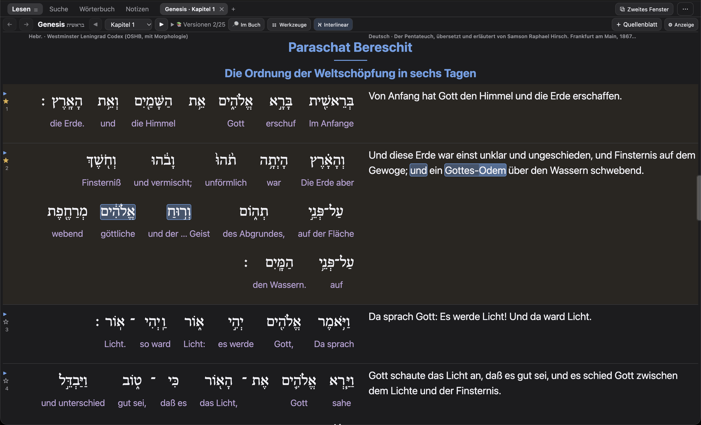
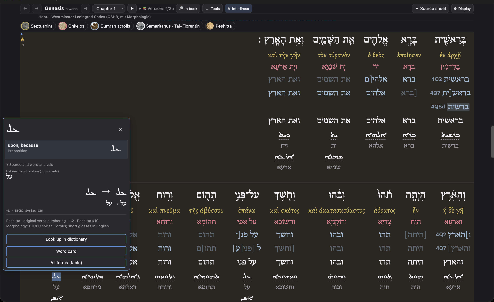
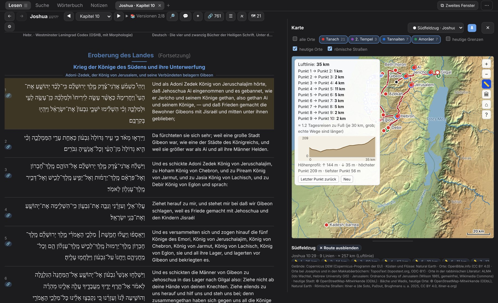
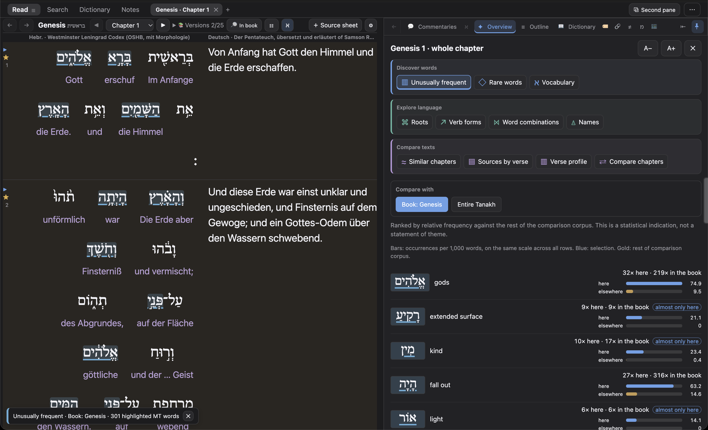
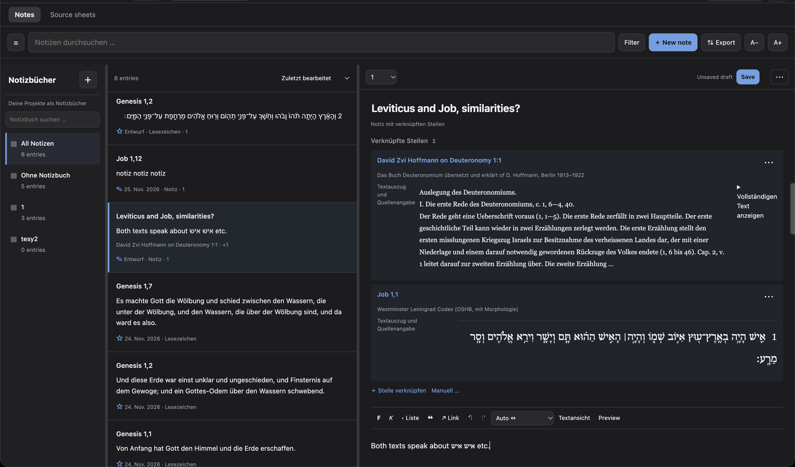
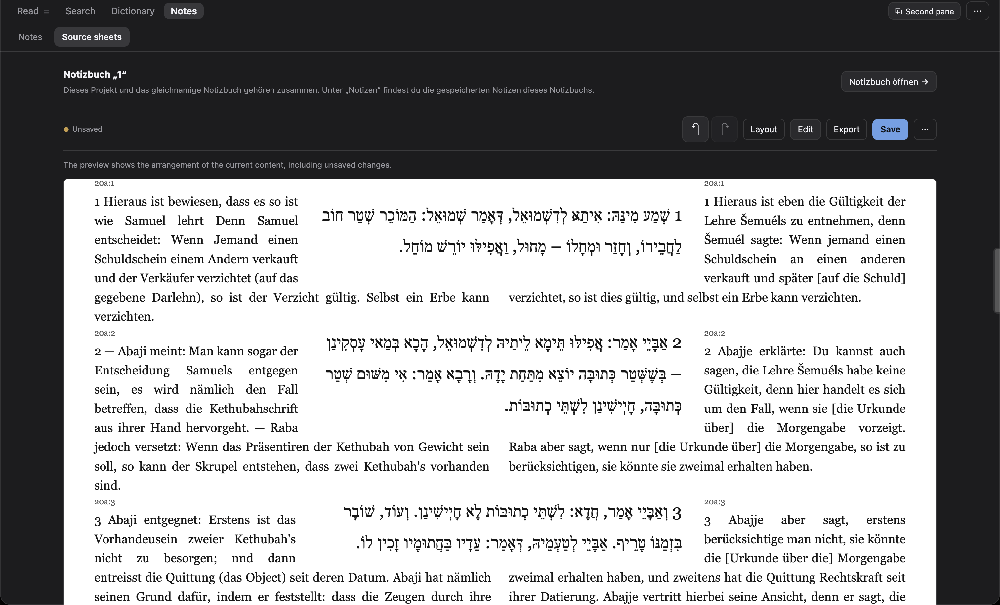

<p align="center"></p>

<h1 align="center">Safran <span dir="rtl">סַפְרָן</span></h1>

<p align="center"><b>Tanach, Talmud und Midrasch offline lernen – Hebräisch Wort für Wort mit deutscher Übersetzung, Wörterbüchern und Kommentaren.</b><br>Eine kostenlose Bibliothek für Schüler, Studierende, Lehrende, Rabbiner und Forschende.</p>

<p align="center">
  <a href="https://github.com/mitkin89/Safran/releases/latest"></a>
  <a href="https://github.com/mitkin89/Safran/releases/latest"></a>
  <a href="https://github.com/mitkin89/Safran/releases/latest"></a>
</p>

<p align="center"><sub>Kostenlos und quelloffen · ohne Konto · funktioniert offline · Oberfläche auf Deutsch, Englisch und Hebräisch</sub></p>

<p align="center">
  <a href="https://github.com/mitkin89/Safran/releases/latest"></a>
  <a href="LICENSE"></a>
  <a href="#offene-datensätze"></a>
</p>

<p align="center"><a href="README.md">English</a> · <b>Deutsch</b> · <a href="#installation">Installation</a> · <a href="CHANGELOG.md">Neuigkeiten</a> · <a href="docs/FEATURES.md">Alle Funktionen</a></p>



<p align="center"><sub>Genesis 1: der hebräische Text, S. R. Hirschs Übersetzung und unter jedem hebräischen Wort das deutsche. Ein Klick auf ein Wort markiert sein Gegenstück.</sub></p>

## Was kann Safran?

- 📖 **Hebräisch Wort für Wort lesen.** Zunz und Philippson stellen das Deutsche unter jedes Wort des ganzen Tanach; Mendelssohn, Goldschmidt, Hirsch, Breuer und andere erschließen einzelne Bücher.
- 🔎 **Jedes Wort nachschlagen.** Ein Doppelklick öffnet Jastrow, BDB, Gesenius, Levy und weitere Wörterbücher; ein Klick zeigt Grammatik, Formen und wie die Übersetzer es wiedergeben.
- 📚 **Über 50 deutsche Werke inklusive** – Bibelübersetzungen und Kommentare, Talmud- und Midraschübersetzungen, Josephus, Graetz, Ginzberg –, dazu die ganze Bibliothek von Sefaria zum Herunterladen.
- 📜 **Die alten Übersetzungen vergleichen.** Septuaginta, Qumranrollen, Samaritanischer Pentateuch, Peschitta, Onkelos und der Aleppo-Kodex neben dem Hebräischen.
- ✍️ **Unterricht vorbereiten.** Stellen in Notizbüchern und Quellenblättern sammeln und als PDF oder Word ausgeben.
- 🔒 **Alles bleibt auf deinem Rechner.** Kein Konto nötig; einmal installiert, funktioniert Safran ohne Internet.

<table>
<tr>
<td width="33%" valign="top"><br><sub><b>Wortkarte</b> – Formen, Häufigkeit und wie die Übersetzer ein Wort wiedergeben</sub></td>
<td width="33%" valign="top"><br><sub><b>Alte Übersetzungen</b> Wort für Wort unter dem Hebräischen</sub></td>
<td width="33%" valign="top"><br><sub><b>Bibelkarten</b> – Orte, Routen, Entfernungen und Höhenprofil</sub></td>
</tr>
<tr>
<td width="33%" valign="top"><br><sub><b>Quellenblätter</b> – Text und Übersetzungen nebeneinander, druckfertig</sub></td>
<td width="33%" valign="top"><br><sub><b>Suche</b> – Wörter, Wortfolgen und Grundformen in der ganzen Bibliothek</sub></td>
<td width="33%" valign="top"><br><sub><b>Textkritischer Apparat</b> – Qumran, LXX, Hexapla, Peschitta</sub></td>
</tr>
</table>

## Installation

Lade die Datei für dein System aus der [neuesten Version](https://github.com/mitkin89/Safran/releases/latest):

| System | Datei | Start |
| --- | --- | --- |
| macOS (Apple Silicon: M1 oder neuer) | `.dmg` | Öffnen und Safran in den Ordner Programme ziehen. |
| Windows | Setup-`.exe` oder portable `.exe` | Installationsprogramm ausführen oder die portable App direkt starten. |
| Linux | `.deb` für Intel/AMD (`amd64`) oder ARM (`arm64`), oder `.AppImage` für Intel/AMD | Debian-Paket installieren oder das AppImage ausführbar machen und öffnen. |

<details>
<summary><b>macOS meldet, Safran „kann nicht geöffnet werden“?</b></summary>

Safran hat kein kostenpflichtiges Apple-Entwicklerzertifikat. Öffne **Systemeinstellungen → Datenschutz & Sicherheit** und wähle **Trotzdem öffnen**. Die DMG enthält außerdem **Safran freischalten.command**: per Rechtsklick **Öffnen** wählen. Nur für einen Download aus diesem Repository verwenden.
</details>

<details>
<summary><b>Windows zeigt eine SmartScreen-Warnung?</b></summary>

Wähle **Weitere Informationen → Trotzdem ausführen**. Die Warnung erscheint, weil die App nicht mit einem kostenpflichtigen Zertifikat signiert ist. Nur für einen Download aus diesem Repository verwenden.
</details>

### Erste Schritte

1. **Lesen:** Die mitgelieferten Texte und Wörterbücher stehen beim ersten Start bereit. Buch und Kapitel wählen; unter **Versionen** die Ausgaben für die parallele Ansicht auswählen.
2. **Bibliothek erweitern:** Unter **⋯ → Herunterladen…** den Sefaria-Katalog laden und Bücher sowie Sprachen auswählen. Heruntergeladene Texte funktionieren offline.
3. **Wörter untersuchen:** **Interlinear** einschalten, ein hebräisches Wort für Grammatik und Wortkarte anklicken oder per Doppelklick im Wörterbuch nachschlagen.
4. **Festhalten:** Unter **Notizen** ein Notizbuch anlegen oder mit **＋ Quellenblatt** im Lesefenster eine Stelle samt Edition übernehmen.

Die Sprache der Oberfläche stellst du unter **⋯ → Sprache** um.

## Lesen und vergleichen

- **Parallele Ausgaben:** Hebräisch, Englisch, Deutsch und alte Übersetzungen in Spalten, mit Reitern, Stellennavigation und zweitem Lesefenster.
- **Dem Text folgen:** Ein Wortklick markiert die Gegenstücke, Fußnoten öffnen sich im Text, und verknüpfte Stellen führen in andere Bücher.
- **Kommentare und Kontext:** Zu einem Vers oder Kapitel sammelt Safran Kommentare, Parallelstellen, Talmud- und Midraschbezüge, Halacha, Orte und Wörterbuchbelege.
- **Lesewerkzeuge:** einstellbare Schriften, helle und dunkle Ansicht, Gliederungen, Bibelkarten, jüdischer Kalender und optionales hebräisches Audio.

Der **Kapitelüberblick** zeigt, welche Wörter, Wurzeln, Verbformen und Namen in einem Kapitel auffällig häufig sind – im Vergleich zum Buch oder zum ganzen Tanach –, markiert sie im Text und findet ähnliche Kapitel.



## Wörter, Wörterbücher und Suche

Die **Wortkarte** verbindet Grammatik, belegte Formen, Übersetzungsentscheidungen und Fundstellen: Sieh, wie ein Übersetzer ein Wort in der ganzen Bibel wiedergibt, und öffne die Stellen hinter jeder Wiedergabe.

Die **Wörterbücher** funktionieren offline. Suche nach Stichwort oder im Artikeltext, oder klicke doppelt auf ein Wort im Lesetext:

- **Biblisches Hebräisch:** Brown–Driver–Briggs (BDB) und Gesenius.
- **Rabbinisches Hebräisch und Aramäisch:** Jastrow und Levy, für Talmud und Midrasch.
- **Altgriechisch:** Liddell & Scott und Pape, für die Septuaginta und andere griechische Texte.
- **Jüdische Nachschlagewerke:** Samuel Krauss (griechische und lateinische Lehnwörter; Register der *Talmudischen Archäologie*) und Jacob Hamburgers *Real-Encyclopädie für Bibel und Talmud*.

Abkürzungen werden beim Überfahren erklärt, zitierte Stellen öffnen sich im Lesefenster. Eigene Wörterbücher lassen sich im DSL-Format hinzufügen (dem Format von GoldenDict und ABBYY Lingvo).

Die **Suche** findet Wortfolgen, Platzhalter und benachbarte Wörter, gefiltert nach Sprache und Buch. Wer nach der Grundform eines hebräischen oder griechischen Worts sucht, findet auch die gebeugten Formen. [Konkordanz](docs/concordance.md) · [Satzsuche im Tanach](docs/bhsa-clause-search.md)

## Notizbücher und Quellenblätter

Unter **Notizen** liegen deine Notizbücher und Quellenblätter. Eine Notiz kann formatierten Text, Schlagwörter und Stellen aus bestimmten Ausgaben enthalten.

Ein **Quellenblatt** hilft beim Vorbereiten einer Unterrichtsstunde, eines Vergleichs oder einer Lernrunde:

1. Eine Stelle aus dem Lesefenster übernehmen oder per Stellenangabe hinzufügen, etwa `Deuteronomy 1:1–10` oder `Deuteronomy 1:2,5,10`, und die Ausgabe wählen.
2. Überschriften, eigenen Text, Kommentare und Notizen ergänzen; Quellen im Haupttext oder am Rand anordnen.
3. Die Seite in der Vorschau prüfen und als PDF, DOCX oder HTML ausgeben oder das ganze Projekt als Datei weitergeben.

<table>
<tr>
<td width="50%"></td>
<td width="50%"></td>
</tr>
</table>

[Ausführlicher Ablauf, Formate und Grenzen](docs/RESEARCH.md)

## Für die Forschung: Apparat und Masora

<details>
<summary><b>Textkritischer Apparat</b> – den hebräischen Text mit Handschriften und alten Übersetzungen vergleichen</summary>

Lies einen Vers oder ein Kapitel, wähle Textzeugen und prüfe die Quelle hinter jeder Lesart.

| Zeuge | Vergleich | Umfang |
| --- | --- | --- |
| **MA** | Aleppo gegen Leningrad: Konsonanten, Vokale und Worttrennung | 39 Bücher; Verluste des Aleppo-Kodex markiert |
| **SMR** | Samaritanischer Pentateuch nach Tal–Florentin mit den Originalnoten | Tora |
| **DSS** | Biblische Qumranrollen mit Handschriftensiglen und Rekonstruktionszeichen | 36 Bücher |
| **LXX** | CATSS-Noten, Rückübersetzungen (das Hebräische, das eine griechische Lesart voraussetzt) und eingeordnete Septuaginta-Lesarten | 38 Bücher; Ester als Rahlfs-Lesetext |
| **Hex** | Fields Hexapla: Aquila, Symmachus, Theodotion und die anderen griechischen Revisoren | 39 Bücher |
| **Syr** | Peschitta-Wortzuordnung und Safrans eingeordnete Lesarten | 39 Bücher |
| **Ken** | Kennicotts Lesarten mittelalterlicher Handschriften | 39 Bücher |

Einordnungen, erschlossene hebräische Vorlagen und Erklärungen sind Arbeitshilfen, keine kritische Edition; unsichere Lesarten bleiben markiert, und die Quelle ist immer einen Klick entfernt. [Apparat-Traditionen](docs/apparatus-traditions.md)


</details>

<details>
<summary><b>Masora</b> – 26.969 Notizen aus 18 Handschriften mit deutschen Arbeitsübersetzungen</summary>

Lies **26.969 transkribierte Notizen** aus **1.550 veröffentlichten Seiten von 18 Handschriften**, importiert aus Corpus Masoreticum / BIMA. Nach Handschrift filtern, Versen folgen und zitierte Belege in der Vorschau öffnen. Jede hebräische Notiz steht zusammen mit einer **deutschen Arbeitsübersetzung**; beschädigte, mehrdeutige oder unvollständige Stellen bleiben gekennzeichnet. Der Import umfasst die bisher veröffentlichten Seiten, keine vollständigen Editionen. [Methode und Umfang](docs/masora-import.md) · [Quellenlizenz](app/LICENSE-MASORA.md)


</details>

## Was gehört zur Bibliothek?

Safran bringt über 50 deutsche Werke mit: Bibelübersetzungen und Kommentare von Zunz, Philippson, Herxheimer, Mendelssohn, Hirsch, Hoffmann und Breuer; Raschi nach Bamberger; Kautzschs Apokryphen; Talmud- und Midraschübersetzungen; Josephus; Graetz und Ginzbergs *Legenden der Juden*. Ebenfalls enthalten sind der Westminster-Text mit Morphologie, der Aleppo-Kodex, die Qumranrollen, die Septuaginta, die Targumim und die Peschitta. Weitere Bücher kommen von Sefaria, und eigene Texte lassen sich als TXT, DOCX, CSV oder JSON importieren.

<details>
<summary><b>Die vollständige Liste der mitgelieferten deutschen Texte</b></summary>

| Werk | Umfang |
| --- | --- |
| Zunz, *Die vier und zwanzig Bücher der Heiligen Schrift* (1838) | ganzer Tanach |
| Philippson, *Die Israelitische Bibel*, Übersetzung **und** Kommentar | ganzer Tanach |
| Herxheimer, *Die vier und zwanzig Bücher der Bibel* (1843), Übersetzung **und** Kommentar | ganzer Tanach |
| Kautzsch, *Die Apokryphen und Pseudepigraphen des Alten Testaments* (1900) | Ben Sira, Jubiläen, Henoch, Tobit, Judith, Makkabäer, Weisheit Salomos u. a. |
| Mendelssohn, *Die fünf Bücher Mose*, deutsche Übersetzung (Dessau 1815) | Tora; Interlinear |
| Mendelssohn, *Netivot ha-Schalom* (Übersetzung, Taitsch und Biur) | Tora |
| Raschi nach Bamberger · Hertz, Pentateuch-Kommentar | Raschi: Exodus bis Deuteronomium · Hertz: Exodus, Numeri, Deuteronomium |
| Goldschmidt, Übersetzung der Tora (1921) | Tora |
| S. R. Hirsch, Tora und Psalmen · Julius Hirsch, Jesaja und die Zwölf Propheten · Joseph und Raphael Breuer: Josua, Richter, Jeremia, Jecheskel, Esra, Nehemia | Übersetzung und Kommentar |
| Wünsches Midrasch-Übersetzungen | Bemidbar und Debarim Rabba, die Rabba-Bände zu den fünf Megillot, Pesikta des Rab Kahana, Midrasch Schmuel, *Mechiltha* (Mekhilta de-Rabbi Jischmael, mit Jakob Winter, 1909) |
| *Mischne Tora* (Mandelstamm, 1851) | 39 Abschnitte |
| *Führer der Unschlüssigen* (More Nevuchim) · *Kizzur Schulchan Aruch* (Bamberger) | |
| Ginzberg, *Die Legenden der Juden*, Lesefassung nach seinem deutschen Manuskript, ausgerichtet an Sefarias *Legends of the Jews* | Bd. 1–4, über 4000 Noten Ginzbergs als Fußnoten; Abkürzungen beim Überfahren; 10.600 Quellen (Bibel, Midrasch, Talmud, Josephus, Philo …) in beide Richtungen verlinkt; Gliederung |
| *Schulchan Aruch* (Lederer): Orach Chajim, Jore Deah, Ewen haëser · *Abot de-Rabbi Natan* (Pollak) · Traktat *Soferim* (Müller) · *Heiligung des Neumonds* (Hildesheimer) | |
| Talmud: Rawicz (Megilla, Rosch ha-Schana, Ketubot, Sanhedrin, Chulin I) · Straschun (Taanit) · Sammter (Baba Mezia, 1876) · Pinner (Berachot, 1842, mit Erläuterungen, dazu seine *Einleitung in den Talmud* und Vorrede; seine Übersetzung von Maimonides’ Einleitung zur Mischna nach Sefarias Gliederung) | deutsche Übersetzungen des 19. Jahrhunderts, je Daf und Segment |
| Mischna aus dem Talmud: die Mischnajot aller 37 Traktate in Goldschmidts Übersetzung sowie aus Pinner, Sammter, Rawicz und Straschun, als eigene Mischna-Fassungen | je Kapitel und Mischna, mit den Fußnoten des Übersetzers |
| Josephus, *Jüdische Altertümer*, *Jüdischer Krieg* und *Gegen Apion* (Clementz, 1899/1900) | nach Whistons Gliederung wie bei Sefaria, mit Nieses Paragraphenzahlen |
| H. Graetz, *Geschichte der Juden* (11 Bände, nach zeno.org) | Kapitel und Noten mit Fußnoten, Seitenmarken der Druckausgabe, Gliederung |
| D. Hoffmann, *Das Buch Leviticus* und *Das Buch Deuteronomium* | Übersetzung und Kommentar |
| Samuel (Wolf) · Ijob (Dawidowicz) · die *Arba Megillot* (Raphael Breuer) | Übersetzung und Kommentar |
| S. Krauss, *Talmudische Archäologie* (Bd. I–III, 1910–1912) | ganzer Text mit Anmerkungen, Abbildungen und Gliederung; das Register ist ein eigenes Wörterbuch |

</details>

Bringt ein App-Update geänderte Bibliothekstexte mit, fragt Safran vor dem Ersetzen und sichert die alten Dateien.

## Offene Datensätze

Vieles, was für Safran aufbereitet wurde, ist als offener, zitierfähiger Datensatz mit eigener DOI auf Zenodo veröffentlicht:

| Datensatz | Inhalt | DOI |
| --- | --- | --- |
| [field-hexapla](https://github.com/mitkin89/field-hexapla) | Fields *Origenis Hexaplorum quae supersunt* (1875): Transkription, strukturierte Daten und englische Fußnoten | [10.5281/zenodo.24464811](https://doi.org/10.5281/zenodo.24464811) |
| [levy-dictionaries](https://github.com/mitkin89/levy-dictionaries) | Levys Wörterbücher zu Talmud, Midrasch und Targum | [10.5281/zenodo.24465108](https://doi.org/10.5281/zenodo.24465108) |
| [krauss-works](https://github.com/mitkin89/krauss-works) | Krauss: griechische und lateinische Lehnwörter; *Talmudische Archäologie* mit Register | [10.5281/zenodo.24465261](https://doi.org/10.5281/zenodo.24465261) |
| [hamburger-realencyclopaedie](https://github.com/mitkin89/hamburger-realencyclopaedie) | Hamburgers *Real-Encyclopädie für Bibel und Talmud* | [10.5281/zenodo.24465434](https://doi.org/10.5281/zenodo.24465434) |
| [lxx-peshitta-apparatus](https://github.com/mitkin89/lxx-peshitta-apparatus) | Eingeordnete LXX- und Peschitta-Lesarten gegenüber dem masoretischen Text; Wortzuordnung MT–Peschitta | [10.5281/zenodo.24465785](https://doi.org/10.5281/zenodo.24465785) |
| [german-talmud-translations](https://github.com/mitkin89/german-talmud-translations) | Goldschmidts vollständiger Talmud und deutsche Talmudübersetzungen des 19. Jahrhunderts | [10.5281/zenodo.24466136](https://doi.org/10.5281/zenodo.24466136) |
| [mendelssohn-pentateuch](https://github.com/mitkin89/mendelssohn-pentateuch) | Mendelssohns Pentateuch: Biur, Taitsch und die Dessauer Übersetzung von 1815 | [10.5281/zenodo.24466528](https://doi.org/10.5281/zenodo.24466528) |

## Offline arbeiten und Daten behalten

Lesen, Suche, Wörterbücher, Notizbücher und Quellenblätter funktionieren ohne Konto und ohne Internet. Weitere Bücher herunterladen, Kalenderdaten aktualisieren und nach Updates suchen braucht eine Verbindung. Deine Notizen, Projekte und importierten Dateien liegen nur auf deinem Rechner – sichere den Bibliotheksordner oder exportiere deine Notizen, bevor du auf einen anderen Rechner umziehst.

## Rückmeldung

Ein Fehler oder eine Idee? [Eröffne ein Issue](https://github.com/mitkin89/Safran/issues) und nenne Betriebssystem, Safran-Version, Buch, Ausgabe und Stelle. Textbeiträge sollten ihre Quelle und Lizenz angeben.

## Quellen und Lizenz

Safrans Quellcode steht unter der [MIT-Lizenz](LICENSE). **Diese Lizenz gilt nicht für die mitgelieferten Texte und Datensätze.** Einige sind gemeinfrei oder stehen unter CC BY/CC BY-SA; andere erlauben nur nicht kommerzielle Nutzung, darunter CATSS, Kennicott und mehrere ETCBC-/Tal–Florentin-Datensätze. Vor Weitergabe oder Wiederverwendung die vollständige [Quellen- und Lizenzliste](app/SOURCES.de.md) beachten. Die Transkriptionen von Corpus Masoreticum / BIMA stehen unter [CC BY-SA 4.0](app/LICENSE-MASORA.md).

Viele Texte lassen sich aus der offenen Bibliothek von [Sefaria](https://www.sefaria.org) herunterladen; jede Ausgabe behält ihre Lizenz. Safran ist ein unabhängiges Projekt und nicht mit Sefaria verbunden.

## Entwicklung

```sh
npm ci
npm start
npm test
```

Programmcode und mitgelieferte Daten liegen in [`app/`](app/), die Dokumentation in [`docs/`](docs/). Installationsdateien auf dem Zielsystem mit `npm run dist` (macOS), `npm run dist:win` oder `npm run dist:linux` erstellen. [Entwicklungsanleitung](docs/DEVELOPMENT.md) · [Alle Funktionen und Tastenkürzel](docs/FEATURES.md) · [Änderungsverlauf](CHANGELOG.md)

<p align="center"><sub><b>סַפְרָן</b> bedeutet im modernen Hebräisch Bibliothekar und stammt von derselben Wurzel wie <i>sefer</i>, Buch. Safran entsteht bei <a href="https://talmud.de">talmud.de</a>.</sub></p>
