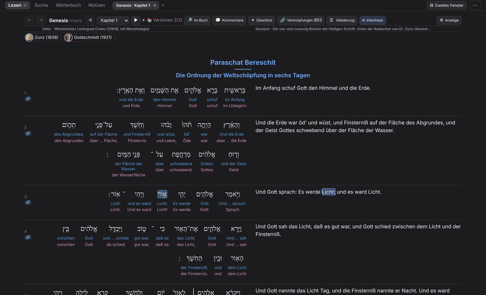
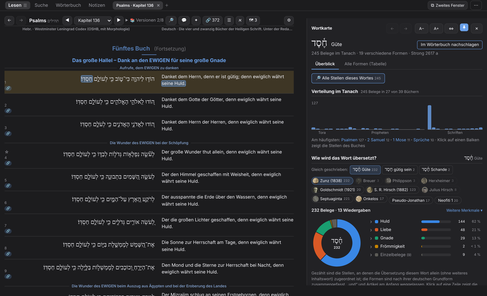
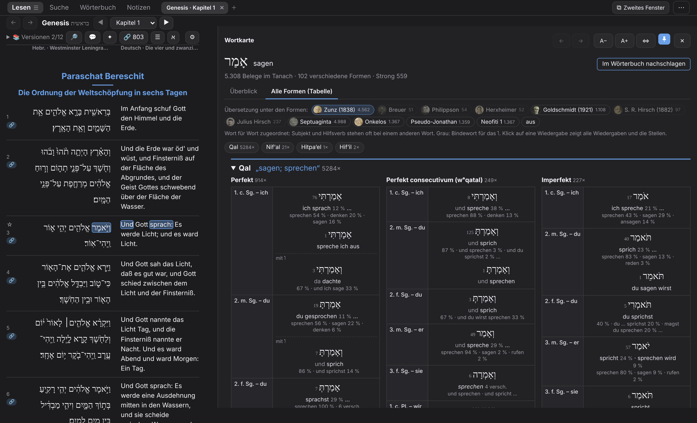
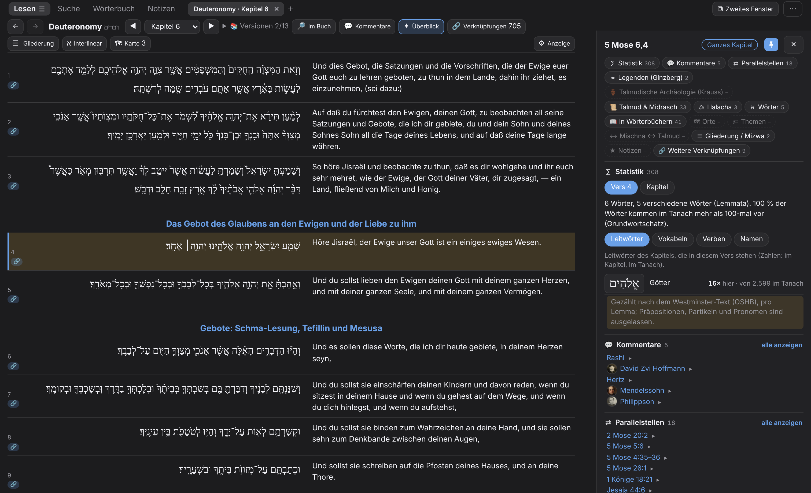
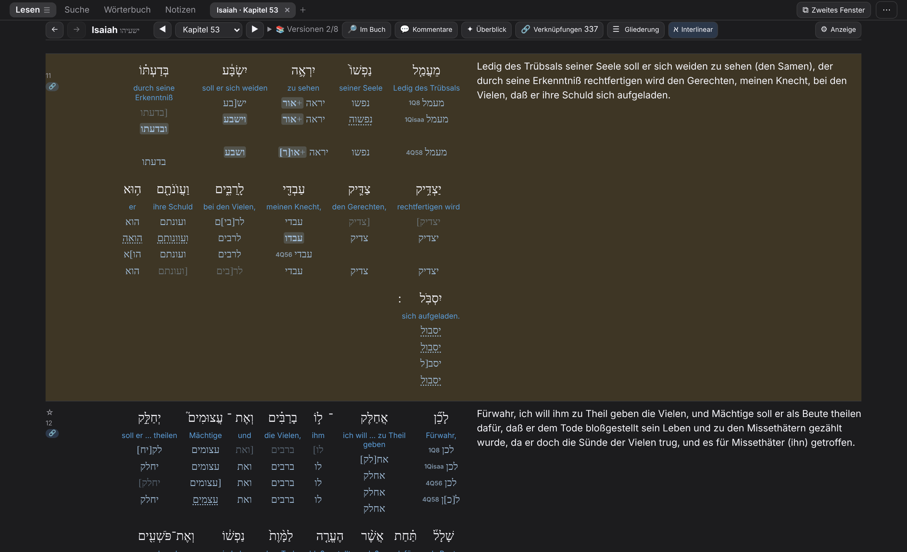
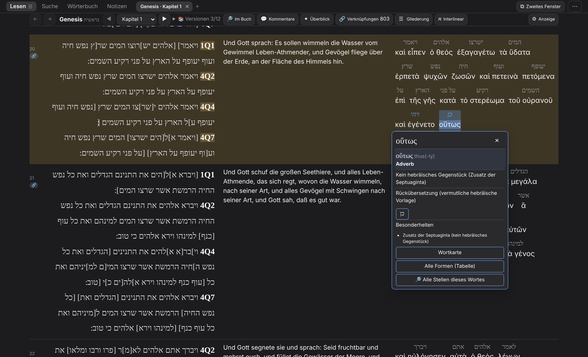
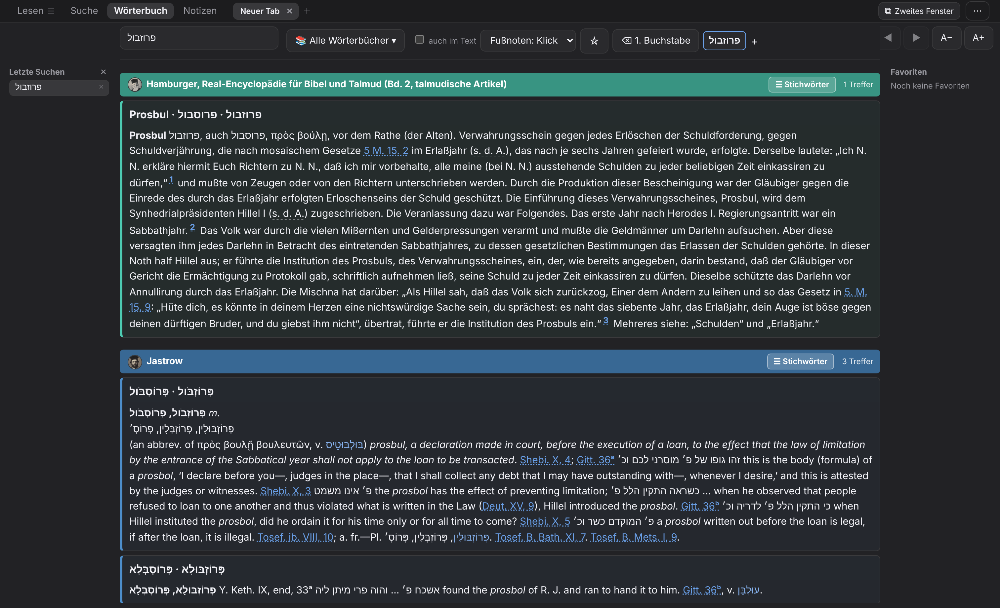
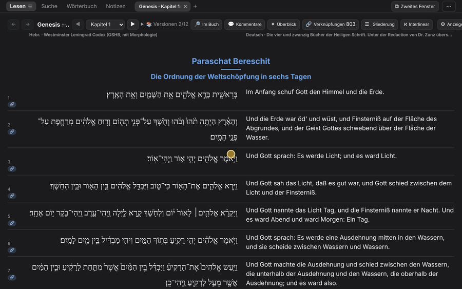
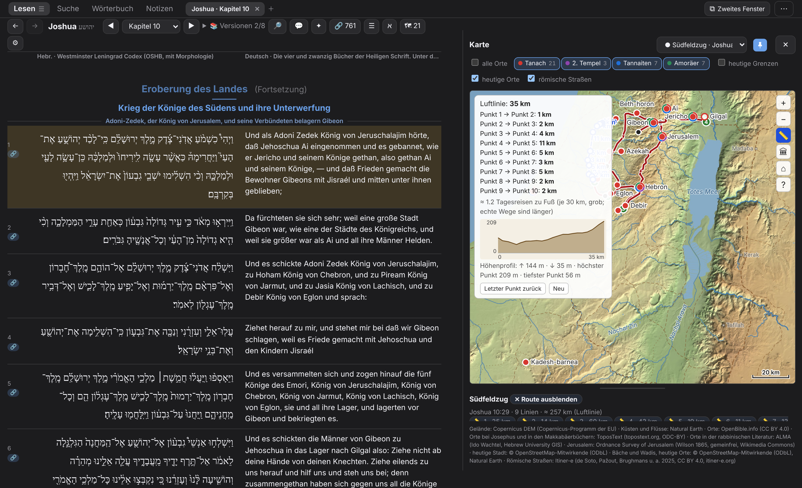

<h1 align="center">Safran סַפְרָן</h1>

<b>Deine jüdische Bibliothek, offline – mit dem ganzen Tanach Wort für Wort auf Deutsch.</b> Tanach, Talmud, Midrasch und Kommentare auf Hebräisch, Englisch und Deutsch, mit eingebautem Wörterbuchregal.

  
  
  
  
  

  

<a href="https://www.youtube.com/watch?v=_htLzC7Q3Ug">▶ Überblicksvideo</a> &nbsp;·&nbsp; <a href="docs/releases/2.7.0.md"><b>Neu in 2.7.0</b></a> (englisch) &nbsp;·&nbsp; <a href="#installation">Installation</a> &nbsp;·&nbsp; <a href="README.md">English</a> &nbsp;·&nbsp; <b>Deutsch</b>

   
  Genesis 1 als Interlinear: unter jedem hebräischen Wort das Deutsch von Zunz (1838) und Goldschmidt (1921). Ein Klick auf ein Wort hebt sein Gegenstück in der fortlaufenden Übersetzung hervor.

   
  ▶ Überblicksvideo auf YouTube ansehen

Safran ist eine kostenlose Desktop-App für macOS, Windows und Linux, die deine Texte auf dem eigenen Rechner hält. Du wählst einmal die Bücher und Sprachen aus der [Sefaria](https://www.sefaria.org)-Bibliothek und liest, durchsuchst und kommentierst sie danach ohne Internetverbindung. Neu in 2.7.0: der **Apparatus** mit Handschriften- und Versionslesarten, ein gemeinsames Seitenpanel und erweiterte Stellenstatistiken. Der **ganze Tanach Wort für Wort auf Deutsch** (Interlinear) und die **Wortkarte** zeigen, wie hebräische Wörter übersetzt werden. Dazu bringt Safran **über 50 deutsche Werke** mit (Übersetzungen, Kommentare und Nachschlagewerke), die es sonst kaum gibt, darunter Louis Ginzbergs *Legenden der Juden* nach seinem deutschen Manuskript, und **zehn Wörterbücher und Nachschlagewerke** mit über 300.000 Einträgen. Safran ist ein unabhängiges Projekt und nicht mit Sefaria verbunden.

Der **≠ Apparatus** gehört ab 2.7.0 zur offiziellen Version: mit Samaritanus / Tal–Florentin, Septuaginta (CATSS), biblischen Qumran-Rollen und den verfügbaren Kennicott-Büchern. Quellen, abweichende Verszählung, Rekonstruktionen und unsichere Zuordnungen bleiben erkennbar. Für Mischna Berakhot gibt es außerdem einen Handschriftenvergleich von Kaufmann, Parma und Cambridge. Der Umfang hängt von Buch und Quelle ab.

## Warum Safran?

| | |
| --- | --- |
| 🔡 **Der ganze Tanach Wort für Wort auf Deutsch** | Der Knopf *Interlinear* stellt das Deutsch von Zunz (alle 39 Bücher) unter jedes hebräische Wort; darunter können Goldschmidt zur Tora, S. R. Hirsch zur Tora und zu den Psalmen, Julius Hirsch zu Jesaja und den zwölf kleinen Propheten, Wolf zu beiden Samuelbüchern sowie Septuaginta, Targumim und Qumran-Rollen stehen. |
| 🃏 **Eine Wortkarte zu jedem hebräischen Wort** | *Wie wird das Wort übersetzt?* als Diagramm je Übersetzung, das vollständige Paradigma als Tabelle und die Wiedergaben in Septuaginta, Targumim und Qumran-Rollen. |
| ✦ **Alles zu dieser Stelle** | Ein Fenster (Cmd+I) sammelt Kommentare, Parallelstellen, Legenden, Talmud & Midrasch, Halacha, Wörter, Orte und Wörterbuchartikel zu einem Vers, einem Blatt oder einem Kapitel. |
| 📴 **Funktioniert offline** | Texte, Verknüpfungen, Wörterbücher, Karten und Audio liegen auf deiner Festplatte. Nichts wird irgendwohin gesendet. |
| 🇩🇪 **Deutsche Texte, die es sonst nicht gibt** | Über 50 Werke: Zunz, Philippson, Mendelssohns Biur, Herxheimer, Hertz, Hirsch, Raschi nach Bamberger, die Kautzsch-Apokryphen, Midrasch Rabba, Josephus, Graetz, der Schulchan Aruch (Lederer), Ginzbergs *Legenden der Juden* … sofort beim ersten Start da. |
| 📚 **Ein Wörterbuchregal, nicht nur ein Lexikon** | Liddell & Scott, BDB, Gesenius, Jastrow, Levy, Krauss und Hamburgers Real-Encyclopädie: über 300.000 Einträge, durchsuchbar nach Stichwort *und* im Volltext, mit Abkürzungen beim Überfahren und Quellen, die sich im Lesefenster öffnen. |
| 📜 **Handschriften und alte Übersetzungen** | Samaritanischer Pentateuch (CACCHT / DT-UCPH) mit Tal–Florentin als hebräischem Haupttext, englischer Parallelübersetzung, roten MT-Abweichungen und Morphologie unveränderter Wörter; Aleppo-Kodex, die biblischen Qumran-Rollen und alle 735 nichtbiblischen mit Morphologie, die Septuaginta mit anklickbarer Morphologie und LXX-MT-Vergleich, Targum Onkelos, Pseudo-Jonathan und Neofiti. |
| 🔎 **Suche, die Grammatik kennt** | Volltextsuche in allem, alle Formen eines Wortes über das Lemma (hebräisch und griechisch) und eine Grammatiksuche nach Stamm, Zeit, Person, Genus und Numerus. |
| 🗺 **Gemacht zum Lernen** | Vers-für-Vers-Ausrichtung, zweites Lesefenster, Bibelkarte, Gliederungen, jüdischer Kalender und eine hebräische Lesung des ganzen Tanach. |

## Installation

Die Datei für dein System aus der [neuesten Version](https://github.com/mitkin89/Safran/releases/latest) herunterladen. Safran hat kein kostenpflichtiges Entwicklerzertifikat, darum braucht der erste Start einen Schritt mehr.

- **macOS** – die `.dmg` öffnen und **Safran** in den Ordner **Programme** ziehen.
  > ⚠️ **„Safran ist beschädigt und kann nicht geöffnet werden“?** Die App ist nicht defekt; macOS meldet das bei Apps ohne kostenpflichtiges Apple-Zertifikat. Die `.dmg` erneut öffnen und mit Rechtsklick **Safran freischalten.command** → *Öffnen* → *Öffnen*. Oder im Terminal: `xattr -cr /Applications/Safran.app`. Bei *„Entwickler kann nicht überprüft werden“*: *Systemeinstellungen → Datenschutz & Sicherheit → Trotzdem öffnen*.
- **Windows** – das Installationsprogramm (oder die portable `.exe`) starten. Zeigt SmartScreen *„Der Computer wurde durch Windows geschützt“*: **Weitere Informationen** → **Trotzdem ausführen**.
- **Linux** – das `.AppImage` einmal ausführbar machen (`chmod +x Safran-*.AppImage`) und starten, oder das `.deb` installieren (`sudo apt install ./safran_*.deb`).

Mehr dazu unter [Häufige Fragen](#häufige-fragen).

### Erste Schritte

Die Oberfläche gibt es auf Deutsch, Englisch und Hebräisch. Sie startet je nach Systemsprache auf Deutsch oder Englisch und lässt sich jederzeit unter ⋯ → *Sprache* umstellen.

1. **Texte wählen:** ⋯ → *Herunterladen…* öffnen, den Katalog einmal laden (etwa 22 MB), Kategorien oder einzelne Bücher ankreuzen und die Sprachen wählen (Hebräisch, Englisch, Deutsch). Die mitgelieferten deutschen Texte und die Wörterbücher sind schon da, bevor du etwas herunterlädst.
2. **Lesen:** ein Buch wählen, eine Stelle ins Springen-Feld tippen (`2:5`, `Daf 3a`, `gen. 1:1`) und Cmd+K (unter Windows und Linux Strg+K) für die Kommentare drücken. Ein neuer Tab zeigt den Wochenabschnitt und das Daf Yomi; ein Klick öffnet sie.
3. **Tiefer gehen:** in einem Buch des Tanach *Interlinear* drücken, dann steht das Deutsch unter jedem hebräischen Wort. Ein Klick auf ein hebräisches Wort zeigt Grammatik und *Wortkarte*, ein Doppelklick auf ein beliebiges Wort schlägt es in den Wörterbüchern nach, und Cmd+I (Strg+I) öffnet *Alles zu dieser Stelle*.

## Was Safran kann

<table>
<tr>
<td width="33%" valign="top"><b>🔡 Interlinear: Hebräisch und Deutsch Wort für Wort</b> Der Knopf <i>Interlinear</i> stellt eine Übersetzung unter jedes hebräische Wort des Westminster-Textes. In einem kleinen Feld kreuzt du die Werke an; mehrere stehen untereinander, jedes in seiner Farbe. <b>Zunz</b> deckt den ganzen Tanach ab (alle 39 Bücher), <b>Goldschmidt</b> die Tora (alle fünf Bücher), <b>S. R. Hirsch</b> die Tora und Psalmen, <b>Julius Hirsch</b> Jesaja und die zwölf kleinen Propheten, <b>Wolf</b> beide Samuelbücher. <b>Breuer</b> ist für Josua, Richter, Jeremia, Jecheskel, Esra, Nehemia, Ruth, Hohelied, Kohelet und Klagelieder zugeordnet. Genauso lassen sich die <b>Septuaginta</b>, die Targumim <b>Onkelos, Pseudo-Jonathan und Neofiti</b> und die <b>Qumran-Rollen</b> dazunehmen; in den Rollen sind die Abweichungen vom masoretischen Text markiert. Ein Klick auf ein Wort hebt seine Gegenstücke in allen Fassungen hervor.</td>
<td width="33%" valign="top"><b>🃏 Wortkarte</b> Ein hebräisches Wort anklicken und seine <i>Wortkarte</i> öffnen. <b>„Wie wird das Wort übersetzt?“</b> zeigt als Ringdiagramm und Liste die Wiedergaben in jeder zugeordneten Übersetzung, in der Septuaginta und in den Targumim; jede Wiedergabe öffnet ihre Stellen. <b>Alle Formen (Tabelle)</b> ist das vollständige Paradigma, geordnet wie in einer Grammatik, mit der üblichen Wiedergabe unter jeder Form. Darunter: Verteilung im Tanach, die Wörterbücher und die Belege in Septuaginta, Targumim und Qumran-Rollen. Die Karte lässt sich neben dem Text anpinnen.</td>
<td width="33%" valign="top"><b>✦ Alles zu dieser Stelle (Cmd+I)</b> Ein Fenster sammelt, was Safran zu einem Vers, einem Blatt oder einem ganzen Kapitel weiß: Kommentare, Parallelstellen, Legenden (Ginzberg), Talmud & Midrasch, Halacha, Leitwörter, Orte, Themen, Wörterbuchartikel, die die Stelle zitieren, und deine Notizen.  <b>Kommentare zum ganzen Kapitel (Cmd+K)</b> Das Kommentarfenster zeigt ein Kapitel Kommentator für Kommentator, Vers für Vers; ein Klick auf eine Versnummer beschränkt es auf diesen Vers.</td>
</tr>
</table>

   
  Wortkarte zu חֶסֶד: Verteilung im Tanach und „Wie wird das Wort übersetzt?“ – hier bei Zunz, umschaltbar auf die anderen Übersetzungen, die Septuaginta und die Targumim.

   
  Alle Formen (Tabelle): das Paradigma von אָמַר, unter jeder Form die Wiedergabe der gewählten Übersetzung.

   
  Alles zu dieser Stelle (Cmd+I), hier zu 5. Mose 6,4: Kommentare, Parallelstellen, Legenden, Talmud & Midrasch, Halacha, Wörter und mehr in einem Fenster.

Und alles Weitere:

<table>
<tr>
<td width="50%" valign="top"><b>📖 Drei Sprachen, Vers für Vers</b> Hebräisch, Englisch und Deutsch nebeneinander, Vers für Vers ausgerichtet, jede Version eine Spalte oder eine Spalte je Sprache. Hebräisch öffnet sich im Westminster Leningrad Codex oder, wo ein Buch ihn nicht hat, in einer echten Ausgabe (im Talmud z. B. der vokalisierte William-Davidson-Text), nicht in Sefarias zusammengeführtem Text. Fußnoten öffnen sich im Text. Bibelstellen in allen Texten, auch mit römischer Kapitelzahl (<i>Jerem. XXIII, 24</i>), öffnen sich per Klick. Kapitel und Talmudseiten per Pfeiltasten.</td>
<td width="50%" valign="top"><b>💬 Kommentarfenster (Cmd+K)</b> Raschi, Ibn Esra u. a. unter dem gewählten Vers, auf Hebräisch, Englisch oder Deutsch. <i>Folgen</i> hält es auf dem Vers, den du gerade liest; ▲/▼ oder <code>j</code>/<code>k</code> gehen Vers für Vers weiter. Lässt sich neben dem Text anpinnen, zusammen mit dem Wörterbuch: als Reiter, untereinander oder nebeneinander.</td>
</tr>
<tr>
<td valign="top"><b>🔎 Volltextsuche</b> In allem, was du geladen hast, auch in Fußnoten und eigenen Texten. Ignoriert Vokale und Kantillation. Wörter in der Nähe, Platzhalter, unscharfe Suche für Schreibvarianten, derselbe Vers in mehreren Fassungen nur ein Treffer. Im hebräischen Tanach außerdem <b>alle Formen eines Wortes</b> (über das Lemma) und eine <b>Grammatiksuche</b> nach Wortart, Stamm, Zeitform, Person, Genus und Numerus. Cmd/Strg+F sucht im angezeigten Text, auf Wunsch nur als <i>ganzes Wort</i>.</td>
<td valign="top"><b>🔤 Morphologie per Klick</b> Der OSHB-Tanach trägt zu jedem Wort Lemma und Morphologie: ein Klick zeigt Stamm, Form, Person, Genus und Numerus; von dort öffnet sich das Lemma im Wörterbuch oder in seiner Wortkarte. Ein Klick zeigt auch die Grammatik jedes griechischen Wortes der Septuaginta und der Wörter in den Targumim und den Qumran-Rollen.</td>
</tr>
<tr>
<td valign="top"><b>⧉ Zweites Lesefenster</b> Zwei Bücher nebeneinander, jedes mit eigenen Tabs, eigenem Verlauf und Kommentarfenster. Beide Fenster blättern im Gleichlauf.</td>
<td valign="top"><b>📜 Handschriften und Fassungen</b> Aleppo-Kodex; die biblischen Qumran-Rollen, jedes Wort anklickbar; <b>alle 735 nichtbiblischen Qumran-Rollen</b> mit Lemma und Morphologie. Septuaginta mit <b>anklickbarer Morphologie</b> und hebräischem Gegenstück je Wortgruppe: ein <b>LXX-MT-Vergleich</b>, der Plus, Minus und Zuordnung markiert. Targum Onkelos, Pseudo-Jonathan und Neofiti mit Morphologie, Parallelstellen, Sefarias Verknüpfungen. Stellenangaben in anderer <b>Verszählung</b> (KJV, Vulgata, Septuaginta) werden automatisch umgerechnet.</td>
</tr>
<tr>
<td valign="top"><b>🗺 Bibelkarte und Gliederungen</b> Die Orte jedes Kapitels auf einer Karte von Israel mit Entfernungen und Höhenprofil, eine detaillierte Jerusalem-Karte von 1865, dazu Themen. Gliederungen für den Tanach (in der Tora mit Schalter 613 Mizwot), die Mischna, die Apokryphen, den <i>Führer der Unschlüssigen</i> und Ginzbergs <i>Legenden</i>, als eigenes Fenster und als Überschriften zwischen den Versen (abschaltbar).</td>
<td valign="top"><b>🎧 Hebräische Lesung</b> Eine Lesung des ganzen Tanach von Abraham Schmueloff, pro Buch herunterladbar. Jeder Vers hat sein eigenes ▶: Ein Klick spielt genau diesen Vers ab, danach läuft die Lesung weiter. Der gelesene Vers wird markiert.</td>
</tr>
<tr>
<td valign="top"><b>✍️ Eigene Texte und Notizen</b> TXT, Word, CSV oder JSON als zusätzliche Spalte oder als Kommentar importieren. Lesezeichen und Notizen mit Export nach JSON, Markdown, Word oder PDF.</td>
<td valign="top"><b>🖥 Gemacht für langes Lesen</b> Helles, dunkles oder automatisches Thema, einstellbare Größe, Seitenrand normal oder schmal, Oberfläche auf Deutsch, Englisch und Hebräisch. Die Tab-Leiste blendet sich beim Scrollen nach unten aus und kommt beim Scrollen nach oben zurück (abschaltbar). Safran öffnet sich so, wie du es verlassen hast: Fenster, Tabs, Lesestelle, Kommentar und Wörterbuch.</td>
</tr>
<tr>
<td valign="top"><b>📅 Jüdischer Kalender im neuen Tab</b> Wochenabschnitt, Haftara, Daf Yomi und Jeruschalmi Yomi des Tages; ein Klick öffnet die Stelle. Zu anderen Tagen blättern oder ein Datum wählen. Die Daten stammen von hebcal.com und werden für 13 Monate gespeichert, darum funktioniert der Kalender auch offline.</td>
<td valign="top"><b>🖼 Porträts</b> Kleine Bilder von Übersetzern, Kommentatoren und Lexikografen (Zunz, Mendelssohn, S. R. Hirsch, Goldschmidt, Hoffmann, Malbim, Levy, Jastrow …) sowie des Aleppo- und des Leningrader Kodex neben Versionen, Kommentaren und Wörterbüchern; beim Überfahren erscheint eine große Ansicht.</td>
</tr>
</table>

**Bücher zweisprachig drucken:** Öffne das Buch und wähle die hebräische und deutsche Fassung als Spalten. Unter **⋯ → Exportieren …** kannst du den aktuellen Abschnitt, einen Abschnitts-/Kapitelbereich oder **Ganzes Buch** als PDF oder Word exportieren. Die Fassungen stehen versweise nebeneinander; Fußnoten, eigene Notizen und Verknüpfungen sind optional. Die PDF lässt sich anschließend normal drucken.

Die Textschriftgrößen übernimmt der Export aus **Anzeige**: Grundschrift sowie die getrennten Größen für Hebräisch, Deutsch und die anderen Sprachen. Stelle sie vor dem Export so ein, wie du sie drucken möchtest.

   
  Qumran-Rollen im Interlinear, Jesaja 53,11: je Rolle eine Zeile, Abweichungen vom masoretischen Text markiert – hier das Plus אור („Licht“) in 1QIsaᵃ, 1Q8 und 4Q58.

   
  LXX-MT-Vergleich: das hebräische Gegenstück über jeder griechischen Wortgruppe, Plus und Minus der Septuaginta markiert; ein Klick auf ein Plus zeigt die wahrscheinliche hebräische Rückübersetzung.

<a href="docs/FEATURES.md">Alle Funktionen, Tastenkürzel und das Menü Werkzeuge (englisch) →</a>

Berachot 2a–10b gibt es außerdem als **William Davidson Edition – Safran-Morphologie** mit 10.786 hebräisch-aramäischen Wortannotationen. Ein Wortklick zeigt Lemma, Bestimmung, Alternativen und Quellenhinweise; die Formtabelle enthält ausschließlich Belege aus diesem Bereich. Grammatik- und Lemmasuche berücksichtigen diese Ausgabe. Offene Merkmale bleiben markiert, der Wortlaut einschließlich Vokalisation ist unverändert. Siehe [Methode und Prüfbericht](tools/bavli/PRUEFBERICHT.md).

## Wörterbücher

Den Reiter *Wörterbuch* öffnen, den Knopf 📖 neben dem Kommentarfenster drücken oder ein Wort in einem Text doppelklicken. Zehn Wörterbücher und Nachschlagewerke mit über 300.000 Einträgen sind dabei:

| Wörterbuch | Einträge | Extras |
| --- | ---: | --- |
| **Pape**, Griechisch-deutsches Handwörterbuch (1880/1914) | 98.833 | griechische Stichwörter ohne Trennstriche; griechische Wortkarten, Querverweise, Abbildungen offline |
| **Liddell & Scott**, Greek-English Lexicon | 115.617 | 115.628 griechische Stichwörter; mit griechischen Wortkarten für belegte Septuaginta-Lemmata verbunden; Suche ohne Akzente und Spiritus, σ/ς gleichwertig; Querverweise anklickbar, Abkürzungen beim Überfahren |
| **BDB**, Brown-Driver-Briggs (ungekürzt) | 10.022 | auch nach Strong- und BDB-Nummer; Bibelstellen verlinkt |
| **Gesenius**, Hebräisches Handwörterbuch (1915) | 10.118 | |
| **Jastrow**, Dictionary of the Targumim, Talmud and Midrash | 32.466 | |
| **Levy**, Wörterbuch über die Talmudim und Midraschim (Bd. 1–4) | 19.503 | Abkürzungen beim Überfahren, Quellen verlinkt |
| **Levy**, Chaldäisches Wörterbuch über die Targumim (Bd. 1–2) | 7.232 | aramäische Wortkarten mit Formen und Targum-Belegen, Abkürzungen beim Überfahren, Quellen verlinkt |
| **Krauss**, Griechische und lateinische Lehnwörter (Teil II) | 6.329 | Abkürzungen beim Überfahren, Quellen verlinkt, Verweise *s. X* anklickbar |
| **Krauss**, Register der *Talmudischen Archäologie* (Bd. III) | 11.727 | jeder Eintrag führt in die drei Bände |
| **Hamburger**, Real-Encyclopädie für Bibel und Talmud (Bd. 1; Bd. 2, talmudische Artikel; Supplementbände I–VI) | 3.026 | Fußnoten im Text, Quellen verlinkt |

Krauss’ ***Talmudische Archäologie*** (Bd. I–III, Leipzig 1910–1912) selbst steht in der Bibliothek: der ganze Text mit allen Anmerkungen, Abbildungen und Gliederung. Seine Stellenangaben sind Links, und das Register oben dient als Index dazu.

   
  Wörterbuch-Reiter: eine Suche in allen Wörterbüchern, hier mit Antworten aus Hamburger und Jastrow; links die letzten Suchen, rechts die Favoriten.

- **Kluges Nachschlagen:** Vokalzeichen und Endbuchstaben werden ignoriert, die Präfixe ו ה ב כ ל מ ש abgelöst, und Einträge, die mit deinem Wort beginnen, erscheinen mit. Beim Tippen kommen Vorschläge.
- **Volltext:** mit dem Häkchen *auch im Text* wird im Artikeltext gesucht, nicht nur in den Stichwörtern. Treffer werden hervorgehoben. Auch Phrasen in Anführungszeichen und die Platzhalter `*` und `?` funktionieren.
- **Vom Text und zurück:** ein aus dem Text nachgeschlagenes Wort zeigt, woher es kommt (*aus Genesis 25:8*); ein Klick führt zum Vers zurück.
- **Wörterbücher wählen:** der Knopf 📚 legt fest, welche Wörterbücher durchsucht werden. Die Auswahl wird gemerkt.
- **Stichwortliste:** *☰ Stichwörter* öffnet die vollständige, filterbare Stichwortliste eines Wörterbuchs.
- **Verlinkte Quellen:** eine Stellenangabe wie *Rosh Hashanah 18b* öffnet die Stelle im Lesefenster, sofern der Text in deiner Bibliothek ist.
- **Eigene mitbringen:** `.dsl`- / `.dsl.dz`-Wörterbücher (ABBYY-Lingvo-Format) im Menü 📚 über *DSL-Datei hinzufügen …* einbinden. Mit `{{ref:…}}` markierte Stellen werden in Safran anklickbar.

## Deutsche Texte, die es bei Sefaria nicht gibt

Safran liefert über 50 deutsche Werke im Ordner `bundled/` mit (mehr als 400 Buchdateien). Sie werden beim ersten Start importiert und erscheinen unter *Eigene Texte* sowie als zusätzliche Versionen und Kommentatoren neben den Sefaria-Texten. Darunter: Zunz, Philippson und Herxheimer zum ganzen Tanach, Mendelssohn, Goldschmidt und Hirsch, die Kautzsch-Apokryphen, Wünsches Midrasch-Übersetzungen, Talmud-Übersetzungen des 19. Jahrhunderts, der Schulchan Aruch, Josephus, Graetz und Ginzberg.

Wenn ein Update eine andere Fassung eines bereits vorhandenen Textes mitliefert, fragt Safran vor dem Ersetzen. Die Rückfrage fasst die Bücher derselben Übersetzung zusammen und berücksichtigt auch frühere eigene Importe. Du kannst die bisherige Fassung behalten, die neue übernehmen oder mit „Alle neuen Fassungen übernehmen“ sämtliche angebotenen Texte ohne weitere Rückfragen aktualisieren. Vor dem Ersetzen sichert Safran die alte Datei im Bibliotheksordner unter `backups/text-updates`. „Behalten“ wird für die angebotene Fassung gemerkt; eine spätere Änderung wird erneut angeboten.

<b>Die vollständige Liste der mitgelieferten deutschen Texte</b>

| Werk | Umfang |
| --- | --- |
| Zunz, *Die vier und zwanzig Bücher der Heiligen Schrift* (1838) | ganzer Tanach |
| Philippson, *Die Israelitische Bibel*, Übersetzung **und** Kommentar | ganzer Tanach |
| Herxheimer, *Die vier und zwanzig Bücher der Bibel* (1843), Übersetzung **und** Kommentar | ganzer Tanach |
| Kautzsch, *Die Apokryphen und Pseudepigraphen des Alten Testaments* (1900) | Ben Sira, Jubiläen, Henoch, Tobit, Judith, Makkabäer, Weisheit Salomos u. a. |
| Mendelssohn, *Netivot ha-Schalom* (Übersetzung, Taitsch und Biur) | Tora |
| Raschi nach Bamberger · Hertz, Pentateuch-Kommentar | Raschi: Exodus bis Deuteronomium · Hertz: Exodus, Numeri, Deuteronomium |
| Goldschmidt, Übersetzung der Tora (1921) | Tora |
| S. R. Hirsch, Tora und Psalmen · Julius Hirsch, Jesaja und die Zwölf Propheten · Joseph und Raphael Breuer: Josua, Richter, Jeremia, Jecheskel, Esra, Nehemia | Übersetzung und Kommentar |
| Wünsches Midrasch-Übersetzungen | Bemidbar und Debarim Rabba, die Rabba-Bände zu den fünf Megillot, Pesikta des Rab Kahana, Midrasch Schmuel, *Mechiltha* (Mekhilta de-Rabbi Jischmael, mit Jakob Winter, 1909) |
| *Mischne Tora* (Mandelstamm, 1851) | 39 Abschnitte |
| *Führer der Unschlüssigen* (More Nevuchim) · *Kizzur Schulchan Aruch* (Bamberger) | |
| Ginzberg, *Die Legenden der Juden*, Lesefassung nach seinem deutschen Manuskript, ausgerichtet an Sefarias *Legends of the Jews* | Bd. 1–4, über 4000 Noten Ginzbergs als Fußnoten; Abkürzungen beim Überfahren; 10.600 Quellen (Bibel, Midrasch, Talmud, Josephus, Philo …) verlinkt und als Verknüpfungen in beide Richtungen; Gliederung |
| *Schulchan Aruch* (Lederer): Orach Chajim, Jore Deah, Ewen haëser · *Abot de-Rabbi Natan* (Pollak) · Traktat *Soferim* (Müller) · *Heiligung des Neumonds* (Hildesheimer) | |
| Talmud: Rawicz (Megilla, Rosch ha-Schana, Ketubot, Sanhedrin, Chulin I) · Straschun (Taanit) · Sammter (Baba Mezia, 1876) · Pinner (Berachot, 1842, mit Erläuterungen, dazu seine *Einleitung in den Talmud* und Vorrede; seine Übersetzung von Maimonides’ Einleitung zur Mischna nach Sefarias Gliederung) | deutsche Übersetzungen des 19. Jahrhunderts, je Daf und Segment |
| Mischna aus dem Talmud: die Mischnajot aller 37 Traktate in Goldschmidts Übersetzung sowie aus Pinner, Sammter, Rawicz und Straschun, als eigene Mischna-Fassungen | je Kapitel und Mischna, mit den Fußnoten des Übersetzers |
| Josephus, *Jüdische Altertümer*, *Jüdischer Krieg* und *Gegen Apion* (Clementz, 1899/1900) | nach Whistons Gliederung wie bei Sefaria, mit Nieses Paragraphenzahlen |
| H. Graetz, *Geschichte der Juden* (11 Bände, nach zeno.org) | Kapitel und Noten mit Fußnoten, Seitenmarken der Druckausgabe, Gliederung; das bei zeno rückwärts gespeicherte Hebräisch ist umgedreht |
| D. Hoffmann, *Das Buch Leviticus* und *Das Buch Deuteronomium* | Übersetzung und Kommentar |
| Samuel (Wolf) · Ijob (Dawidowicz) · die *Arba Megillot* (Breuer) | Übersetzung und Kommentar |
| S. Krauss, *Talmudische Archäologie* (Bd. I–III, 1910–1912) | ganzer Text mit Anmerkungen, Abbildungen und Gliederung; das Register ist ein eigenes Wörterbuch |

Ebenfalls enthalten: der Westminster Leningrad Codex mit Morphologie (OSHB), der Aleppo-Kodex, die biblischen Qumran-Rollen (36 Bücher) und alle 735 nichtbiblischen Rollen (die 40 größten als eigene Bücher, die übrigen je Höhle) mit Lemma und Morphologie, Targum Onkelos, Pseudo-Jonathan und Neofiti sowie die Septuaginta: der CATSS-Text zum Tanach und 21 griechische Dateien nach Rahlfs für Hosea, Ester mit den Zusätzen und die deuterokanonischen Bücher (1.–4. Makkabäer, Sirach, Weisheit, Tobit, Judit, Baruch, Brief Jeremias, Susanna, Bel, 1. Esdras, Oden, Psalmen Salomos), mit Lemma und Bestimmung für jedes griechische Wort (lxx-morph). Quellen und Lizenzen: [SOURCES.de.md](SOURCES.de.md).

## Weitere Bildschirmfotos

   
  Kurze Tour: Interlinear, Wortkarte mit Formentabelle, <i>Alles zu dieser Stelle</i> und Nachschlagen im Wörterbuch per Doppelklick.

<b>Morphologie, Suche und Bibelkarte</b>

   
  Klick auf ein hebräisches Wort: Grammatik auf einen Blick, Knöpfe für Wörterbuch, Wortkarte und Formentabelle, und der BDB-Eintrag neben dem Text.

   
  Erweiterte Suche: Platzhalter und Wörter in der Nähe, ein Diagramm der Treffer je Buch und ein Kategorienfilter.

   
  Bibelkarte: Routen aus dem Text und Entfernungen messen mit Höhenprofil; die Orte des Kapitels stehen unter der Karte.

## Häufige Fragen

<b>Erster Start unter macOS, Windows und Linux: „beschädigt“, „Entwickler nicht verifiziert“, SmartScreen, AppImage</b>

Die App hat kein kostenpflichtiges Entwicklerzertifikat (die Zertifikate von Apple und Microsoft kosten Geld), darum ist beim ersten Start ein Schritt mehr nötig. Die App ist nicht defekt. Unter macOS ist sie lokal (ad hoc) signiert.

**macOS** – bei *„Safran ist beschädigt und kann nicht geöffnet werden“* oder *„Entwickler kann nicht überprüft werden“*:

1. **Safran** in den Ordner **Programme** ziehen.
2. Am einfachsten: die `.dmg` erneut öffnen und mit Rechtsklick **Safran freischalten.command** → *Öffnen* → *Öffnen*. Oder im Terminal: `xattr -cr /Applications/Safran.app`
3. Bei *„Entwickler kann nicht überprüft werden“*: *Systemeinstellungen → Datenschutz & Sicherheit → Trotzdem öffnen* (nach unten scrollen) oder Rechtsklick auf die App → *Öffnen* → *Öffnen*.

**Windows** – SmartScreen zeigt evtl. *„Der Computer wurde durch Windows geschützt“*: **Weitere Informationen** → **Trotzdem ausführen**.

**Linux** – das `.AppImage` muss einmal ausführbar gemacht werden (`chmod +x Safran-*.AppImage` oder im Dateimanager: *Eigenschaften → Zugriffsrechte → Ausführen erlauben*). Das `.deb` wird normal installiert (`sudo apt install ./safran_*.deb`).

<b>Wie viel Speicherplatz brauche ich?</b>

Nur so viel, wie du auswählst. Grobe Werte: alle zusammengeführten hebräischen Texte ≈ 2,8 GB, Englisch ≈ 0,5 GB, deutsche Übersetzungen von Sefaria ≈ 0,13 GB. Alle JSON-Texte mit jeder Einzelversion ≈ 7 GB. Sefarias Verknüpfungsdaten ≈ 680 MB (optional). Hebräische Lesung insgesamt ≈ 3 GB, pro Buch herunterladbar (optional). Der Speicherort lässt sich verschieben, etwa auf eine externe Festplatte.

<b>Funktioniert es wirklich offline?</b>

Ja. Eine Verbindung brauchst du zum Herunterladen von Texten, Verknüpfungen und Audio und für die optionale Update-Prüfung. Alles andere, auch Suche, Wörterbücher, Karten und die mitgelieferten deutschen Texte, läuft ohne Internet.

<b>Wie steht es um den Datenschutz?</b>

Safran hat kein Konto, kein Tracking und keinen eigenen Server. Es lädt aus dem öffentlichen Sefaria-Export und von GitHub-Releases, nur was du anforderst. Deine Notizen, Lesezeichen, importierten Texte und Wörterbücher bleiben auf deinem Rechner. Safran lädt nie etwas zu Sefaria hoch.

<b>Wie verhält sich Safran zu Sefaria?</b>

Safran ist ein unabhängiges, quelloffenes Projekt und nicht mit Sefaria verbunden. Die Sefaria-Texte sind nicht Teil der App; sie werden aus dem öffentlichen [Sefaria-Export](https://github.com/Sefaria/Sefaria-Export) geladen und behalten ihre eigenen Lizenzen. Safran legt eigene deutsche Texte, Wörterbücher und Werkzeuge obendrauf. Das Menü Werkzeuge kann außerdem CSV-Dateien für einen Sefaria-Upload vorbereiten und prüfen.

<b>Welche Versionen von macOS, Windows und Linux?</b>

Safran ist eine Electron-App; an jedem [Release](https://github.com/mitkin89/Safran/releases) hängen Installer für macOS (`.dmg`), Windows (Installer und portable `.exe`) und Linux (`.AppImage` und `.deb`). Für hebräischen Text lohnt sich die kostenlose Schrift **SBL Hebrew** der Society of Biblical Literature; Safran verwendet sie automatisch.

## Mitwirken

- **Fehler und Ideen:** ein [Issue](https://github.com/mitkin89/Safran/issues) anlegen. Bitte System, Safran-Version (⋯-Menü) und bei Textproblemen Buch und Stelle nennen.
- **Texte:** eigene Übersetzungen oder Kommentare mit ⋯ → *Eigene Texte für GitHub exportieren …* ausgeben und als Pull Request für `bundled/` anbieten. Bitte Quelle und Lizenz angeben.
- **Code:** [docs/DEVELOPMENT.md](docs/DEVELOPMENT.md) beschreibt Start aus dem Quelltext (`npm install`, `npm start`), Build und Tests. Die Oberflächentexte liegen in `i18n.js` (Englisch) und `i18n-he.js` (Hebräisch).

## Quellen und Lizenz

Der Quellcode steht unter der [MIT-Lizenz](LICENSE). Texte, Wörterbücher, Karten und Audio haben eigene Lizenzen: Sefaria-Export, OSHB, ETCBC (Aleppo-Kodex, Qumran-Rollen, Targumim, Parallelstellen), CATSS-Septuaginta ([LICENSE-CATSS.md](LICENSE-CATSS.md)), OpenBible.info, Copernicus DEM, Natural Earth, UBS Bible Routes, ToposText, OpenStreetMap und andere. Alles steht in [SOURCES.de.md](SOURCES.de.md). Die Änderungen stehen in [CHANGELOG.md](CHANGELOG.md) (englisch).

**Einige mitgelieferte Daten dürfen nur nicht kommerziell genutzt werden:** das ETCBC-Targum-Korpus (Onkelos, Pseudo-Jonathan, Neofiti; CC BY-NC 4.0), die ETCBC-Daten der Qumran-Rollen (CC BY-NC 4.0) und die CATSS-Septuaginta (CC BY-NC-SA 3.0). Die MIT-Lizenz gilt für den Code, nicht für diese Daten; wer Safran als Ganzes weitergibt oder weiterverwendet, muss ihre Bedingungen beachten.

---

<b>סַפְרָן</b> <i>(safran)</i> ist hebräisch für Schreiber, im modernen Hebräisch Bibliothekar, von derselben Wurzel wie <i>sefer</i>, Buch. Safran entsteht bei <a href="https://talmud.de">talmud.de</a>.

Berachot 2a–10b bietet außerdem **Wortzuordnung · Test** für Goldschmidt und Pinner. 2a–3b sind in beiden Fassungen von Hand zugeordnet; weitere geprüfte Stellen und klar gekennzeichnete Vorschläge sind enthalten. [Prüfstand](tools/bavli/interlinear/README.md).

### Textkritik

In den fünf Büchern der Tora öffnet **≠ Textkritik** ein anpinnbares Pane zum
angeklickten Vers. Der erste erfasste Zeuge ist der Samaritanus nach
Tal–Florentin. Auch ohne seine Lesespalte sind die Lesarten und Originalanmerkungen
verfügbar: Die Anmerkungen stehen direkt untereinander. Beim Überfahren eines
zitierten hebräischen Wortes erscheint der vollständige Samaritanus-Vers mit
englischer Übersetzung; ein Klick öffnet seine Morphologie. Quellen und
Abkürzungserklärungen bleiben sichtbar bzw. per Hover erreichbar. Schreibunterschiede
lassen sich zusätzlich einblenden.
Vergleichsbasis ist Westminster / OSHB. Der MT-Stellenbezug wird über gemeinsame
Wörter ermittelt; abweichende Versgrenzen und nicht sicher zugeordnete Stellen
bleiben kenntlich. Unter **Zählung** kann man zur eigenen Tal-Zählung wechseln.
Mit **Ganzes Kapitel**, **▲/▼ Vers**, **Folgen** und **A−/A+** bedient sich der
Kopf wie beim Kommentarfenster. Ein Klick im Lesetext zeigt wieder den Einzelvers;
die Versüberschriften der Kapitelansicht führen zurück zum Lesetext. Schriftgröße,
Folgen und Zeugenauswahl werden gespeichert. Unter **Sprache** erscheint derzeit
Englisch, die tatsächlich vorhandene Sprache der Tal-Originalanmerkungen.
LXX, Qumran und Kennicott werden in diesem Pane noch nicht zusammengeführt.

### Samaritanischer Pentateuch

In Genesis bis Deuteronomium unter **Fassungen** „Samaritanischer Pentateuch (Tal–Florentin)“ und die englische Fassung „The Samaritan Pentateuch, Florentin and Tal (2024)“ auswählen. Die 1.074 Tal-Lesarten aus den DT-UCPH-Daten sind in den hebräischen Haupttext eingearbeitet. **Rot** kennzeichnet in beiden Sprachen und den Fußnoten die MT-Abweichungen der Druckausgabe. Die 3.459 Fußnoten und 790 Endnoten behalten ihre ursprüngliche Stellenangabe und Druckseite. Unveränderte Wörter bieten weiterhin die CACCHT-Wortkarte mit Lexem, Morphologie und Umschrift; neue oder geänderte Formen erhalten keine ungeprüfte Analyse. Beide Fassungen folgen Tals Verszählung. **CC BY-NC 4.0**; [Quellen und Build](tools/samaritan/README.md).
