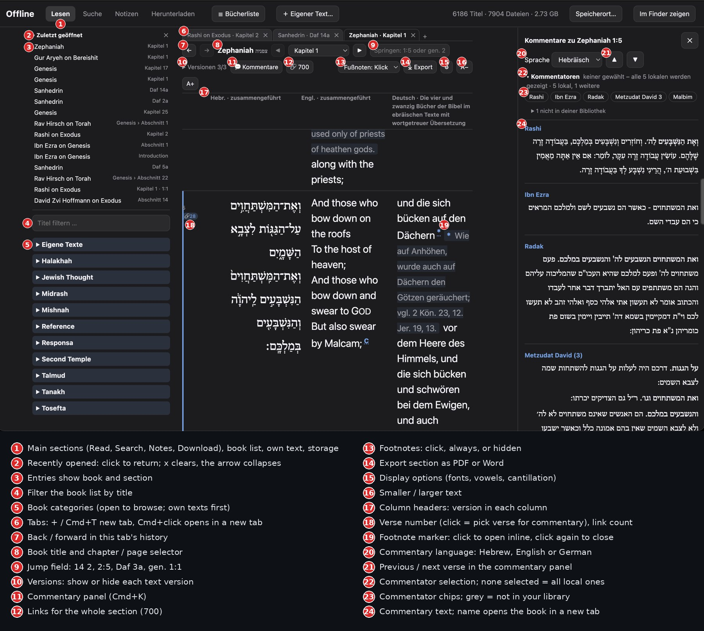
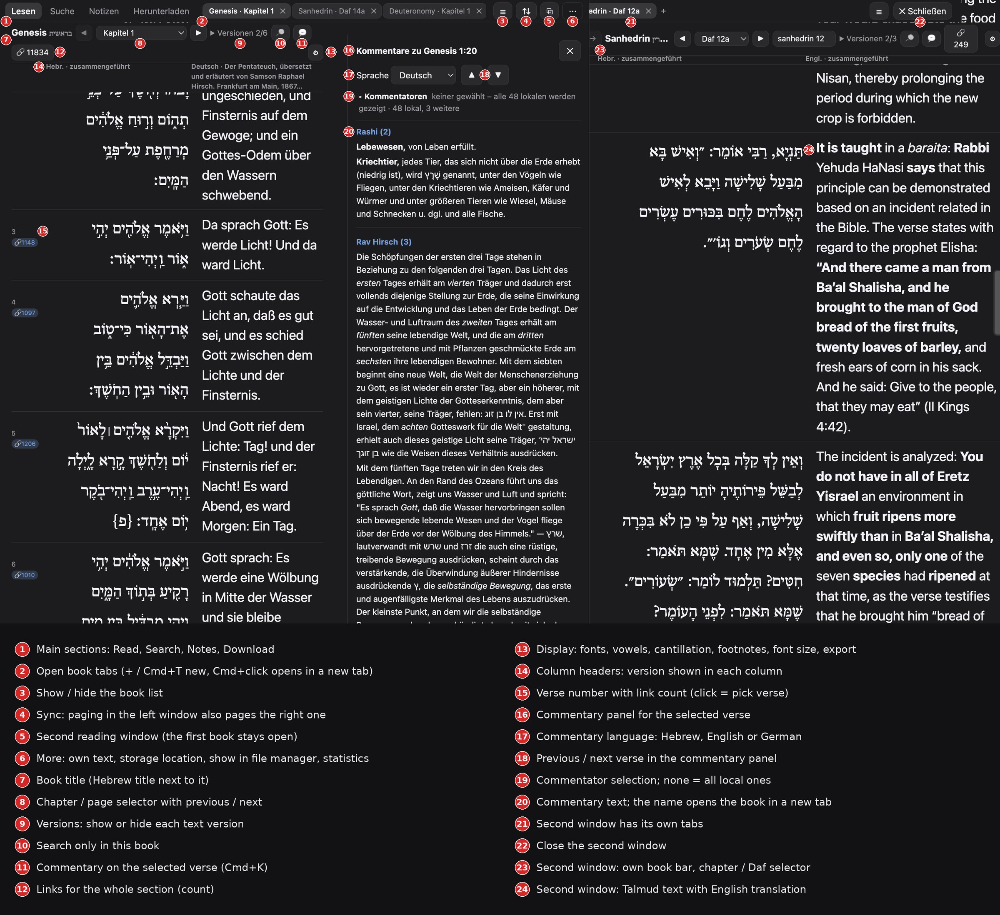

<h1 align="center">Safran סַפְרָן</h1>

<b>Offline library for Tanakh, Talmud, Midrash and commentaries, with German translations that are hard to find anywhere else.</b> For macOS and Windows. Free and open source.

  
  
  
  
  

<b>English</b> · <a href="README.de.md">Deutsch</a>

 <i>Zephaniah 1: Hebrew, English and German side by side, book list and history on the left, commentary on the right.</i>

Safran puts the Sefaria library on your own computer: you choose which books and languages to download once, then read, search and annotate them without an internet connection. On top of that it ships its own collection of **German translations and commentaries** (Zunz, Philippson, Mendelssohn, Herxheimer, Hertz, Rashi after Bamberger, Midrash Rabbah, More Nevuchim …) and a **dictionary shelf** (BDB, Gesenius, Jastrow, Levy, Krauss) that is searchable by headword and full text. Safran is an independent project and **not affiliated with Sefaria**.

## Quick start

1. **Download** the installer for your system from the [latest release](https://github.com/mitkin89/Safran/releases/latest) and open it. The app is not signed with a paid certificate, so the first start needs one extra click: see [First start](#first-start-on-macos-and-windows).
2. **Choose texts:** open *Download* (⋯ menu), load the catalog once (~22 MB), tick categories or single books and the languages you want (Hebrew, English, German). The storage location can be changed, e.g. to an external drive.
3. **Read:** pick a book from the list, type a passage into the jump field (`2:5`, `Daf 3a`, `gen. 1:1`) and open the commentary panel with Cmd+K. Double-click any word to look it up in the dictionaries.

The bundled German texts and dictionaries are available immediately, before anything is downloaded.

## What Safran can do

<table>
<tr>
<td width="50%" valign="top"><b>📖 Verse by verse, in three languages</b> Hebrew, English and German side by side, aligned verse by verse, with footnotes inline, chapters and Talmud pages via arrow keys, and a second reading window for parallel passages.</td>
<td width="50%" valign="top"><b>🇩🇪 German texts you won't find elsewhere</b> 290+ versions, many not on Sefaria: Zunz, Philippson, Mendelssohn (Biur), Herxheimer, Hertz, Hirsch, Rashi and Kitzur Shulchan Arukh (Bamberger), Midrash Rabbah, More Nevuchim …</td>
</tr>
<tr>
<td width="50%" valign="top"><b>📚 A dictionary shelf</b> BDB, Gesenius, Jastrow, Levy (Talmud and Targumim) and Krauss ship with the app; add your own ABBYY-Lingvo DSL dictionaries. Search headwords or the full article text, pick which dictionaries to search, browse the headword list of each one.</td>
<td width="50%" valign="top"><b>🔤 Morphology at a click</b> The OSHB Tanakh carries lemma and morphology for every word: click a word for stem, form, person, gender and number, and the lemma is looked up in the dictionary.</td>
</tr>
<tr>
<td width="50%" valign="top"><b>💬 Commentary panel</b> Rashi, Ibn Ezra and more under the selected verse, in Hebrew, English or German. Pin it beside the text together with the dictionary.</td>
<td width="50%" valign="top"><b>🔎 Full-text search</b> Across everything you downloaded, including footnotes and your own texts. Ignores vowels and cantillation; words near each other, wildcards and fuzzy matching for variant spellings; recent searches and favourites.</td>
</tr>
<tr>
<td width="50%" valign="top"><b>🗺 Bible map and outlines</b> Places of each chapter on a map of Israel with distances and elevation profile, a detailed 1865 map of Jerusalem, topics, and outlines for 39 books with a 613 Mitzvot switch.</td>
<td width="50%" valign="top"><b>🎧 Hebrew audio</b> Reading of the Tanakh with verse markers; the verse being read is highlighted.</td>
</tr>
<tr>
<td width="50%" valign="top"><b>📜 Manuscripts and versions</b> Aleppo Codex, Dead Sea Scrolls, Septuagint with the Hebrew counterpart per word group, Targumim with morphology, parallel passages and Sefaria's link data.</td>
<td width="50%" valign="top"><b>✍️ Your own texts and notes</b> Import TXT, Word, CSV or JSON as an extra column or as a commentary; bookmarks and notes with export; tabs, history and sessions restored on the next start.</td>
</tr>
</table>

Details, keyboard shortcuts and the Tools menu: [docs/FEATURES.md](docs/FEATURES.md).

## Dictionaries

The *Wörterbuch* tab (or the 📖 button next to the commentary panel) opens the dictionary panel. Bundled with the app:

| Dictionary | Entries | Notes |
| --- | ---: | --- |
| BDB, Brown-Driver-Briggs (unabridged) | 10,022 | also by Strong and BDB number; verses linked |
| Gesenius, Hebräisches Handwörterbuch (1915) | 10,118 | |
| Jastrow, Dictionary of the Targumim, Talmud and Midrash | 32,466 | |
| Levy, Wörterbuch über die Talmudim und Midraschim (vols. 1–4) | 19,503 | abbreviations explained on hover, sources linked |
| Levy, Chaldäisches Wörterbuch über die Targumim (vols. 1–2) | 7,232 | abbreviations explained on hover, sources linked |
| Krauss, Griechische und lateinische Lehnwörter (part II) | 6,329 | abbreviations on hover, sources linked, cross-references *s. X* clickable |

- **Lookup** ignores vowel points and final-letter forms, strips the prefixes ו ה ב כ ל מ ש, and lists entries that start with your word. Suggestions appear while typing.
- **Full text:** tick *auch im Text* to search inside the articles, not only the headwords; hits are highlighted.
- **Choose dictionaries:** the 📚 button selects which dictionaries are searched; the choice is remembered.
- **Headword list:** the *☰ Stichwörter* button in a dictionary's title bar opens its complete, filterable headword list; a click looks the word up in that dictionary.
- **Linked sources:** citations such as *Rosh Hashanah 18b* open the passage in the reader (Cmd/Ctrl-click: new tab, Shift-click: second window) if the text is in your library.
- **Recent searches and favourites** sit under the search field; both are included in the notes export.
- **Your own dictionaries:** add `.dsl` / `.dsl.dz` files (ABBYY Lingvo format) under *Wörterbücher verwalten*. Tags like `[b]`, `[i]`, `[ref]` are rendered; citations marked with `{{ref:…}}` become clickable in Safran.
- Right-click a Hebrew word in the text → *Im Wörterbuch nachschlagen*, or double-click it.

## Texts that are not on Sefaria

Besides the Sefaria texts, Safran ships its own collection of German translations and commentaries in the `bundled/` folder: Zunz (1838), Philippson, Mendelssohn (Netivot ha-Shalom, Biur), Herxheimer, Hertz, Hirsch's Psalms, Rashi and Kitzur Shulchan Arukh (Bamberger), Midrash Rabbah, More Nevuchim and others. They are imported on first start and appear under *Eigene Texte*, as extra versions and commentators next to the Sefaria texts. Also bundled: the Westminster Leningrad Codex with morphology (OSHB), the Aleppo Codex, the Qumran scrolls, Targum Pseudo-Jonathan and Neofiti, and the Septuagint (CATSS). Sources and licenses: [SOURCES.md](SOURCES.md).

## Screenshots

<!-- TODO gallery: add the screenshots below to screenshots/ and replace the placeholders.
     Suggested captures (macOS, dark theme, window ≈ 1600×1000, zoom 100 %, SBL Hebrew installed):
     1. dictionary-fulltext.png   – Wörterbuch tab, query "אפוטרופוס", "auch im Text" ticked, 📚 showing "3 von 6",
                                     Levy + Jastrow + Krauss hits with highlights, Letzte Suchen/Favoriten visible.
     2. dictionary-headwords.png  – Krauss article with an abbreviation tooltip open and the ☰ Stichwörter list popped up.
     3. search-advanced.png       – Suche tab, "anf* · gott · erd*" with distance 10, result chips per book.
     4. map-jerusalem.png         – 🗺 map of Jerusalem (Wilson 1865) at high zoom with a place note.
     5. morphology.png            – OSHB column, a word clicked, the morphology popup and BDB entry in the dictionary panel.
     6. safran-tour.gif           – 10–15 s GIF: open a book → Cmd+K → double-click a word → dictionary → pin the panel.
     Keep each image ≤ 400 KB (JPEG q80 or optimised PNG). -->

*Two reading windows side by side (Genesis with commentary panel on the left, Sanhedrin on the right) with the compact toolbar.*

## First start on macOS and Windows

The app has no paid developer certificate (Apple's and Microsoft's certificates cost money), so the first start needs one extra step. The app is not broken. On macOS it is signed locally (ad-hoc).

**macOS** – if you see *"Safran is damaged and can't be opened"* or *"the developer cannot be verified"*:

1. Drag **Safran** into the **Applications** folder.
2. Easiest: open the `.dmg` again and right-click **Safran freischalten.command** → *Open* → *Open*. Or run in the Terminal: `xattr -cr /Applications/Safran.app`
3. For the message *"developer cannot be verified"* use *System Settings → Privacy & Security → Open Anyway* (scroll down), or right-click the app → *Open* → *Open*.

**Windows** – SmartScreen may show *"Windows protected your PC"*: click **More info** → **Run anyway**.

### Data size (rough figures)

All merged Hebrew texts ≈ 2.8 GB, English ≈ 0.5 GB, German translations (288 versions, mostly Tanakh, Talmud, Mishnah) ≈ 0.13 GB. All JSON texts including every single version ≈ 7 GB. Sefaria's link data ≈ 680 MB, Hebrew audio ≈ 3 GB (per book, optional). Texts are downloaded from the public Sefaria export, only what you choose, and Safran never uploads anything to Sefaria.

## Interface

The interface is available in German, English and Hebrew (⋯ → *Sprache*), with a light, dark or automatic theme and an adjustable overall size. Hebrew text is set in **SBL Hebrew** if it is installed (free from the Society of Biblical Literature). Safran can check GitHub for a newer version on request or at every start.

## Contributing

- **Bugs and ideas:** open an [issue](https://github.com/mitkin89/Safran/issues). Please mention your system, the Safran version (⋯ menu) and, for text problems, the book and passage.
- **Texts:** your own translations or commentaries can be exported with ⋯ → *Eigene Texte für GitHub exportieren …* and offered as a pull request into `bundled/`. Please state the source and license.
- **Code:** see [docs/DEVELOPMENT.md](docs/DEVELOPMENT.md) for running from source, building and tests. The interface strings live in `i18n.js` (English) and `i18n-he.js` (Hebrew).

## About

The name is the Hebrew word **סַפְרָן** (*safran*): a scribe, in modern Hebrew a librarian, from the same root as *sefer* (book). The app is built by [talmud.de](https://talmud.de). It never uploads anything to Sefaria; Sefaria's texts are not part of the app.

## More

- [All features, keyboard shortcuts, Tools menu](docs/FEATURES.md)
- [Development, build and tests](docs/DEVELOPMENT.md)
- [Sources and licenses](SOURCES.md): Sefaria, OSHB, ETCBC, CATSS, dictionaries, maps, audio, outlines
- [Changelog](CHANGELOG.md)

## License

The source code of this app is released under the [MIT License](LICENSE). Texts, dictionaries and maps have their own licenses, see [SOURCES.md](SOURCES.md) and [LICENSE-CATSS.md](LICENSE-CATSS.md).
