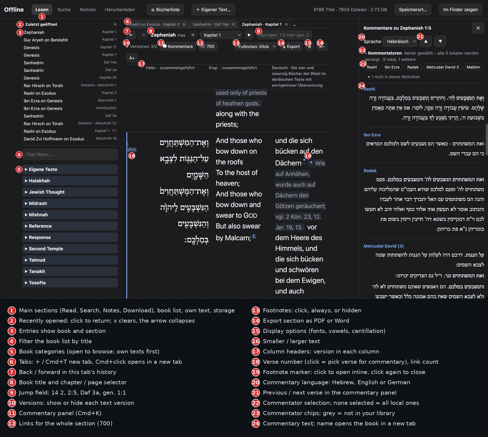
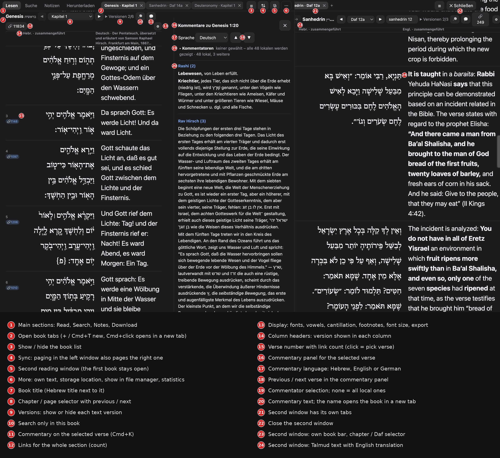

# Sefaria Mac

An offline library for [Sefaria](https://www.sefaria.org) texts on macOS (Electron). On launch it opens the **Offline Library** directly; a **Werkzeuge** (Tools) menu adds book download and upload-preparation helpers.

> **Not affiliated with Sefaria.** This is an independent, unofficial project. The app contains **no texts**: they are downloaded to your computer from the public Sefaria export. The app never uploads anything to Sefaria.

> The user interface is currently in German.



*Zephaniah 1: Hebrew, English and German side by side, with the book list and history on the left and the commentary panel on the right.*



*Two reading windows side by side (Genesis with commentary panel on the left, Sanhedrin on the right), with the compact toolbar.*

## Features

- **Download:** load the catalog once (~22 MB), tick categories or single books, choose languages (Hebrew, English, German) and download. By default the merged version per language is used; German translations are downloaded in full. Interrupted downloads can be resumed; existing files are skipped.
- **Reading:** Hebrew, English and German side by side, aligned verse by verse. Chapters / Talmud pages (2a, 2b …) via drop-down or arrow keys. Footnotes open inline in the text (click the small marker). Individual versions can be switched on and off.
- **Tabs, history and sessions:** multiple tabs with back/forward per tab, a "recently opened" list, and open tabs are restored on the next start.
- **Jump field:** type a location (`3`, `2:5`, `14 2`, `Daf 3a`, `gen. 1:1`, `Kapitel 14 Vers 2`); abbreviated book names work.
- **Search:** full-text search across all downloaded texts (including footnotes and your own texts), Hebrew vowels and cantillation ignored, optional "whole words with prefixes", category filter. Advanced search: up to three words near each other (adjustable distance, optional word order), wildcards (`anf*`, `m?er`) and fuzzy matching for variant spellings (Raschi/Rashi). In-page search with Cmd+F, also in the commentary panel.
- **Links (Verknüpfungen):** download Sefaria's link data once (~680 MB), then see links per verse, grouped by category and book, with text preview.
- **Commentary panel (Cmd+K):** shows commentaries on the selected verse (e.g. Rashi and Ibn Ezra one below the other) in the chosen language. If no commentator is selected, all locally available ones are shown.
- **Your own texts:** import TXT, Word (.docx), CSV, JSON or Sefaria upload CSV files, several at once (drag & drop works). Your text appears as an extra column next to the original and is compared line by line with it.
- **Notes and bookmarks**, **display options** (font sizes, hide vowels/cantillation), **export** to PDF or Word, **update check** against the Sefaria export.
- **Tools menu:** download a book or chapter range as CSV/TXT/JSON; prepare and check CSV files for Sefaria upload (duplicates, gaps, order, HTML, control characters, segment counts compared to an existing Sefaria text).
- Hebrew text is set in **SBL Hebrew** if it is installed (free from the Society of Biblical Literature), otherwise a fallback font is used.

### Keyboard shortcuts

| Shortcut | Action |
| --- | --- |
| ← / → | previous / next section |
| Cmd+T / Cmd+W | new tab / close tab (Cmd+Shift+W closes the window) |
| Cmd+1…9 | select tab (9 = last), Cmd+Alt+←/→ tab left/right |
| Cmd+[ / Cmd+] | back / forward |
| Cmd+F | search in the displayed text |
| Cmd+K | commentary panel |
| Cmd+B | show/hide book list |
| Cmd+Shift+O | open the Offline Library |

## Data size (rough figures)

All merged Hebrew texts ≈ 2.8 GB, English ≈ 0.5 GB, German translations (288 versions, mostly Tanakh, Talmud, Mishnah) ≈ 0.13 GB. All JSON texts including every single version ≈ 7 GB. The storage location can be changed ("Speicherort…"), e.g. to an external drive.

## Getting started

1. Install Node.js 22 LTS.
2. In the project folder:

```bash
npm install
npm start
```

## Build a normal Mac app

```bash
npm run dist
```

The `.dmg` ends up in `dist/`. The app is not code-signed: on first launch, right-click the app and choose "Open".

## Tests (logic only, no UI)

```bash
npm test
```

## Sefaria source and licenses

All texts, the catalog and the link data come from the public **Sefaria export** ([Sefaria/Sefaria-Export](https://github.com/Sefaria/Sefaria-Export), files hosted in Google Cloud Storage). Sefaria itself is an open-source project: <https://github.com/Sefaria/Sefaria-Project> · <https://www.sefaria.org>.

The texts are **not** covered by this project's license. Each text version has its own license (mostly Creative Commons, some public domain, some restricted); it is listed in the version information on Sefaria and in the exported files. If you reuse or redistribute texts, please follow those licenses and credit Sefaria and the original sources. Texts you import yourself stay on your computer.

## License

The source code of this app is released under the [MIT License](LICENSE).
- Cmd+F durchsucht auch den geöffneten Kommentar-Bereich; identische, mehrfach verknüpfte Kommentartexte erscheinen nur einmal.
- **Erweiterte Suche** (Reiter „Suche“): bis zu drei Wörter in der Nähe voneinander (Abstand wählbar, optional in fester Reihenfolge), Platzhalter `*` und `?` (z. B. `anf*`, `erd*`) und **Fuzzy** für ähnliche Schreibweisen (Raschi/Rashi, Avraham/Abraham). Eine Hilfe mit Beispielen steht aufklappbar unter den Eingabefeldern.
- **Kategorien in der Suche**: Rechts steht dauerhaft eine durchsuchbare Liste mit Häkchen (wie die Bücherliste). Ohne Häkchen wird überall gesucht; mit Häkchen nur in den gewählten Kategorien; „Alle Kategorien auswählen“ hebt die Auswahl auf.
- **Reihenfolge wie auf Sefaria**: Hauptkategorien (Tanakh, Mishnah, Talmud, Midrash, Halakhah …), Bücher des Tanach und Traktate in der gewohnten Reihenfolge statt alphabetisch – in der Bücherliste, im Reiter „Herunterladen“ und in der Suche.
- **Zweites Lesefenster**: Knopf „⧉ Zweites Fenster“ (oben) teilt das Fenster in zwei Hälften. Rechts läuft ein zweiter Leser mit eigenen Tabs, eigenem Verlauf, Kommentar-Bereich und Bücherliste (☰), links bleibt das erste Buch offen. Alt+Klick auf ein Buch in der linken Liste öffnet es direkt rechts. Die Trennlinie lässt sich ziehen; Cmd+F gilt für das Fenster, in dem du zuletzt geklickt hast. Rechts gibt es nur den Reiter „Lesen“; Suche, Herunterladen und eigene Texte bleiben im linken Fenster.
- „Zuletzt geöffnet“ ist beim Start eingeklappt (Klick auf die Überschrift klappt es auf; die Wahl wird gemerkt).

## New in 1.1

- **Search:** results and book chips follow the Sefaria order (Tanakh, Mishnah, Talmud, …); larger result text; search inside categories *and* single books (e.g. just Genesis); per-book hit chips and CSV export; searches run in a background thread.
- **Reader:** "🔎 In diesem Buch" searches only the open book; right-click a verse to copy its reference or open it on sefaria.org; "⇅ Gleichlauf" syncs paging with the second window; Cmd/Ctrl+W closes the tab of the window you are working in.
- **Own texts:** re-importing the same title/version asks before overwriting; ⟳ re-reads the original source file; word-level diff against an existing version; "CSV" saves an own text as a Sefaria upload CSV.
- **Security:** navigation is locked to local files (including the second pane), stricter CSP, drag-and-drop file paths are allow-listed, PDF export via temp file.
- **Windows:** `npm run dist:win` builds an installer and a portable exe (Ctrl instead of Cmd, Explorer instead of Finder, Ctrl+Tab for tabs); a GitHub Actions workflow builds macOS and Windows.
- **Compact toolbar:** the header and book bar shrank from about 175 px to about 90 px: one row for the app tabs and open books, a ⋯ menu for rarely used items (own text, storage location, show in file manager, statistics), and a ⚙ panel for footnotes, font size and export.
- **Context menu on books and history:** right-click a book in the list or in the history for *Open*, *Open in new tab* and *Open in second window* (if the second window already has a book open, a new tab is created there). The second window now lays out correctly and no longer cuts off its right side.
- The talmud.de logo appears on the empty start page and in the ⋯ menu.
- **Suggestions while typing:** the jump field and the new-tab field suggest book names as you type (e.g. "ge" → Genesis); arrow keys and Enter or a click pick one. The new-tab page shows the logo too.
- The same right-click menu (*Open*, *Open in new tab*, *Open in second window*) works on commentator names in the commentary panel.
- The links panel lists categories in a fixed order: Tanakh, Mishnah, Tosefta, Talmud, Responsa, then everything else (by number of links).
- The language selection is remembered across books: if you switch English off, other books open without English too (unless a book has no German text, then English is shown as a fallback).
- **Own commentaries in the commentary panel:** import your own text via "Eigener Text…" and name it `<Commentator> on <Book>` (Sefaria's naming, e.g. `Mein Kommentar on Genesis`), with the same chapter/verse structure as the book (one line per verse). It then appears as a commentator in the commentary panel next to the Sefaria commentaries, for the matching verse and in the language of the own text. No Sefaria links are needed.
- Fixed: the link badge next to a verse number could appear twice.
- The commentator chips only list commentaries that exist locally **in the chosen language**; those available only in another language, and those not downloaded, are collapsed below with a note.
- Own texts in Sefaria upload format (`Title chapter:verse<TAB>text`, also as `.txt`) are now recognised, including gaps (verses without a note) and the title from the references. Used for own commentaries such as `Hertz on Deuteronomy`.
