<p align="center"></p>

<h1 align="center">Safran <span dir="rtl">סַפְרָן</span></h1>

<p align="center"><b>Study Tanakh, Talmud and Midrash offline — Hebrew word by word with German translation, dictionaries and commentaries.</b><br>A free desktop library for students, teachers, rabbis and scholars.</p>

<p align="center">
  <a href="https://github.com/mitkin89/Safran/releases/latest"></a>
  <a href="https://github.com/mitkin89/Safran/releases/latest"></a>
  <a href="https://github.com/mitkin89/Safran/releases/latest"></a>
</p>

<p align="center"><sub>Free and open source · no account · works offline · interface in English, German and Hebrew</sub></p>

<p align="center">
  <a href="https://github.com/mitkin89/Safran/releases/latest"></a>
  <a href="LICENSE"></a>
  <a href="#open-datasets"></a>
</p>

<p align="center"><b>English</b> · <a href="README.de.md">Deutsch</a> · <a href="#install">Install</a> · <a href="CHANGELOG.md">What’s new</a> · <a href="docs/FEATURES.md">All features</a></p>

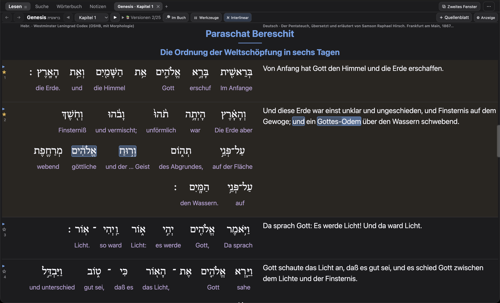

<p align="center"><sub>Genesis 1: the Hebrew text, S. R. Hirsch’s German translation and a German line under every Hebrew word. A click on a word highlights its counterpart.</sub></p>

## What you can do

- 📖 **Read Hebrew word by word.** Zunz and Philippson put German under every word of the whole Tanakh; Mendelssohn, Goldschmidt, Hirsch, Breuer and others cover single books.
- 🔎 **Look up any word.** A double-click opens Jastrow, BDB, Gesenius, Levy and more; a click shows grammar, forms and how translators render it.
- 📚 **Over 50 German works included** — Bible translations and commentaries, Talmud and Midrash translations, Josephus, Graetz, Ginzberg — plus all of Sefaria’s library to download.
- 📜 **Compare the ancient versions.** Septuagint, Qumran scrolls, Samaritan Pentateuch, Peshitta, Onkelos and the Aleppo Codex beside the Hebrew.
- ✍️ **Prepare lessons.** Collect passages in notebooks and source sheets and export them as PDF or Word.
- 🔒 **Everything stays on your computer.** No account needed; once installed, it works without internet.

<table>
<tr>
<td width="33%" valign="top">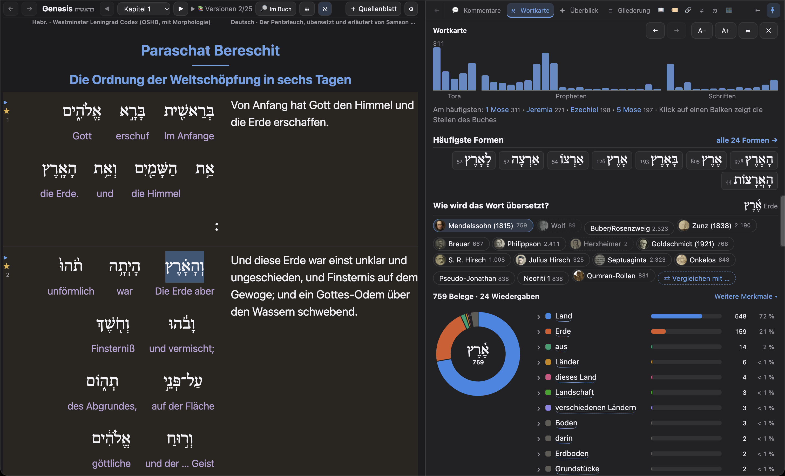<br><sub><b>Word study</b> — forms, frequency and how translators render a word</sub></td>
<td width="33%" valign="top">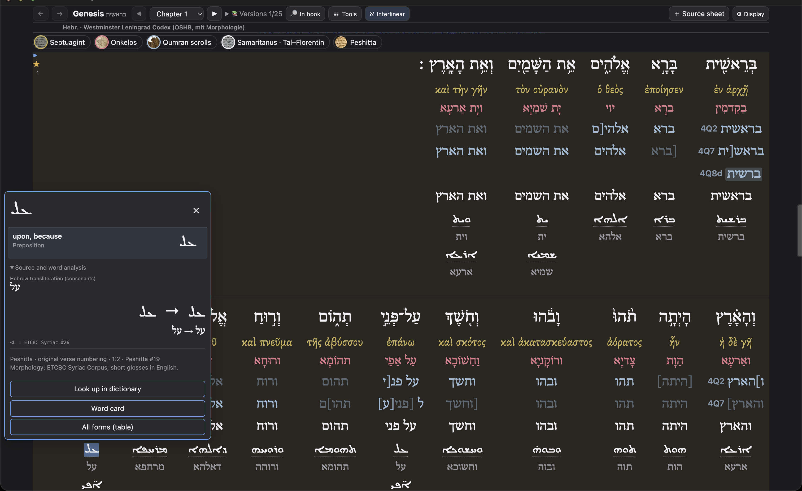<br><sub><b>Ancient versions</b> word by word under the Hebrew</sub></td>
<td width="33%" valign="top">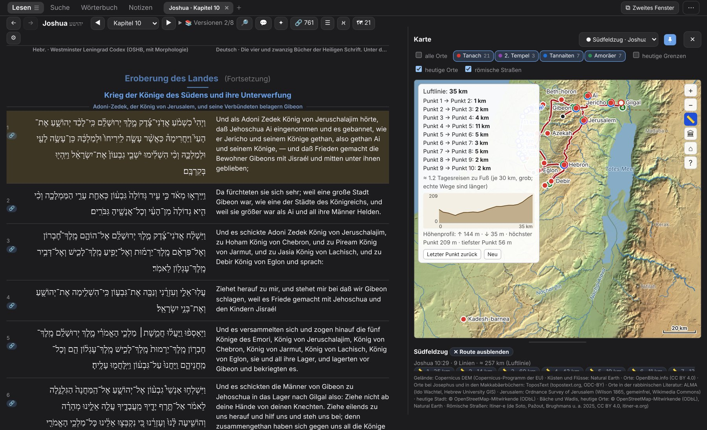<br><sub><b>Bible maps</b> — places, routes, distances and elevation</sub></td>
</tr>
<tr>
<td width="33%" valign="top">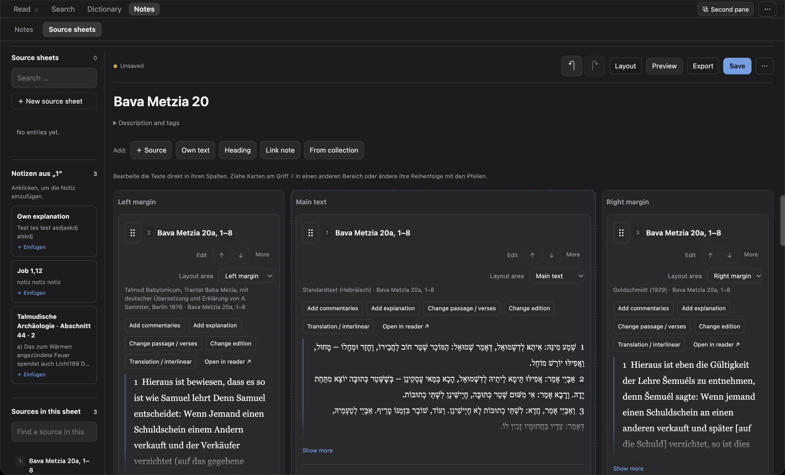<br><sub><b>Source sheets</b> — text and translations side by side, ready to print</sub></td>
<td width="33%" valign="top">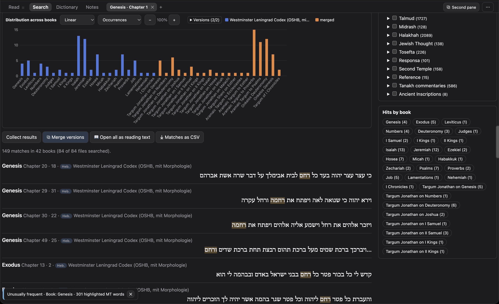<br><sub><b>Search</b> — words, phrases and dictionary forms across the library</sub></td>
<td width="33%" valign="top">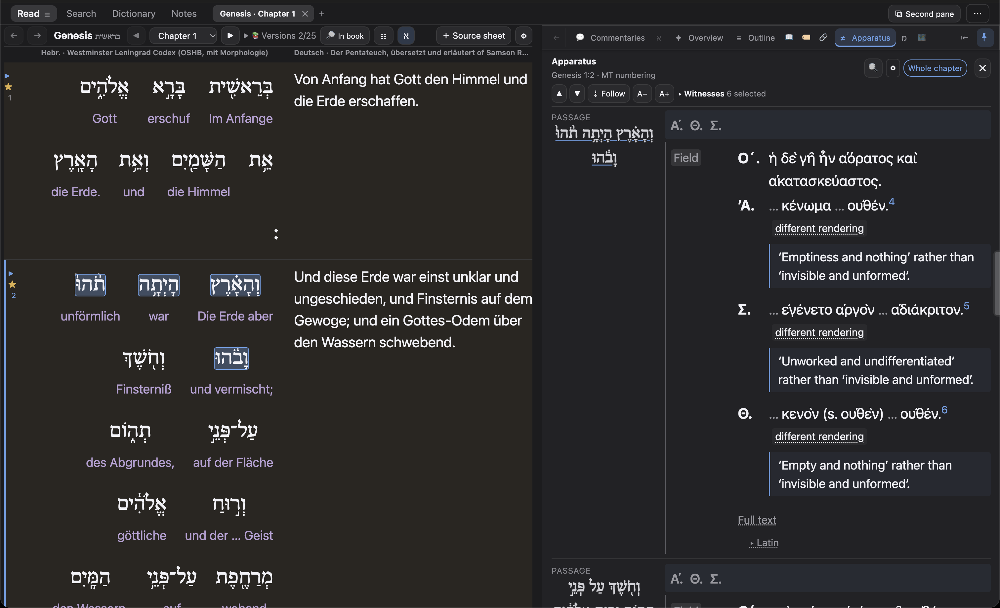<br><sub><b>Textual apparatus</b> — Qumran, LXX, Hexapla, Peshitta</sub></td>
</tr>
</table>

## Install

Download the file for your system from the [latest release](https://github.com/mitkin89/Safran/releases/latest):

| System | File | How to start |
| --- | --- | --- |
| macOS (Apple Silicon: M1 or newer) | `.dmg` | Open it and drag Safran into Applications. |
| Windows | Setup `.exe` or portable `.exe` | Run the installer, or start the portable app directly. |
| Linux | `.deb` for Intel/AMD (`amd64`) or ARM (`arm64`), or `.AppImage` for Intel/AMD | Install the Debian package, or make the AppImage executable and open it. |

<details>
<summary><b>macOS says Safran “can’t be opened”?</b></summary>

Safran has no paid Apple developer certificate. Open **System Settings → Privacy & Security** and choose **Open Anyway**. The DMG also contains **Safran freischalten.command**: right-click it and choose **Open**. Only do this for a download from this repository.
</details>

<details>
<summary><b>Windows shows a SmartScreen warning?</b></summary>

Choose **More info → Run anyway**. The warning appears because the app is not signed with a paid certificate. Only do this for a download from this repository.
</details>

### First steps

1. **Start reading.** The bundled texts and dictionaries are there on first launch. Pick a book and chapter; **Versions** chooses which editions appear side by side.
2. **Add your library.** Under **⋯ → Download…**, load the Sefaria catalog and choose books and languages. Downloaded texts work offline.
3. **Study a word.** Turn on **Interlinear**, click a Hebrew word for its grammar and word card, or double-click it to look it up in the dictionaries.
4. **Keep what you find.** Open **Notes** for a notebook, or use **＋ Source sheet** in the reader to collect a passage with its edition.

Change the interface language under **⋯ → Language**.

## Read and compare

- **Parallel editions:** Hebrew, English, German and ancient versions in columns, with tabs, passage navigation and a second reading pane.
- **Follow the text:** select a word to highlight its counterparts, open footnotes in place and follow references into other books.
- **Commentaries and context:** for a verse or chapter, Safran gathers commentaries, parallel passages, Talmud and Midrash links, halakhah, places and dictionary citations.
- **Reading tools:** adjustable fonts, light and dark themes, outlines, Bible maps, a Jewish calendar and optional Hebrew audio.

The **chapter overview** shows which words, roots, verb forms and names are unusually frequent in a chapter compared with its book or the whole Tanakh, highlights them in the text and finds similar chapters.

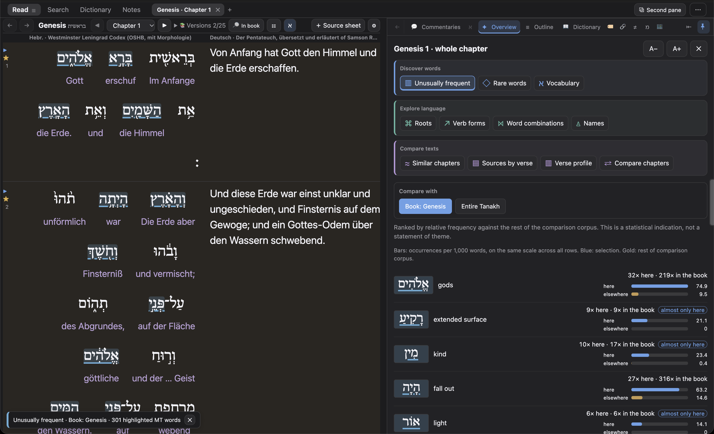

## Words, dictionaries and search

The **word card** connects grammar, attested forms, translation choices and occurrences: see how a translator renders a word throughout the Bible and open the passages behind each rendering.

The **dictionaries** work offline. Search by headword or inside the entries, or double-click a word in the reader:

- **Biblical Hebrew:** Brown–Driver–Briggs (BDB) and Gesenius.
- **Rabbinic Hebrew and Aramaic:** Jastrow and Levy, for Talmud and Midrash.
- **Ancient Greek:** Liddell & Scott and Pape, for the Septuagint and other Greek texts.
- **Jewish reference works:** Samuel Krauss (Greek and Latin loanwords; index of the *Talmudische Archäologie*) and Jacob Hamburger’s *Real-Encyclopädie für Bibel und Talmud*.

Abbreviations are explained when you hover over them, and cited passages open in the reader. You can add your own dictionaries in DSL format (the format of GoldenDict and ABBYY Lingvo).

**Search** finds phrases, wildcards and nearby words, filtered by language and book. A search for a Hebrew or Greek dictionary form also finds its inflected forms. [Concordance](docs/concordance.md) · [Tanakh clause search](docs/bhsa-clause-search.md)

## Notebooks and source sheets

**Notes** holds your notebooks and source sheets. A note can contain formatted text, tags and passages from specific editions.

A **source sheet** helps you prepare a lesson, a comparison or a study session:

1. Take a passage from the reader, or add it by reference, such as `Deuteronomy 1:1–10` or `Deuteronomy 1:2,5,10`, and choose the edition.
2. Add headings, your own text, commentaries and notes; place sources in the main text or in the margins.
3. Preview the page and export it as PDF, DOCX or HTML, or share the whole project as a file.

<table>
<tr>
<td width="50%">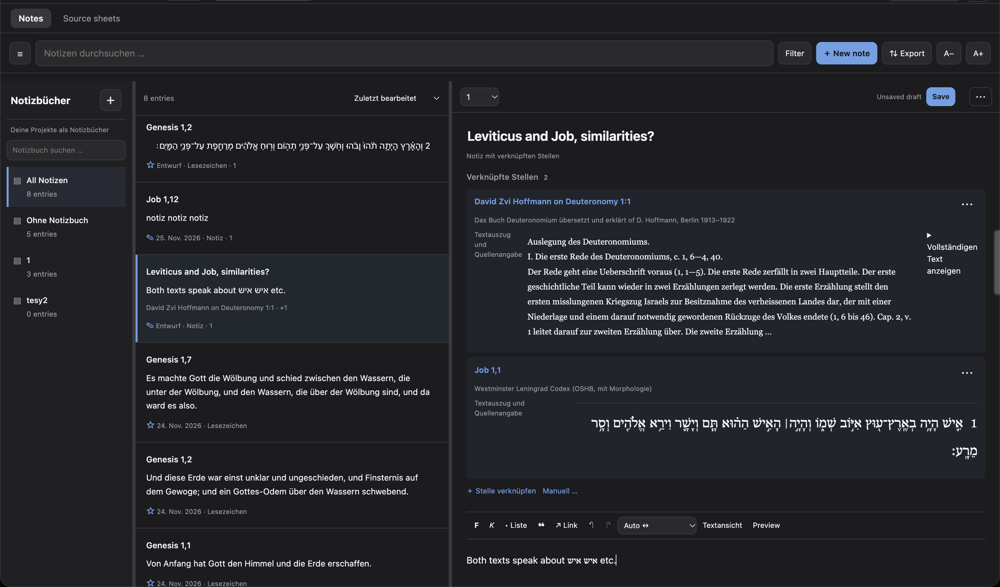</td>
<td width="50%">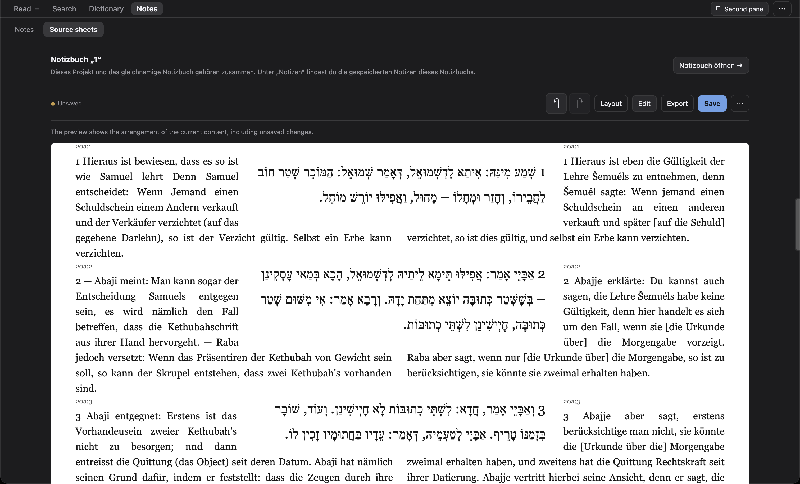</td>
</tr>
</table>

[Detailed workflow, formats and limits](docs/RESEARCH.md) (German)

## For scholars: apparatus and Masorah

<details>
<summary><b>Textual apparatus</b> — compare the Hebrew text with manuscripts and ancient versions</summary>

Read a verse or chapter, choose witnesses and inspect the source behind every variant.

| Witness | Comparison | Coverage |
| --- | --- | --- |
| **MA** | Aleppo text against Leningrad: consonants, vowels and word division | 39 books; losses in the Aleppo Codex marked |
| **SMR** | Samaritan Pentateuch, Tal–Florentin, with the original notes | Torah |
| **DSS** | Biblical Qumran scrolls, with manuscript sigla and reconstruction marks | 36 books |
| **LXX** | CATSS notes, retroversions (the Hebrew a Greek reading presupposes) and classified Septuagint readings | 38 books; Esther as a Rahlfs reading text |
| **Hex** | Field’s Hexapla: Aquila, Symmachus, Theodotion and the other Greek revisers | 39 books |
| **Syr** | Peshitta word alignment and Safran’s classified readings | 39 books |
| **Ken** | Kennicott’s readings of medieval manuscripts | 39 books |

Classifications, inferred Hebrew originals (*Vorlagen*) and explanations are study aids, not a critical edition; uncertain readings stay marked, and the source is always one click away. [Apparatus traditions](docs/apparatus-traditions.md)


</details>

<details>
<summary><b>Masorah</b> — 26,969 notes from 18 manuscripts with German working translations</summary>

Browse **26,969 transcribed notes** from **1,550 published pages of 18 manuscripts**, imported from Corpus Masoreticum / BIMA. Filter by manuscript, follow verses and preview cited passages. Each Hebrew note appears together with a **German working translation**; damaged, ambiguous or incomplete places stay marked. The import covers the pages published so far, not complete editions. [Method and coverage](docs/masora-import.md) · [Source license](app/LICENSE-MASORA.md)

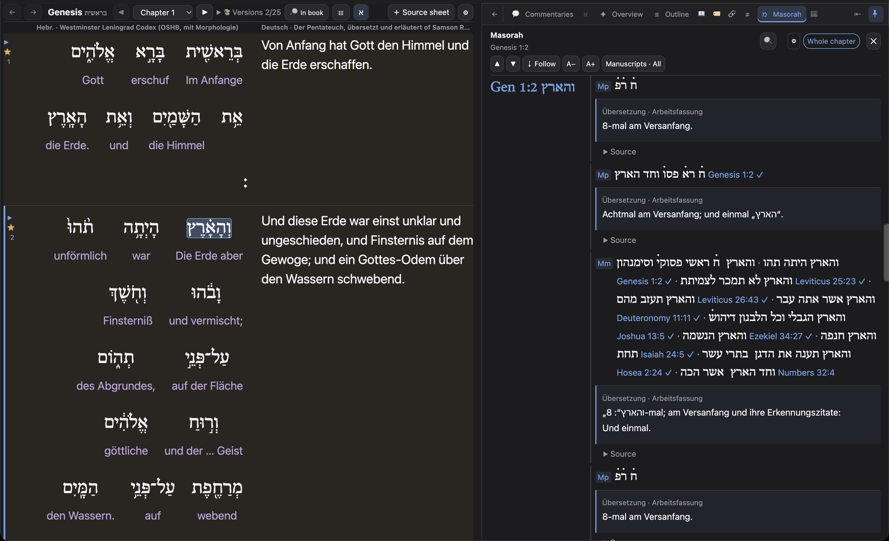
</details>

## What is in the library?

Safran bundles more than 50 German works: Bible translations and commentaries by Zunz, Philippson, Herxheimer, Mendelssohn, Hirsch, Hoffmann and Breuer; Rashi after Bamberger; Kautzsch’s Apocrypha; Talmud and Midrash translations; Josephus; Graetz; and Ginzberg’s *Legenden der Juden*. Also included are the Westminster text with morphology, the Aleppo Codex, the Qumran scrolls, the Septuagint, the Targumim and the Peshitta. Further books come from Sefaria, and you can import your own TXT, DOCX, CSV or JSON texts.

<details>
<summary><b>The full list of bundled German texts</b></summary>

| Work | Scope |
| --- | --- |
| Zunz, *Die vier und zwanzig Bücher der Heiligen Schrift* (1838) | whole Tanakh |
| Philippson, *Die Israelitische Bibel*, translation **and** commentary | whole Tanakh |
| Herxheimer, *Die vier und zwanzig Bücher der Bibel* (1843), translation **and** commentary | whole Tanakh |
| Kautzsch, *Die Apokryphen und Pseudepigraphen des Alten Testaments* (1900) | Ben Sira, Jubilees, Enoch, Tobit, Judith, Maccabees, Wisdom of Solomon and more |
| Mendelssohn, *Die fünf Bücher Mose*, German translation (Dessau 1815) | Torah; interlinear |
| Mendelssohn, *Netivot ha-Shalom* (translation, Taitsch and Biur) | Torah |
| Rashi after Bamberger · Hertz, Pentateuch commentary | Rashi: Exodus to Deuteronomy · Hertz: Exodus, Numbers, Deuteronomy |
| Goldschmidt, translation of the Torah (1921) | Torah |
| S. R. Hirsch, Torah and Psalms · Julius Hirsch, Isaiah and the Twelve Prophets · Joseph and Raphael Breuer: Joshua, Judges, Jeremiah, Ezekiel, Ezra, Nehemiah | translation and commentary |
| Wünsche's Midrash translations | Bemidbar and Devarim Rabbah, the Rabbah volumes on the five Megillot, Pesikta de-Rav Kahana, Midrash Shmuel, *Mechiltha* (Mekhilta de-Rabbi Yishmael, with Jakob Winter, 1909) |
| *Mischne Tora* (Mandelstamm, 1851) | 39 sections |
| *Führer der Unschlüssigen* (More Nevuchim) · *Kizzur Schulchan Aruch* (Bamberger) | |
| Ginzberg, *Die Legenden der Juden*, reading edition from his German manuscript, aligned with Sefaria's *Legends of the Jews* | vols. 1–4, with over 4,000 of Ginzberg's notes as footnotes; abbreviations explained on hover; 10,600 sources (Bible, Midrash, Talmud, Josephus, Philo …) linked in both directions; outline |
| *Schulchan Aruch* (Lederer): Orach Chajim, Jore Deah, Ewen haëser · *Avot DeRabbi Natan* (Pollak) · Tractate *Soferim* (Müller) · *Sanctification of the New Month* (Hildesheimer) | |
| Talmud: Rawicz (Megillah, Rosh Hashanah, Ketubot, Sanhedrin, Chullin I) · Straschun (Taanit) · Sammter (Bava Metzia, 1876) · Pinner (Berakhot, 1842, with notes, plus his *Einleitung in den Talmud* and preface; his translation of Maimonides’ Introduction to the Mishnah, segmented like Sefaria) | 19th-century German translations, by daf and segment |
| Mishnah from the Talmud: the mishnayot of all 37 tractates in Goldschmidt's translation, plus those of Pinner, Sammter, Rawicz and Straschun, as separate Mishnah versions | by chapter and mishnah, with the translator's footnotes |
| Josephus, *Antiquities*, *Jewish War* and *Against Apion* (German by Clementz, 1899/1900) | segmented like Sefaria (Whiston), with Niese's section numbers |
| H. Graetz, *Geschichte der Juden* (11 volumes, from zeno.org) | chapters and notes with footnotes, page marks of the print edition, outline |
| D. Hoffmann, *Das Buch Leviticus* and *Das Buch Deuteronomium* | translation and commentary |
| Samuel (Wolf) · Job (Dawidowicz) · the *Arba Megillot* (Raphael Breuer) | translation and commentary |
| S. Krauss, *Talmudische Archäologie* (vols. I–III, 1910–1912) | full text with endnotes, figures and outline; the index is a dictionary of its own |

</details>

When an app update brings changed library texts, Safran asks before replacing them and backs up the old files.

## Open datasets

Much of the material prepared for Safran is published as open, citable datasets with their own DOI on Zenodo:

| Dataset | Content | DOI |
| --- | --- | --- |
| [field-hexapla](https://github.com/mitkin89/field-hexapla) | Field’s *Origenis Hexaplorum quae supersunt* (1875): transcription, structured data and English footnotes | [10.5281/zenodo.24464811](https://doi.org/10.5281/zenodo.24464811) |
| [levy-dictionaries](https://github.com/mitkin89/levy-dictionaries) | Levy’s dictionaries of Talmud, Midrash and Targum | [10.5281/zenodo.24465108](https://doi.org/10.5281/zenodo.24465108) |
| [krauss-works](https://github.com/mitkin89/krauss-works) | Krauss: Greek and Latin loanwords; *Talmudische Archäologie* with index | [10.5281/zenodo.24465261](https://doi.org/10.5281/zenodo.24465261) |
| [hamburger-realencyclopaedie](https://github.com/mitkin89/hamburger-realencyclopaedie) | Hamburger’s *Real-Encyclopädie für Bibel und Talmud* | [10.5281/zenodo.24465434](https://doi.org/10.5281/zenodo.24465434) |
| [lxx-peshitta-apparatus](https://github.com/mitkin89/lxx-peshitta-apparatus) | Classified LXX and Peshitta readings against the Masoretic Text; MT–Peshitta word alignment | [10.5281/zenodo.24465785](https://doi.org/10.5281/zenodo.24465785) |
| [german-talmud-translations](https://github.com/mitkin89/german-talmud-translations) | Goldschmidt’s complete Talmud and 19th-century German Talmud translations | [10.5281/zenodo.24466136](https://doi.org/10.5281/zenodo.24466136) |
| [mendelssohn-pentateuch](https://github.com/mitkin89/mendelssohn-pentateuch) | Mendelssohn’s Pentateuch: Biur, Taitsch and the Dessau 1815 translation | [10.5281/zenodo.24466528](https://doi.org/10.5281/zenodo.24466528) |

## Offline use and your data

Reading, search, dictionaries, notebooks and source sheets work without an account or an internet connection. Downloading more books, refreshing calendar data and checking for updates need a connection. Your notes, projects and imported files are stored only on your computer — back up the library folder or export your notes before moving to another computer.

## Feedback

Found a problem or have an idea? [Open an issue](https://github.com/mitkin89/Safran/issues) and mention your system, Safran version, book, edition and passage. Contributions of texts should name their source and license.

## Sources and license

Safran’s source code is [MIT-licensed](LICENSE). **That license does not cover the bundled texts and datasets.** Some are public domain or CC BY/CC BY-SA; others allow only non-commercial use, including CATSS, Kennicott and several ETCBC/Tal–Florentin datasets. See the complete [list of sources and licenses](app/SOURCES.md) before redistributing or reusing data. Corpus Masoreticum / BIMA transcriptions are [CC BY-SA 4.0](app/LICENSE-MASORA.md).

Many texts can be downloaded from [Sefaria](https://www.sefaria.org)’s open library; each keeps its edition’s license. Safran is an independent project and is not affiliated with Sefaria.

## Development

```sh
npm ci
npm start
npm test
```

Application code and bundled data live in [`app/`](app/), documentation in [`docs/`](docs/). Build installers on the target system with `npm run dist` (macOS), `npm run dist:win` or `npm run dist:linux`. [Development guide](docs/DEVELOPMENT.md) · [All features and shortcuts](docs/FEATURES.md) · [Changelog](CHANGELOG.md)

<p align="center"><sub><b>סַפְרָן</b> means librarian in modern Hebrew, from the same root as <i>sefer</i>, book. Safran is built by <a href="https://talmud.de">talmud.de</a>.</sub></p>
