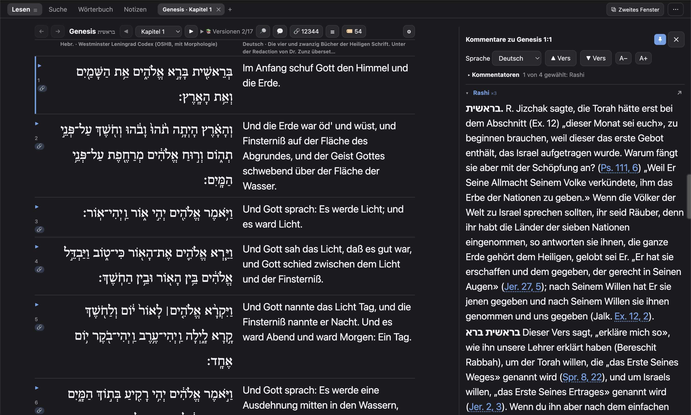
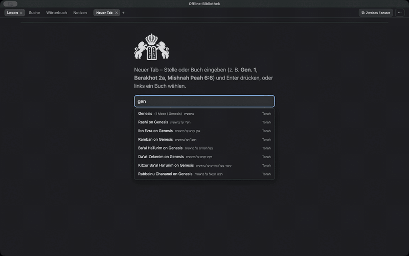
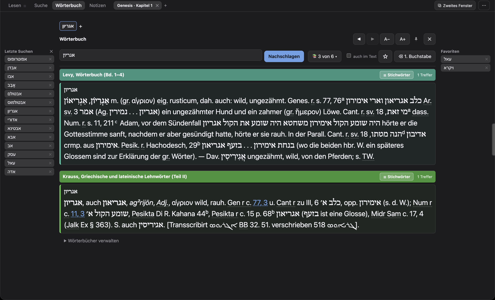
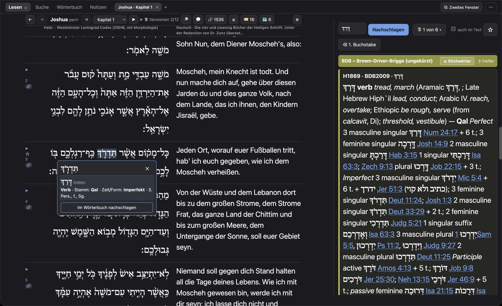
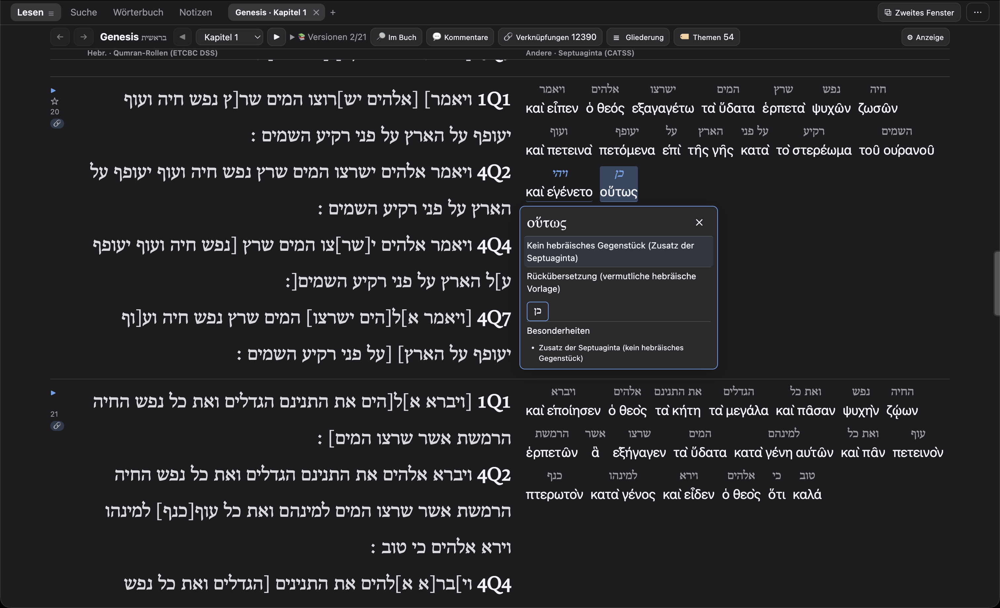
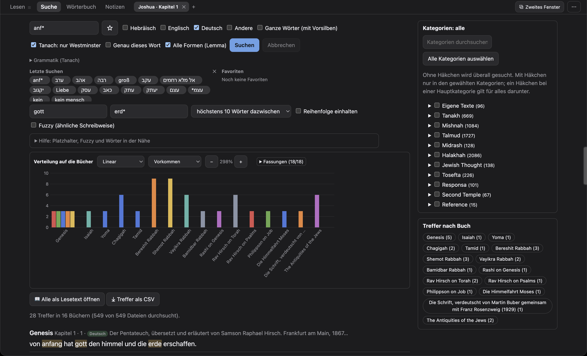
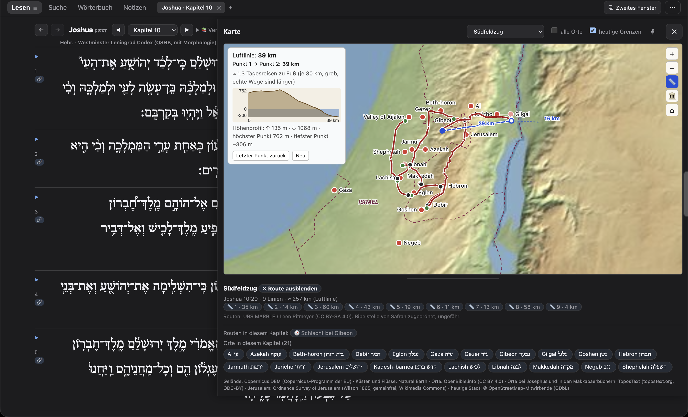
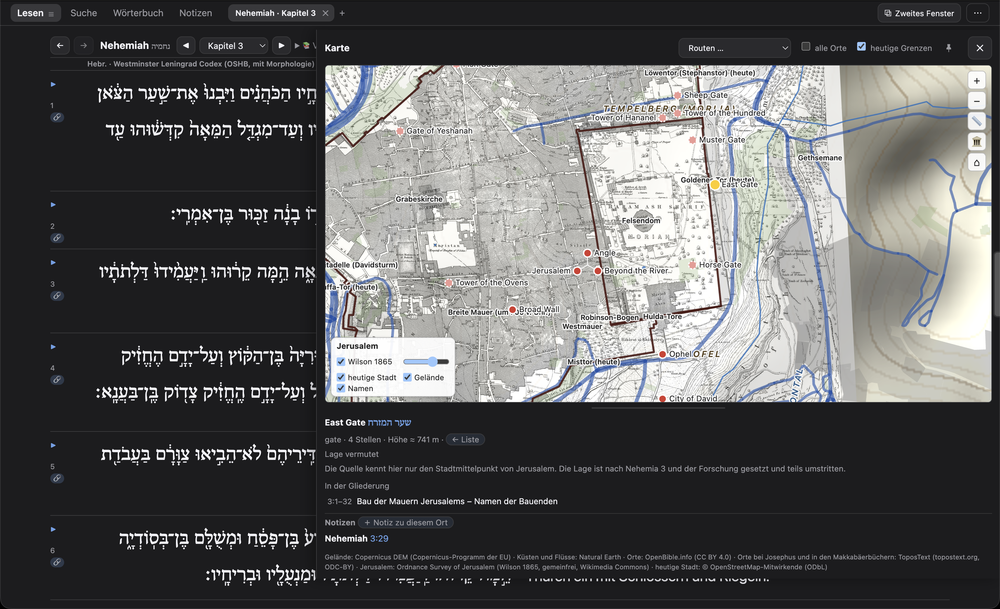

<h1 align="center">Safran סַפְרָן</h1>

<b>Your Jewish library, offline: Tanakh, Talmud, Midrash and commentaries in Hebrew, English and German, with a dictionary shelf built in.</b>

  
  
  
  
  

  

<b>English</b> &nbsp;·&nbsp; <a href="README.de.md">Deutsch</a>

   
  Genesis 1: Hebrew and German (Zunz) side by side, with Rashi in German in the commentary panel.

   
  ▶ Watch the overview video on YouTube

Safran is a free desktop app that keeps your texts on your own computer. Pick the books and languages you want from the [Sefaria](https://www.sefaria.org) library once, and read, search and annotate them afterwards without an internet connection. On top of that, Safran ships **345 German translations and commentaries** that are hard to find anywhere else, among them Louis Ginzberg's *Legenden der Juden* from his German manuscript, plus **seven dictionaries** with more than 88,000 entries. Safran is an independent project and not affiliated with Sefaria.

## Why Safran?

| | |
| --- | --- |
| 📴 **Works offline** | Texts, links, dictionaries, maps and audio live on your disk. Nothing is sent anywhere. |
| 🇩🇪 **German texts you won't find elsewhere** | Zunz, Philippson, Mendelssohn's Biur, Herxheimer, Hertz, Hirsch, Rashi after Bamberger, the Kautzsch Apocrypha, Midrash Rabbah, More Nevuchim, the Schulchan Aruch (Lederer), Ginzberg's *Legenden der Juden* … ready on first start. |
| 📚 **A dictionary shelf, not a single lookup** | BDB, Gesenius, Jastrow, Levy, Krauss and Hamburger's Real-Encyclopädie, searchable by headword *and* full text, with abbreviations explained on hover and sources that open in the reader. |
| 🔬 **Built for study** | Verse-by-verse alignment, morphology on click, a second reading window, Aleppo Codex, Dead Sea Scrolls, Septuagint, Bible map, outlines and Hebrew audio. |

## Quick start

1. **Download and open** the installer for your system from the [latest release](https://github.com/mitkin89/Safran/releases/latest). The app is not signed with a paid certificate, so the first start needs one extra click, see [FAQ](#faq).
2. **Choose your texts.** Open *Download* in the ⋯ menu, load the catalog once (about 22 MB), tick categories or single books, and pick the languages (Hebrew, English, German). The bundled German texts and the dictionaries are there before you download anything.
3. **Read.** Pick a book, type a passage into the jump field (`2:5`, `Daf 3a`, `gen. 1:1`), press Cmd+K for commentaries, and double-click any word to look it up in the dictionaries.

## What Safran can do

<table>
<tr>
<td width="50%" valign="top"><b>📖 Three languages, verse by verse</b> Hebrew, English and German side by side, aligned verse by verse. Footnotes open inline. Bible references in any text, also with Roman chapter numbers (<i>Jerem. XXIII, 24</i>), open on click. Chapters and Talmud pages via arrow keys.</td>
<td width="50%" valign="top"><b>💬 Commentary panel (Cmd+K)</b> Rashi, Ibn Ezra and more under the selected verse, in Hebrew, English or German. Pin it beside the text, together with the dictionary.</td>
</tr>
<tr>
<td valign="top"><b>🔎 Full-text search</b> Across everything you downloaded, including footnotes and your own texts. Ignores vowels and cantillation. Words near each other, wildcards, fuzzy matching for variant spellings.</td>
<td valign="top"><b>🔤 Morphology at a click</b> The OSHB Tanakh carries lemma and morphology for every word: click for stem, form, person, gender and number, and the lemma opens in the dictionary.</td>
</tr>
<tr>
<td valign="top"><b>⧉ Second reading window</b> Two books side by side, each with its own tabs, history and commentary panel. Page both windows together.</td>
<td valign="top"><b>📜 Manuscripts and versions</b> Aleppo Codex, Qumran scrolls, Septuagint with the Hebrew counterpart per word group: an <b>LXX–MT comparison</b> that marks pluses, minuses and alignment (interlinear switchable), Targum Pseudo-Jonathan and Neofiti with morphology, parallel passages, Sefaria's link data.</td>
</tr>
<tr>
<td valign="top"><b>🗺 Bible map and outlines</b> The places of each chapter on a map of Israel with distances and elevation profile, a detailed 1865 map of Jerusalem, outlines for 39 books with a 613 Mitzvot switch and for Ginzberg's <i>Legends</i>, and topics.</td>
<td valign="top"><b>🎧 Hebrew audio</b> A reading of the whole Tanakh by Abraham Schmueloff, downloadable per book. Every verse has its own ▶ button: click it to hear exactly that verse, and the reading carries on from there. The verse being read is highlighted.</td>
</tr>
<tr>
<td valign="top"><b>✍️ Your own texts and notes</b> Import TXT, Word, CSV or JSON as an extra column or as a commentary. Bookmarks and notes with export to JSON, Markdown, Word or PDF.</td>
<td valign="top"><b>🖥 Made for long reading</b> Light, dark or automatic theme, adjustable size, interface in German, English and Hebrew, tabs and sessions restored on the next start.</td>
</tr>
</table>

<a href="docs/FEATURES.md">All features, keyboard shortcuts and the Tools menu →</a>

## Dictionaries

Open the *Wörterbuch* tab, press the 📖 button next to the commentary panel, or double-click a word in any text. Seven dictionaries ship with the app:

| Dictionary | Entries | Extras |
| --- | ---: | --- |
| **BDB**, Brown-Driver-Briggs (unabridged) | 10,022 | also by Strong and BDB number; verses linked |
| **Gesenius**, Hebräisches Handwörterbuch (1915) | 10,118 | |
| **Jastrow**, Dictionary of the Targumim, Talmud and Midrash | 32,466 | |
| **Levy**, Wörterbuch über die Talmudim und Midraschim (vols. 1–4) | 19,503 | abbreviations on hover, sources linked |
| **Levy**, Chaldäisches Wörterbuch über die Targumim (vols. 1–2) | 7,232 | abbreviations on hover, sources linked |
| **Krauss**, Griechische und lateinische Lehnwörter (part II) | 6,329 | abbreviations on hover, sources linked, *s. X* cross-references clickable |
| **Hamburger**, Real-Encyclopädie für Bibel und Talmud (vol. 1, vol. 2 talmudic articles) | 2,753 | footnotes inline, sources linked |

- **Smart lookup:** vowel points and final-letter forms are ignored, the prefixes ו ה ב כ ל מ ש are stripped, and entries that start with your word are listed too. Suggestions appear while typing.
- **Full text:** tick *auch im Text* to search inside the articles, not only the headwords. Hits are highlighted.
- **Choose dictionaries:** the 📚 button selects which dictionaries are searched. The choice is remembered.
- **Headword list:** *☰ Stichwörter* opens the complete, filterable headword list of a dictionary.
- **Linked sources:** a citation such as *Rosh Hashanah 18b* opens the passage in the reader, if the text is in your library.
- **Bring your own:** add `.dsl` / `.dsl.dz` dictionaries (ABBYY Lingvo format) under *Wörterbücher verwalten*. Citations marked `{{ref:…}}` become clickable in Safran.

## German texts that are not on Sefaria

Safran bundles 345 German text files in `bundled/`. They are imported on first start and appear under *Eigene Texte* and as extra versions and commentators next to the Sefaria texts:

| Work | Scope |
| --- | --- |
| Zunz, *Die vier und zwanzig Bücher der Heiligen Schrift* (1838) | whole Tanakh |
| Philippson, *Die Israelitische Bibel*, translation **and** commentary | whole Tanakh |
| Herxheimer, *Die vier und zwanzig Bücher der Bibel* (1843), translation **and** commentary | whole Tanakh |
| Kautzsch, *Die Apokryphen und Pseudepigraphen des Alten Testaments* (1900) | Ben Sira, Jubilees, Enoch, Tobit, Judith, Maccabees, Wisdom of Solomon and more |
| Mendelssohn, *Netivot ha-Shalom* (translation, Taitsch and Biur) | Torah |
| Rashi after Bamberger · Hertz, Pentateuch commentary | Torah |
| Hirsch, Psalms · Midrash Bemidbar and Devarim Rabbah (Wünsche) · *Führer der Unschlüssigen* (More Nevuchim) · *Kizzur Schulchan Aruch* (Bamberger) | |
| Ginzberg, *Die Legenden der Juden*, reading edition from his German manuscript, aligned with Sefaria's *Legends of the Jews* | vols. 1–4, with over 4,000 of Ginzberg's notes as footnotes; abbreviations explained on hover; 10,600 sources (Bible, Midrash, Talmud, Josephus, Philo …) linked and shown as connections in both directions; outline |
| *Schulchan Aruch* (Lederer): Orach Chajim, Jore Deah, Ewen haëser · *Avot DeRabbi Natan* (Pollak) · Tractate *Soferim* (Müller) · *Sanctification of the New Month* (Hildesheimer) | |
| Samuel (Wolf) · Job (Dawidowicz) · the *Arba Megillot* (Breuer) | translation and commentary |

Also bundled: the Westminster Leningrad Codex with morphology (OSHB), the Aleppo Codex, the Qumran scrolls, Targum Pseudo-Jonathan and Neofiti, and the Septuagint (CATSS). Sources and licenses: [SOURCES.md](SOURCES.md).

## Screenshots

   
  Short tour: commentary and dictionary pinned beside the text, and the outline panel of a book.

   
  Dictionary tab: one search across Levy and Krauss, with recent searches on the left and favourites on the right.

   
  Click a Hebrew word: grammar at a glance, and the BDB entry opens next to the text.

   
  LXX–MT comparison: the Hebrew counterpart above every Greek word group, pluses and minuses of the Septuagint marked, and a click on a plus shows the likely Hebrew retroversion.

   
  Advanced search: wildcards and words near each other, a chart of hits per book, and a category filter.

   
  Bible map: routes from the text, distance measuring with an elevation profile, and all places of the chapter.

   
  Jerusalem on the 1865 Ordnance Survey map: the gates of Nehemiah 3, switchable layers, and a note per place.

## FAQ

<b>First start on macOS and Windows: "damaged", "unidentified developer", SmartScreen</b>

The app has no paid developer certificate (Apple's and Microsoft's certificates cost money), so the first start needs one extra step. The app is not broken. On macOS it is signed locally (ad hoc).

**macOS** – if you see *"Safran is damaged and can't be opened"* or *"the developer cannot be verified"*:

1. Drag **Safran** into the **Applications** folder.
2. Easiest: open the `.dmg` again and right-click **Safran freischalten.command** → *Open* → *Open*. Or run in the Terminal: `xattr -cr /Applications/Safran.app`
3. For *"developer cannot be verified"*: *System Settings → Privacy & Security → Open Anyway* (scroll down), or right-click the app → *Open* → *Open*.

**Windows** – SmartScreen may show *"Windows protected your PC"*: click **More info** → **Run anyway**.

<b>How much disk space do I need?</b>

Only what you choose. Rough figures: all merged Hebrew texts ≈ 2.8 GB, English ≈ 0.5 GB, German translations from Sefaria ≈ 0.13 GB. All JSON texts including every single version ≈ 7 GB. Sefaria's link data ≈ 680 MB (optional). Hebrew audio ≈ 3 GB in total, downloaded per book (optional). The storage location can be moved, for example to an external drive.

<b>Does it really work offline?</b>

Yes. You need a connection to download texts, links and audio, and for the optional update check. Everything else, including search, dictionaries, maps and the bundled German texts, works without internet.

<b>What about privacy?</b>

Safran has no account, no tracking and no server of its own. It downloads from the public Sefaria export and from GitHub releases, only what you ask for. Your notes, bookmarks, imported texts and dictionaries stay on your computer. Safran never uploads anything to Sefaria.

<b>How is Safran related to Sefaria?</b>

Safran is an independent, open-source project and not affiliated with Sefaria. The Sefaria texts are not part of the app; they are downloaded from the public [Sefaria export](https://github.com/Sefaria/Sefaria-Export) and keep their own licenses. Safran adds its own German texts, dictionaries and tools on top. The Tools menu can also prepare and check CSV files for a Sefaria upload.

<b>Which versions of macOS and Windows?</b>

Safran is an Electron app; installers for macOS (`.dmg`) and Windows (installer and portable `.exe`) are attached to each [release](https://github.com/mitkin89/Safran/releases). For Hebrew text, install the free **SBL Hebrew** font from the Society of Biblical Literature; Safran uses it automatically.

## Contributing

- **Bugs and ideas:** open an [issue](https://github.com/mitkin89/Safran/issues). Please mention your system, the Safran version (⋯ menu) and, for text problems, the book and passage.
- **Texts:** export your own translations or commentaries with ⋯ → *Eigene Texte für GitHub exportieren …* and offer them as a pull request into `bundled/`. Please state the source and license.
- **Code:** [docs/DEVELOPMENT.md](docs/DEVELOPMENT.md) explains running from source (`npm install`, `npm start`), building and tests. Interface strings live in `i18n.js` (English) and `i18n-he.js` (Hebrew).

## Sources and license

The source code is released under the [MIT License](LICENSE). Texts, dictionaries, maps and audio have their own licenses: Sefaria export, OSHB, ETCBC (Aleppo Codex, Qumran scrolls, Targumim, parallels), CATSS Septuagint ([LICENSE-CATSS.md](LICENSE-CATSS.md)), OpenBible.info, Copernicus DEM, Natural Earth, UBS Bible Routes, ToposText, OpenStreetMap and others. Everything is listed in [SOURCES.md](SOURCES.md). The changelog is in [CHANGELOG.md](CHANGELOG.md).

---

<b>סַפְרָן</b> <i>(safran)</i> is Hebrew for a scribe, in modern Hebrew a librarian, from the same root as <i>sefer</i>, book. Safran is built by <a href="https://talmud.de">talmud.de</a>.

