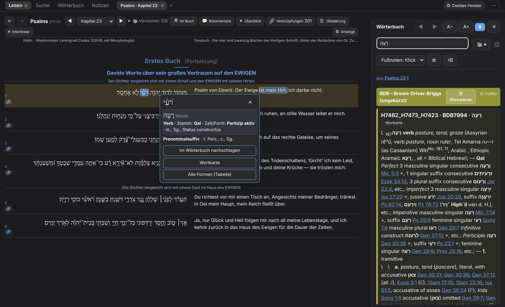
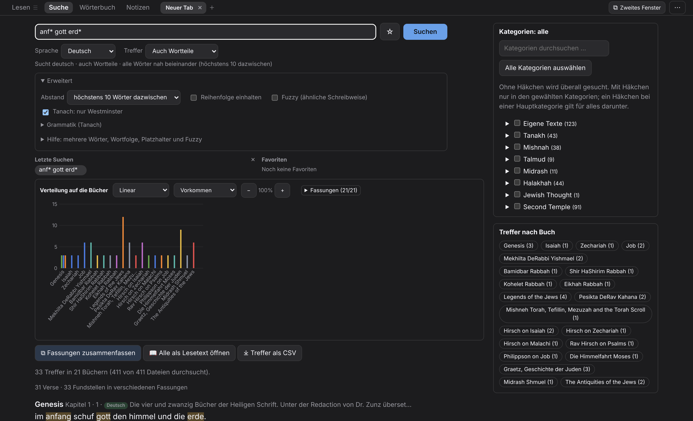
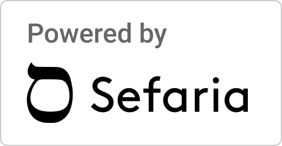

<h1 align="center">Safran סַפְרָן</h1>

<b>Your Jewish library, offline – with the whole Tanakh word by word in German.</b> Tanakh, Talmud, Midrash and commentaries in Hebrew, English and German, with a dictionary shelf built in.

  
  
  
  
  

  

<a href="https://www.youtube.com/watch?v=_htLzC7Q3Ug">▶ Overview video</a> &nbsp;·&nbsp; <a href="docs/releases/2.7.0.md"><b>New in 2.7.0</b></a> &nbsp;·&nbsp; <a href="#install">Install</a> &nbsp;·&nbsp; <b>English</b> &nbsp;·&nbsp; <a href="README.de.md">Deutsch</a>

   
  Genesis 1 as an interlinear: under every Hebrew word the German of Zunz (1838) and Goldschmidt (1921). A click on a word highlights its counterpart in the running translation.

   
  ▶ Watch the overview video on YouTube

Safran is a free desktop app for macOS, Windows and Linux that keeps your texts on your own computer. Pick the books and languages you want from the [Sefaria](https://www.sefaria.org) library once, and read, search and annotate them afterwards without an internet connection. New in 2.7.0: the **Apparatus** with manuscript and ancient-version readings, a shared study sidebar and richer passage statistics. The **whole Tanakh word by word in German** (interlinear) and a **word card** show how Hebrew words are translated. On top of that, Safran ships **more than 50 German works** (translations, commentaries and reference works) that are hard to find anywhere else, among them Louis Ginzberg's *Legenden der Juden* from his German manuscript, plus **ten dictionaries and reference works** with more than 300,000 entries. Safran is an independent project and not affiliated with Sefaria.

The **≠ Apparatus** pane is included in the official 2.7.0 release. It includes the Samaritanus / Tal–Florentin
apparatus, independent of selected reading columns. Read remarks on one level,
inspect morphology and source citations, and optionally include spelling variants.
Hover or focus a quoted word for its full Samaritan Hebrew/English verse context. Westminster / OSHB is the MT comparison base;
word-anchored verse correspondence and uncertain or different numbering remain
explicit. The header also offers whole-chapter view, verse navigation, follow
reading, saved font size and witness selection, plus the available source language
(currently English). It also includes Tov/Kraft CATSS notes plus separately labelled CATSS reading-text alignment flags (38 Tanakh books), biblical DSS (ETCBC/Abegg: 36 books, 262 manuscript sigla), and the available Digital Kennicott book apparatuses. Hover source sigla for manuscript metadata and source citations for edition context. Securely located MT headings are clickable and mark the corresponding words in the reader.

## Why Safran?

| | |
| --- | --- |
| 🔡 **The whole Tanakh word by word in German** | The *Interlinear* button offers Zunz and Philippson across all 39 books; Goldschmidt and German Mendelssohn (Dessau 1815) for the Torah, S. R. Hirsch for the Torah and Psalms, Julius Hirsch for Isaiah, Wolf for both books of Samuel, and the Septuagint, the Targumim and the Qumran scrolls can stand below it. |
| 🃏 **A word card for every Hebrew word** | *How is the word translated?* as a chart per translation, the complete paradigm as a table, and the renderings in the Septuagint, the Targumim and the Qumran scrolls. |
| ✦ **Everything on this passage** | One panel (Cmd+I) collects commentaries, parallels, legends, Talmud & Midrash, halakhah, words, places and dictionary articles for a verse, a folio or a chapter. |
| 📴 **Works offline** | Texts, links, dictionaries, maps and audio live on your disk. Nothing is sent anywhere. |
| 🇩🇪 **German texts you won't find elsewhere** | More than 50 works: Zunz, Philippson, Mendelssohn's Biur, Herxheimer, Hertz, Hirsch, Rashi after Bamberger, the Kautzsch Apocrypha, Midrash Rabbah, Josephus, Graetz, the Schulchan Aruch (Lederer), Ginzberg's *Legenden der Juden* … ready on first start. |
| 📚 **A dictionary shelf, not a single lookup** | Liddell & Scott, BDB, Gesenius, Jastrow, Levy, Krauss and Hamburger's Real-Encyclopädie: more than 300,000 entries, searchable by headword *and* full text, with abbreviations explained on hover and sources that open in the reader. |
| 📜 **Manuscripts and ancient versions** | The Samaritan Pentateuch (CACCHT / DT-UCPH) with Tal–Florentin readings applied to the Hebrew main text, the English parallel translation, red MT differences, word-linked original notes with small source citations, hover explanations for apparatus abbreviations/signs, and source morphology on unchanged forms, Aleppo Codex, the biblical Qumran scrolls and all 735 non-biblical ones with morphology, the Septuagint with clickable morphology and an LXX–MT comparison, Targum Onkelos, Pseudo-Jonathan and Neofiti. |
| 🔎 **Search that knows grammar** | Full-text search across everything, all forms of a word by lemma (Hebrew and Greek), and a grammar search by stem, tense, person, gender and number. |
| 🗺 **Built for study** | Verse-by-verse alignment, a second reading window, Bible map, outlines, Jewish calendar and a Hebrew reading of the whole Tanakh. |

## Install

Download the file for your system from the [latest release](https://github.com/mitkin89/Safran/releases/latest). Safran has no paid developer certificate, so the first start needs one extra step.

- **macOS** – open the `.dmg` and drag **Safran** into **Applications**.
  > ⚠️ **"Safran is damaged and can't be opened"?** The app is not broken; macOS says this about apps without a paid Apple certificate. Open the `.dmg` again and right-click **Safran freischalten.command** → *Open* → *Open* (the file name is German for "unlock Safran"). Or run in the Terminal: `xattr -cr /Applications/Safran.app`. For *"the developer cannot be verified"*: *System Settings → Privacy & Security → Open Anyway*.
- **Windows** – run the installer (or the portable `.exe`). If SmartScreen shows *"Windows protected your PC"*: **More info** → **Run anyway**.
- **Linux** – make the `.AppImage` executable once (`chmod +x Safran-*.AppImage`) and start it, or install the `.deb` (`sudo apt install ./safran_*.deb`).

More on this in the [FAQ](#faq).

### First steps

The interface comes in German, English and Hebrew. It starts in German or English, depending on your system language, and can be changed at any time under ⋯ → *Language* (*Sprache* in the German interface). This page uses the English names; the screenshots show the German interface.

1. **Choose your texts.** Open ⋯ → *Download…* (*Herunterladen…*), load the catalog once (about 22 MB), tick categories or single books, and pick the languages (Hebrew, English, German). The bundled German texts and the dictionaries are there before you download anything.
2. **Read.** Pick a book, type a passage into the jump field (`2:5`, `Daf 3a`, `gen. 1:1`), and press Cmd+K (Ctrl+K on Windows and Linux) for the commentaries. A new tab shows the weekly Torah portion and the Daf Yomi; a click opens them.
3. **Go deeper.** In a book of the Tanakh, press *Interlinear* for the German under every Hebrew word. Click a Hebrew word for its grammar and its *Word card* (*Wortkarte*), double-click any word to look it up in the dictionaries, and press Cmd+I (Ctrl+I) for *Everything on this passage* (*Alles zu dieser Stelle*).

## What Safran can do

<table>
<tr>
<td width="33%" valign="top"><b>🔡 Interlinear: Hebrew and German word by word</b> The <i>Interlinear</i> button puts a translation under every Hebrew word of the Westminster text. Tick the works you want in a small panel; several stand one below the other, each in its own colour. <b>Zunz</b> and <b>Philippson</b> cover all 39 books of the Tanakh, <b>Goldschmidt</b> and the <b>German Mendelssohn translation (Dessau 1815)</b> the Torah (all five books), <b>S. R. Hirsch</b> the Torah and Psalms and <b>Julius Hirsch</b> Isaiah and the twelve minor prophets, and <b>Wolf</b> both books of Samuel. The <b>Septuagint</b>, the Targumim <b>Onkelos, Pseudo-Jonathan and Neofiti</b> and the <b>Qumran scrolls</b> can be added the same way; in the scrolls, differences from the Masoretic text are marked. A click on a word highlights its counterparts in all versions.</td>
<td width="33%" valign="top"><b>🃏 Word card</b> Click a Hebrew word and open its <i>Word card</i>. <b>“How is the word translated?”</b> shows a ring chart and a list of the renderings in each aligned translation, in the Septuagint and in the Targumim; every rendering opens its verses. <b>All forms (table)</b> is the complete paradigm, ordered as in a grammar book, with the usual rendering under each form. Below that: distribution in the Tanakh, the dictionaries, and the occurrences in the Septuagint, the Targumim and the Qumran scrolls. The card can be pinned beside the text.</td>
<td width="33%" valign="top"><b>✦ Everything on this passage (Cmd+I)</b> One panel collects what Safran knows about a verse, a folio or a whole chapter: commentaries, parallels, legends (Ginzberg), Talmud & Midrash, halakhah, key words, places, topics, dictionary articles that cite the passage, and your notes.  <b>Commentaries on the whole chapter (Cmd+K)</b> The commentary panel shows a chapter commentator by commentator, verse by verse; a click on a verse number narrows it to that verse.</td>
</tr>
</table>

   
  Word card for חֶסֶד: distribution in the Tanakh, and “How is the word translated?” – here in Zunz, switchable to the other translations, the Septuagint and the Targumim.

   
  All forms (table): the paradigm of אָמַר with the rendering of the chosen translation under each form.

   
  Everything on this passage (Cmd+I), here for Deuteronomy 6:4: commentaries, parallels, legends, Talmud & Midrash, halakhah, words and more in one panel.

And everything else:

<table>
<tr>
<td width="50%" valign="top"><b>📖 Three languages, verse by verse</b> Hebrew, English and German side by side, aligned verse by verse, one column per version or one per language. Hebrew opens in the Westminster Leningrad Codex, or in a real edition where a book has none (e.g. the vocalized William Davidson text in the Talmud), not in Sefaria's merged text. Footnotes open inline. Bible references in any text, also with Roman chapter numbers (<i>Jerem. XXIII, 24</i>), open on click. Chapters and Talmud pages via arrow keys.</td>
<td width="50%" valign="top"><b>💬 Commentary panel (Cmd+K)</b> Rashi, Ibn Ezra and more under the selected verse, in Hebrew, English or German. <i>Follow</i> keeps it on the verse you are reading; ▲/▼ or <code>j</code>/<code>k</code> step verse by verse. Pin it beside the text, together with the dictionary: as tabs, stacked or side by side.</td>
</tr>
<tr>
<td valign="top"><b>🔎 Full-text search</b> Across everything you downloaded, including footnotes and your own texts. Ignores vowels and cantillation. Words near each other, wildcards, fuzzy matching for variant spellings, one hit per verse across versions. In the Hebrew Tanakh also <b>all forms of a word</b> (by lemma) and a <b>grammar search</b> by part of speech, stem, tense, person, gender and number. Cmd/Ctrl+F finds in the displayed text, optionally whole words only.</td>
<td valign="top"><b>🔤 Morphology at a click</b> The OSHB Tanakh carries lemma and morphology for every word: click for stem, form, person, gender and number; from there the lemma opens in the dictionary or in its word card. A click also shows the grammar of every Greek word of the Septuagint and of the words in the Targumim and the Qumran scrolls.</td>
</tr>
<tr>
<td valign="top"><b>⧉ Second reading window</b> Two books side by side, each with its own tabs, history and commentary panel. Page both windows together.</td>
<td valign="top"><b>📜 Manuscripts and versions</b> Aleppo Codex; the biblical Qumran scrolls, every word clickable; <b>all 735 non-biblical Qumran scrolls</b> with lemma and morphology. Septuagint with <b>clickable morphology</b> and the Hebrew counterpart per word group: an <b>LXX–MT comparison</b> that marks pluses, minuses and alignment. Targum Onkelos, Pseudo-Jonathan and Neofiti with morphology, parallel passages, Sefaria's link data. References in other <b>verse numberings</b> (KJV, Vulgate, Septuagint) are converted automatically.</td>
</tr>
<tr>
<td valign="top"><b>🗺 Bible map and outlines</b> The places of each chapter on a map of Israel with distances and elevation profile, a detailed 1865 map of Jerusalem, and topics. Outlines for the Tanakh (with a 613 Mitzvot switch in the Torah), the Mishnah, the Apocrypha, the <i>Guide for the Perplexed</i> and Ginzberg's <i>Legends</i>, in a panel and as headings between the verses (can be switched off).</td>
<td valign="top"><b>🎧 Hebrew audio</b> A reading of the whole Tanakh by Abraham Schmueloff, downloadable per book. Every verse has its own ▶ button: click it to hear exactly that verse, and the reading carries on from there. The verse being read is highlighted.</td>
</tr>
<tr>
<td valign="top"><b>✍️ Your own texts and notes</b> Import TXT, Word, CSV or JSON as an extra column or as a commentary. Bookmarks and notes with export to JSON, Markdown, Word or PDF.</td>
<td valign="top"><b>🖥 Made for long reading</b> Light, dark or automatic theme, adjustable size, normal or narrow page margin, interface in German, English and Hebrew. The tab bar hides while you scroll down and returns when you scroll up (can be switched off). Safran reopens as you left it: window, tabs, reading position, commentary and dictionary.</td>
</tr>
<tr>
<td valign="top"><b>📅 Jewish calendar on the new tab</b> Weekly Torah portion, haftarah, Daf Yomi and Yerushalmi Yomi of the day; a click opens the passage. Browse to other days or pick a date. The data come from hebcal.com and are kept for 13 months, so the calendar also works offline.</td>
<td valign="top"><b>🖼 Portraits</b> Small pictures of translators, commentators and lexicographers (Zunz, Mendelssohn, S. R. Hirsch, Goldschmidt, Hoffmann, Malbim, Levy, Jastrow …) and of the Aleppo and Leningrad codices next to versions, commentaries and dictionaries; hover for a large view.</td>
</tr>
</table>

**Print books side by side:** Open a book and select its Hebrew and German versions as columns. Under **⋯ → Export …**, choose the current section, a section/chapter range or **Whole book**, then export to PDF or Word. Versions are aligned verse by verse; footnotes, personal notes and links are optional. Print the resulting PDF normally.

Text sizes follow **Display**: the base font and separate Hebrew, German and other language sizes. Set these to your preferred print sizes before exporting.

   
  Qumran scrolls in the interlinear, Isaiah 53:11: one line per scroll, differences from the Masoretic text marked – here the plus אור (“light”) in 1QIsaᵃ, 1Q8 and 4Q58.

   
  LXX–MT comparison: the Hebrew counterpart above every Greek word group, pluses and minuses of the Septuagint marked, and a click on a plus shows the likely Hebrew retroversion.

<a href="docs/FEATURES.md">All features, keyboard shortcuts and the Tools menu →</a>

Philippson's imported text has been corrected for misplaced verses, duplicated blocks, clear OCR errors and word breaks. Restored verse endings are marked in brackets; uncertain readings and differing translation choices remain documented in the [review and correction lists](tools/interlinear/philippson/PRUEFLISTE-TANACH.md). Editorial section headings have been removed from the verse text.

Mendelssohn's German Pentateuch (Dessau 1815, Latin script) is a separate interlinear source from the Taitsch and Biur. All five books / 5,846 verse fields are aligned against Westminster, including joint Ketiv/Qere segments. Confirmed misplaced sentence continuations have been returned to their verses and realigned; the nonbiblical printing appendix is preserved separately. Existing OCR candidates and possible omissions remain unchanged in the [review and correction lists](tools/interlinear/mendelssohn/PRUEFLISTE-PENTATEUCH.md).

Berakhot 2a–10b also has a separate **William Davidson Edition – Safran-Morphologie**: 10,786 Hebrew/Aramaic word annotations with lemma, morphology, explicit alternatives and source notes. Click a word for its analysis or the forms actually attested in the covered passage. Grammar and lemma searches include this edition; unresolved features remain marked. The original wording and vocalization are preserved. See the [method and review report](tools/bavli/PRUEFBERICHT.md).

## Dictionaries

Open the *Dictionary* tab (*Wörterbuch*), press the 📖 button next to the commentary panel, or double-click a word in any text. Ten dictionaries and reference works with more than 300,000 entries ship with the app:

| Dictionary | Entries | Extras |
| --- | ---: | --- |
| **Pape**, Griechisch-deutsches Handwörterbuch (1880/1914) | 98,833 | Greek headwords without joining hyphens; Greek word cards, cross-references, offline images |
| **Liddell & Scott**, Greek-English Lexicon | 115,617 | 115,628 Greek headwords; linked to Greek word cards for attested Septuagint lemmas; accents and breathings ignored, σ/ς equivalent; clickable cross-references, abbreviations on hover |
| **BDB**, Brown-Driver-Briggs (unabridged) | 10,022 | also by Strong and BDB number; verses linked |
| **Gesenius**, Hebräisches Handwörterbuch (1915) | 10,118 | |
| **Jastrow**, Dictionary of the Targumim, Talmud and Midrash | 32,466 | |
| **Levy**, Wörterbuch über die Talmudim und Midraschim (vols. 1–4) | 19,503 | abbreviations on hover, sources linked |
| **Levy**, Chaldäisches Wörterbuch über die Targumim (vols. 1–2) | 7,232 | Aramaic word cards with forms and Targum occurrences, abbreviations on hover, sources linked |
| **Krauss**, Griechische und lateinische Lehnwörter (part II) | 6,329 | abbreviations on hover, sources linked, *s. X* cross-references clickable |
| **Krauss**, register of the *Talmudische Archäologie* (vol. III) | 11,727 | every entry leads into the three volumes |
| **Hamburger**, Real-Encyclopädie für Bibel und Talmud (vol. 1; vol. 2, talmudic articles; supplement volumes I–VI) | 3,026 | footnotes inline, sources linked |

Krauss's ***Talmudische Archäologie*** (vols. I–III, Leipzig 1910–1912) itself is part of the library: the full text with all endnotes, figures and an outline. His citations are links, and the register above works as its index.

   
  Dictionary tab: one search across all dictionaries, here answered by Hamburger and Jastrow, with recent searches on the left and favourites on the right.

- **Smart lookup:** vowel points and final-letter forms are ignored, complete headwords are matched by default. Use `*` for word beginnings (for example `שיח*`); the “Remove first letter” button lets you shorten a query explicitly. Suggestions appear while typing.
- **Full text:** tick *also in text* (*auch im Text*) to search inside the articles, not only the headwords. Hits are highlighted. Phrases in quotation marks and the wildcards `*` and `?` work too.
- **From the text and back:** a word looked up from the text shows where it came from (*from Genesis 25:8*); a click returns to the verse.
- **Choose dictionaries:** the 📚 button selects which dictionaries are searched. The choice is remembered.
- **Headword list:** *☰ Stichwörter* (headwords) opens the complete, filterable headword list of a dictionary.
- **Linked sources:** a citation such as *Rosh Hashanah 18b* opens the passage in the reader, if the text is in your library.
- **Bring your own:** add `.dsl` / `.dsl.dz` dictionaries (ABBYY Lingvo format) via the 📚 menu → *Add DSL file …* (*DSL-Datei hinzufügen …*). Citations marked `{{ref:…}}` become clickable in Safran.

## German texts that are not on Sefaria

Safran bundles more than 50 German works in `bundled/` (over 400 book files). They are imported on first start and appear under *Own texts* (*Eigene Texte*) and as extra versions and commentators next to the Sefaria texts. Among them: Zunz, Philippson and Herxheimer for the whole Tanakh, Mendelssohn, Goldschmidt and Hirsch, the Kautzsch Apocrypha, Wünsche's Midrash translations, 19th-century Talmud translations, the Schulchan Aruch, Josephus, Graetz and Ginzberg.

When an app update includes a different version of an existing text, Safran asks before replacing it. Books are grouped by translation, including older own-text imports. You can keep the existing version, accept the new one, or choose “Use all new versions” to update every offered text without further prompts. Before replacement, the old file is backed up under `backups/text-updates` in the library folder. Keeping a version is remembered for that offered version; a later change prompts again.

<b>The full list of bundled German texts</b>

| Work | Scope |
| --- | --- |
| Zunz, *Die vier und zwanzig Bücher der Heiligen Schrift* (1838) | whole Tanakh |
| Philippson, *Die Israelitische Bibel*, translation **and** commentary | whole Tanakh |
| Herxheimer, *Die vier und zwanzig Bücher der Bibel* (1843), translation **and** commentary | whole Tanakh |
| Kautzsch, *Die Apokryphen und Pseudepigraphen des Alten Testaments* (1900) | Ben Sira, Jubilees, Enoch, Tobit, Judith, Maccabees, Wisdom of Solomon and more |
| Mendelssohn, *Die fünf Bücher Mose*, German translation (Dessau 1815) | Torah; interlinear |
| Mendelssohn, *Netivot ha-Shalom* (translation, Taitsch and Biur) | Torah |
| Rashi after Bamberger · Hertz, Pentateuch commentary | Rashi: Exodus to Deuteronomy · Hertz: Exodus, Numbers, Deuteronomy |
| Goldschmidt, translation of the Torah (1921) | Torah |
| S. R. Hirsch, Torah and Psalms · Julius Hirsch, Isaiah and the Twelve Prophets · Joseph and Raphael Breuer: Joshua, Judges, Jeremiah, Ezekiel, Ezra, Nehemiah | translation and commentary |
| Wünsche's Midrash translations | Bemidbar and Devarim Rabbah, the Rabbah volumes on the five Megillot, Pesikta de-Rav Kahana, Midrash Shmuel, *Mechiltha* (Mekhilta de-Rabbi Yishmael, with Jakob Winter, 1909) |
| *Mischne Tora* (Mandelstamm, 1851) | 39 sections |
| *Führer der Unschlüssigen* (More Nevuchim) · *Kizzur Schulchan Aruch* (Bamberger) | |
| Ginzberg, *Die Legenden der Juden*, reading edition from his German manuscript, aligned with Sefaria's *Legends of the Jews* | vols. 1–4, with over 4,000 of Ginzberg's notes as footnotes; abbreviations explained on hover; 10,600 sources (Bible, Midrash, Talmud, Josephus, Philo …) linked and shown as connections in both directions; outline |
| *Schulchan Aruch* (Lederer): Orach Chajim, Jore Deah, Ewen haëser · *Avot DeRabbi Natan* (Pollak) · Tractate *Soferim* (Müller) · *Sanctification of the New Month* (Hildesheimer) | |
| Talmud: Rawicz (Megillah, Rosh Hashanah, Ketubot, Sanhedrin, Chullin I) · Straschun (Taanit) · Sammter (Bava Metzia, 1876) · Pinner (Berakhot, 1842, with notes, plus his *Einleitung in den Talmud* and preface; his translation of Maimonides’ Introduction to the Mishnah, segmented like Sefaria) | 19th-century German translations, by daf and segment |
| Mishnah from the Talmud: the mishnayot of all 37 tractates in Goldschmidt's translation, plus those of Pinner, Sammter, Rawicz and Straschun, as separate Mishnah versions | by chapter and mishnah, with the translator's footnotes |
| Josephus, *Antiquities*, *Jewish War* and *Against Apion* (German by Clementz, 1899/1900) | segmented like Sefaria (Whiston), with Niese's section numbers |
| H. Graetz, *Geschichte der Juden* (11 volumes, from zeno.org) | chapters and notes with footnotes, page marks of the print edition, outline; the Hebrew that zeno stores reversed is turned around |
| D. Hoffmann, *Das Buch Leviticus* and *Das Buch Deuteronomium* | translation and commentary |
| Samuel (Wolf) · Job (Dawidowicz) · the *Arba Megillot* (Breuer) | translation and commentary |
| S. Krauss, *Talmudische Archäologie* (vols. I–III, 1910–1912) | full text with endnotes, figures and outline; the register is a dictionary of its own |

Also bundled: the Westminster Leningrad Codex with morphology (OSHB), the Aleppo Codex, the biblical Qumran scrolls (36 books) and all 735 non-biblical scrolls (the 40 largest as separate books, the rest per cave) with lemma and morphology, Targum Onkelos, Pseudo-Jonathan and Neofiti, and the Septuagint: the CATSS text for the Tanakh and 21 Greek files after Rahlfs for Hosea, Esther with its additions and the deuterocanonical books (Maccabees 1–4, Sirach, Wisdom, Tobit, Judith, Baruch, Letter of Jeremiah, Susanna, Bel, 1 Esdras, Odes, Psalms of Solomon), with lemma and parsing for every Greek word (lxx-morph). Sources and licenses: [SOURCES.md](SOURCES.md).

## More screenshots

   
  Short tour: interlinear, word card with forms table, <i>Everything on this passage</i>, and a dictionary lookup by double-click.

<b>Morphology, search and Bible map</b>

   
  Click a Hebrew word: grammar at a glance, buttons for the dictionary, the word card and the forms table, and the BDB entry next to the text.

   
  Advanced search: wildcards and words near each other, a chart of hits per book, and a category filter.

   
  Bible map: routes from the text and distance measuring with an elevation profile; the places of the chapter are listed below the map.

## FAQ

<b>First start on macOS, Windows and Linux: "damaged", "unidentified developer", SmartScreen, AppImage</b>

The app has no paid developer certificate (Apple's and Microsoft's certificates cost money), so the first start needs one extra step. The app is not broken. On macOS it is signed locally (ad hoc).

**macOS** – if you see *"Safran is damaged and can't be opened"* or *"the developer cannot be verified"*:

1. Drag **Safran** into the **Applications** folder.
2. Easiest: open the `.dmg` again and right-click **Safran freischalten.command** → *Open* → *Open*. Or run in the Terminal: `xattr -cr /Applications/Safran.app`
3. For *"developer cannot be verified"*: *System Settings → Privacy & Security → Open Anyway* (scroll down), or right-click the app → *Open* → *Open*.

**Windows** – SmartScreen may show *"Windows protected your PC"*: click **More info** → **Run anyway**.

**Linux** – the `.AppImage` needs to be made executable once (`chmod +x Safran-*.AppImage`, or in the file manager: *Properties → Permissions → Allow executing*). The `.deb` installs normally (`sudo apt install ./safran_*.deb`).

<b>How much disk space do I need?</b>

Only what you choose. Rough figures: all merged Hebrew texts ≈ 2.8 GB, English ≈ 0.5 GB, German translations from Sefaria ≈ 0.13 GB. All JSON texts including every single version ≈ 7 GB. Sefaria's link data ≈ 680 MB (optional). Hebrew audio ≈ 3 GB in total, downloaded per book (optional). The storage location can be moved, for example to an external drive.

<b>Does it really work offline?</b>

Yes. You need a connection to download texts, links and audio, and for the optional update check. Everything else, including search, dictionaries, maps and the bundled German texts, works without internet.

<b>What about privacy?</b>

Safran has no account, no tracking and no server of its own. It downloads from the public Sefaria export and from GitHub releases, only what you ask for. Your notes, bookmarks, imported texts and dictionaries stay on your computer. Safran never uploads anything to Sefaria.

<b>How is Safran related to Sefaria?</b>

Safran is an independent, open-source project and not affiliated with Sefaria. The Sefaria texts are not part of the app; they are downloaded from the public [Sefaria export](https://github.com/Sefaria/Sefaria-Export) and keep their own licenses. Safran adds its own German texts, dictionaries and tools on top. The Tools menu can also prepare and check CSV files for a Sefaria upload.

<b>Which versions of macOS, Windows and Linux?</b>

Safran is an Electron app; installers for macOS (`.dmg`), Windows (installer and portable `.exe`) and Linux (`.AppImage` and `.deb`) are attached to each [release](https://github.com/mitkin89/Safran/releases). For Hebrew text, install the free **SBL Hebrew** font from the Society of Biblical Literature; Safran uses it automatically.

## Contributing

- **Bugs and ideas:** open an [issue](https://github.com/mitkin89/Safran/issues). Please mention your system, the Safran version (⋯ menu) and, for text problems, the book and passage.
- **Texts:** export your own translations or commentaries with ⋯ → *Export own texts for GitHub …* (*Eigene Texte für GitHub exportieren …*) and offer them as a pull request into `bundled/`. Please state the source and license.
- **Code:** [docs/DEVELOPMENT.md](docs/DEVELOPMENT.md) explains running from source (`npm install`, `npm start`), building and tests. Interface strings live in `i18n.js` (English) and `i18n-he.js` (Hebrew).

## Sources and license

The source code is released under the [MIT License](LICENSE). Texts, dictionaries, maps and audio have their own licenses: Sefaria export, OSHB, ETCBC (Aleppo Codex, Qumran scrolls, Targumim, parallels), CATSS Septuagint ([LICENSE-CATSS.md](LICENSE-CATSS.md)), OpenBible.info, Copernicus DEM, Natural Earth, UBS Bible Routes, ToposText, OpenStreetMap and others. Everything is listed in [SOURCES.md](SOURCES.md). The changelog is in [CHANGELOG.md](CHANGELOG.md).

**Some bundled data may only be used non-commercially:** the ETCBC Targum corpus (Onkelos, Pseudo-Jonathan, Neofiti; CC BY-NC 4.0), the ETCBC Dead Sea Scrolls data (CC BY-NC 4.0) and the CATSS Septuagint (CC BY-NC-SA 3.0). The MIT license covers the code, not these data; anyone who redistributes or reuses Safran as a whole has to observe their terms.

---

<b>סַפְרָן</b> <i>(safran)</i> is Hebrew for a scribe, in modern Hebrew a librarian, from the same root as <i>sefer</i>, book. Safran is built by <a href="https://talmud.de">talmud.de</a>.

Berakhot 2a–10b also offers an experimental **Wortzuordnung · Test** viewer for Goldschmidt and Pinner. Both versions of 2a–3b are manually aligned, with further checked passages and explicitly separate automatic/open proposals. [Review status](tools/bavli/interlinear/README.md).
